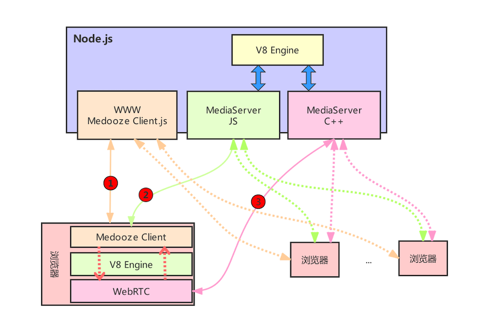
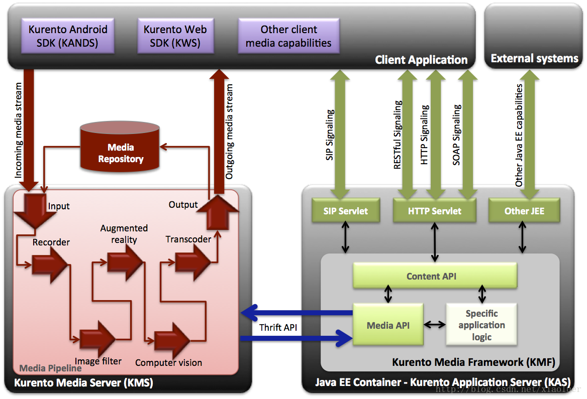
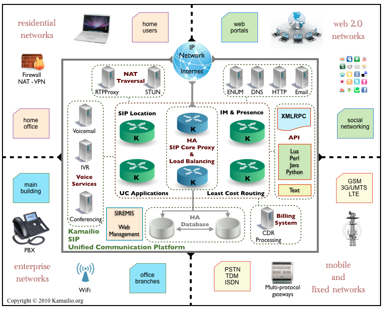
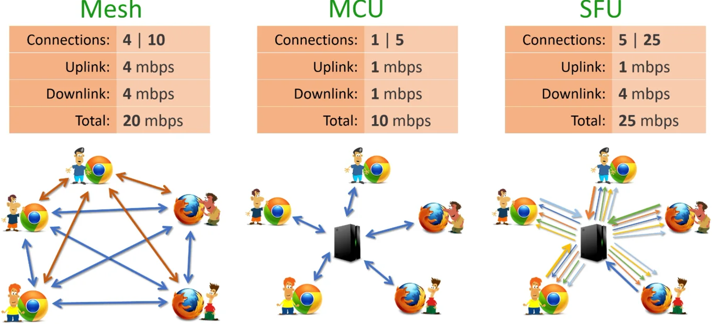

# MaaS工具集
Media as a Service 

---

### liveanalysis，多媒体协议

- ❀多媒体协议视图❀

  protocols（流协议及其他） | formats(封装容器) | codecs（音视频编解码） | hwaccels（硬件加速） | 协议/文档 | 工具/库
  ---|---|---|---|---|---
  **直播↷** | **----** | **---** | **---** | **---**
  **rtmp** | flv tag | | | | 1. [librtmp's github](https://github.com/yixia/librtmp/tree/master/librtmp) 2. [nginx-rtmp-module(支持h265)代码](https://github.com/adwpc/nginx-rtmp-module)
  **rtmps** | | | |
  **rtmpt** | | | |
  **rtmpts** | | | |
  **hls**(Apple HTTP Live Streaming) | m3u8+mpegts部分 | | | 1. H5 video标签原生支持 or H5 MSE扩展 2. 协议 - [HTTP Live Streaming draft-pantos-http-live-streaming-12](https://tools.ietf.org/html/draft-pantos-http-live-streaming-12) |
  **dash**(Dynamic adaptive streaming over HTTP) | mpd+m4v/m4a\|webm\|3gp | | | | 1. [video.js dash插件](https://github.com/videojs/videojs-contrib-dash.git) 2. [dash测试页](http://reference.dashif.org/dash.js/nightly/samples/dash-if-reference-player/index.html) 3. [Bento4's github](https://github.com/axiomatic-systems/Bento4) 4. [Bento4's Bin](https://share.weiyun.com/5w4fPrC) 5. [DASHEncoder2's github](https://github.com/zhanghuicuc/DASHEncoder2/tree/dev-v2) 6. [DASH website demo's github（类似bitcodin网站）](https://github.com/zhanghuicuc/dash_website_demo)
  **http-flv** | | | | H5 MSE扩展
  **http-fmp4** | | | | H5 MSE扩展
  **websocket-flv** | | | | H5 MSE扩展
  **websocket-fmp4** | | | | H5 MSE扩展
  _ |**flv**(Flash Video) |    | | | [flv工具](https://share.weiyun.com/5h54Qqp)
  _ |**mp4**(MPEG-4 part 14) | h264视频编码+aac音频编码 | | H5 video标签原生支持 | 1. [mp4工具](https://share.weiyun.com/5pM2dwF) 2. [GPAC's github](https://github.com/gpac/gpac) 3. [mp4box.js's github](https://github.com/gpac/mp4box.js)
  _ |**fmp4(fragment mp4)** | h264视频编码+aac音频编码 | | | 
  _ |**m4v**(raw MPEG-4 video) | | | |
  _ |**webm** | vp8视频编码+vorbis音频编码 | | H5 video标签原生支持 |
  _ |**ogg** | theora视频编码+vorbis音频编码 | | H5 video标签原生支持 |
  _ |**hds**(HDS Muxer) |    | | |
  _ |**mpeg1video**(raw MPEG-1 video)
  _ |**mpeg2video**(raw MPEG-2 video)
  _ |**mpegts**(MPEG-2 Transport Stream) | | | | [雷霄骅 / TS_Analysis](https://gitee.com/leixiaohua/TS_Analysis)
  _ |**aac**(Advanced Audio Coding) | | | | [雷霄骅 / AAC_Analysis](https://gitee.com/leixiaohua/AAC_Analysis)
  _ |**adts**(ADTS AAC)
  _ |_ |**mpeg1video**(MPEG-1 video)    | | |
  _ |_ |**mpeg2video**(MPEG-2 video)    | | |
  _ |_ |**mpeg4**(MPEG-4 part 2)    | | |
  _ |_ |**h264**(H.264 / AVC / MPEG-4 AVC / MPEG-4 part 10)    | | | 1. [x264's github](https://code.videolan.org/videolan/x264.git) 2. [雷霄骅 / H264_Analysis](https://gitee.com/leixiaohua/H264_Analysis)
  _ |_ |**avc1**(H.264 / AVC / MPEG-4 AVC / MPEG-4 part 10)    | | |
  _ |_ |**hevc**(H.265 / HEVC (High Efficiency Video Coding))    | | | 
  _ |_ |**theora** | | |
  _ |_ |**vp8**(On2 VP8)) | | |
  _ |_ |**vorbis** | | |
  _ |_ |_|**qsv** | |
  **GB28181↷** | **---** | **---** | **---** | **---**
  **rtcp** | | | | 1. 协议 - [RTP: A Transport Protocol for Real-Time Applications](https://tools.ietf.org/html/rfc3550)|
  _ |**rtsp** | | | 1. 协议-[Real Time Streaming Protocol (RTSP)](https://www.ietf.org/rfc/rfc2326.txt) | 1. [rtspdump](https://bisqwit.iki.fi/source/ms-rtsp-dump/)
  _ |**rtp**(rtp_mepg_ts) | | | 1. 协议 - [ RTP Profile for Audio and Video Conferences with Minimal Control](https://tools.ietf.org/html/rfc3551) | 开源协议栈：jrtplib
  **WebRTC↷** | **---** | **---** | **---** | **---**
  **MCU/SFU信令↷** | **---** | **---** | **---** | **---**
  **h.323** | | | | 1. [H.323 Version 6 - Overview](https://www.packetizer.com/ipmc/h323/whatsnew_v6.html) 2. [h323's wiki](https://wiki.wireshark.org/H323) | 1. [h323plus's github](https://github.com/willamowius/h323plus)
  **sip** | | | | 1. 协议 - [SIP: Session Initiation Protocol](https://www.ietf.org/rfc/rfc3261.txt) | 开源协议栈：libosip2、libeXosip2

- H5音视频
  - [各浏览器MSE情况](https://caniuse.com/#feat=mediasource)
  - [各浏览器对dash、hls、smooth支持情况](https://bitmovin.com/docs/player/articles/device-and-cross-browser-support)
  - [H5音视频兼容性测试页](http://ossrs.net/mse/html5.html)
  - [H5 MSE测试页](http://ossrs.net/mse/mse.html)

- VOIP
  - [Voice over IP protocol families](https://wiki.wireshark.org/VOIPProtocolFamily)

### livesniff， 多媒体嗅探、压测
- livesniff，多功能多媒体嗅探，压测工具
### liveaccels，多媒体加速
- wasm，各种webassembly播放器、服务器等
    - livegowasm，livego wasm形式服务器
- 硬件编码
  - NVENC
  - Quick Sync Video(介绍：http://www.elecfans.com/d/789787.html)
    - lsmod|grep 'i915'
    - vainfo
    - http://trac.ffmpeg.org/wiki/Hardware/QuickSync
  - MMX/SSE/SSE2/SSE3/SSE4
  - GPU/CUDA
### liveplayer，Web及移动端
- ❀播放器项目汇总❀

  播放器/库 | 源码及文档 | 分析及使用 
  --- | --- | ----
  **WEB端直播↷** | **---** | **---**
  video.js | 包含了大量扩展插件，[github](https://github.com/videojs) 1. [videojs/videojs-flash](https://github.com/videojs/videojs-flash)，支持rtmp 2. [videojs/http-streaming](https://github.com/videojs/http-streaming)，支持hls、dash等over http流协议 |
  mister-ben/videojs-flvjs | Video.js tech to use flv.js for FLV playback using MSE instead of Flash.[测试页](https://mister-ben.github.io/videojs-flvjs/)，[github](https://github.com/mister-ben/videojs-flvjs) |
  winlinvip/videojs-flow | [github](https://github.com/winlinvip/videojs-flow)，支持websocket-flv |
  playease.js | 支持http/websocket-flv、http/websocket-fmp4、dash、rtmp、hls、Original HTML5 Media Resources (eg. Ogg， Mpeg4， WebM)， [github](https://github.com/studease/playease/blob/master/test/index.html) |
  video-dev/hls.js | [测试页](https://hls-js.netlify.com/demo/)，[github](https://github.com/video-dev/hls.js/) |
  bilibili/flv.js | 开源h5 flv前端播放库，[github](https://github.com/bilibili/flv.js) | 
  jwplayer6 | flash播放器 |
  ckplayer | flash播放器 |
  CyberPlayer | 基于jwplayer二次开发的flash播放器，支持rtmp、flv、hls，[source](https://share.weiyun.com/5rVCKPD) |
  rx-player | 支持dash、smooth，[测试页](https://developers.canal-plus.com/rx-player/)，[github](https://github.com/canalplus/rx-player) |
  **SIP客户端↷** | **---** | **---**
  linephone | [官网](http://www.linphone.org/technical-corner/linphone?qt-technical_corner=0) | |

- call_run_nginx.sh，nginx启动脚本，会拷贝player到/
- call_run_livego.sh，livego启动脚本
- pub_rtmp.sh，推送rtmp流
- pub_rtsp.sh，推送rtsp流
- player，播放器
### livevision，多媒体视觉
- env_mxnet.sh，mxnet cpu环境
- env_mxnet_gpu.sh，mxnet gpu环境
- env_imageai_sh，imageai计算机视觉库环境
- env_imageai_gpu.sh，imageai gpu计算机视觉库环境
- obdetect，目标检测代码
### liveserver，多媒体服务器
- ❀服务器汇总❀

  项目 | 源码 |  分析
  --- | --- | --- |
  **RTMP直播服务器及组件↷** | **---** | **---**
  red5 | [github](https://github.com/Red5/red5-server) | java版，支持rtmp， rtmpt， rtmps， rtmpe
  srs | [github](https://github.com/ossrs/srs) | 开源直播多媒体服务器，支持rtmp、hls等协议
  nginx-rtmp-module | [github](https://github.com/arut/nginx-rtmp-module) | nginx的rtmp模块
  nginx-http-flv-module | [github](https://github.com/winshining/nginx-http-flv-module) | 支持http-flv/hls/dash
  nginx-rtmp-win32(windows版支持h265)| [github](https://github.com/illuspas/nginx-rtmp-win32) | [librtmp h265](https://blog.csdn.net/qq_33795447/article/details/89457581)
  im-pingo/nginx-rtmp-module | [github](https://github.com/im-pingo/nginx-rtmp-module) | 支持hls/http-ts/http-flv/rtmp/hls/dash/h265/h264/aac/mp3/notify/pull/push 
  im-pingo/CDN-Union_H265 | [github](https://github.com/im-pingo/CDN-Union_H265) |金山云FFmpeg扩展，支持h265
  **RTSP服务器及组件↷** |**---** |**---**
  live555 | [github](https://github.com/cmberryau/live555) | 开源rtsp多媒体服务器
  easydarwin | [github](https://github.com/EasyDarwin/EasyDarwin) | 开源rtsp多媒体服务器
  livego | [github](https://github.com/gwuhaolin/livego) | 开源rtsp多媒体服务器
  **SIP/H323/WebRTC/MCU&SFU服务器及组件↷**|**---** |**---**
  Medooze | | 
  OpenWebRTC | [github](https://github.com/EricssonResearch/openwebrtc) |
  EasyRTC | [github](https://github.com/priologic/easyrtc) |
  kurento | [github](https://github.com/Kurento) | 基于WebRTC开源MCU框架，架构图  Networked streaming protocols, including HTTP, RTP and WebRTC. Group communications (MCUs( Multipoint Conferencing Unit) and SFUs(Selective Forwarding Unit.) functionality) supporting bothmedia mixing and media routing/dispatching. Generic support for computational vision（计算机视觉） and augmented reality（现实增强） filters. Media storage supporting writing operations for WebM andMP4and playing in all formats supported by GStreamer. Automatic media transcodification between any of the codecs supported by GStreamer including VP8, H.264, H.263, AMR, OPUS, Speex, G.711, et
  jitsi | [github](https://github.com/jitsi) | 基于WebRTC开源MCU框架
  kamailio | [官网](https://www.kamailio.org) | 开源sip代理服务器 
  opensips | [官网](https://www.opensips.org/) | 开源sip代理服务器 
  gnugk | [官网](https://www.gnugk.org) | 基于openh323开源voip服务器 
  Kurento | | 支持SFU/MCU
  Janus | | 支持SFU/MCU
  licode | [github](https://github.com/lynckia/licode) | 支持SFU/MCU
  MediaSoup | | 支持SFU
  openmcu | [github](https://github.com/muggot/openmcu) | 全功能的H.323，SIP和RTSP的开源多点控制单元，具有以下特性：支持通过端口1420(http://localhost:1420)上的Web界面进行配置和控制;支持多国语言;支持的协议:H.323，SIP;支持的视频编解码器：H.261，H.263，H.263 +，H.264，VP8;支持的音频编解码器:G.711，G.722，G723.1，G.726，G.729，iLBC，Speex，SILK，OPUS;支持多个不同的会议可以同时进行，使用不同的“房间”;支持实时显示呼叫统计;支持从MCU发起呼叫到远程终端;支持会议翻译为网络流。
  asterisk | [github](https://github.com/asterisk/asterisk) |
  freeswitch | [github](https://github.com/signalwire/freeswitch) |
  | |
  coturn | [github](https://github.com/coturn/coturn) | 开源stun/turn穿透服务器

- srstools，srs直播工具相关工具
  - living
    - start_srs_compose.sh，SRS Forward模式集群docker-compose编排，支持rtmp(11936)、HLS(11937)、HTTP-FLV(11938)、HDS(11939)
    - start_srs_stack.sh，SRS Forward模式集群docker swarm/stack编排，支持rtmp(11936)、HLS(11937)、HTTP-FLV(11938)、HDS(11939)
  - 媒体服务器
    - 媒体中转架构
    
  - pull_srs.sh，拉取srs版本库脚本
  - build_srs，编译srs release脚本，需放入srs版本库中
  - build_srs_gprof.sh，编译加入gprof性能工具
  - centos6.5_dev.sh，容器开发环境，已经集成了gcc、gdb等工具
  - gperf，google性能工具相关脚本
  - clangtools，Apple clang/llvm相关工具
  - valgrind，linux下valgring内存、cpu分析工具
- install_livego.sh，纯go实现的支持rtmp、hls、httpflv协议的轻量级直播服务器
- install_easydarwin，纯go实现的支持rtsp的直播服务器
- install_live555.sh，c++实现的流媒体项目
- ipc_sipserver，sip服务器

### livesafe，多媒体安全

### livenv， 环境安装
- k8环境及工具
  - install_minikube.sh
  - install_kubeadm.sh
  - install_kubectl.sh
  - install_minikube.sh
- web assembly工具链
  - install_emscripten.sh
  - install_emsdk.sh
- X11 GUI in Docker
  - start_docker_ubuntu-desktop.sh

### 测试地址
- BSTV rtmp://202.69.69.180:443/webcast/bshdlive-pc