# MaaS工具集❀

Media as a Service, from codec to server architecture...✍ 

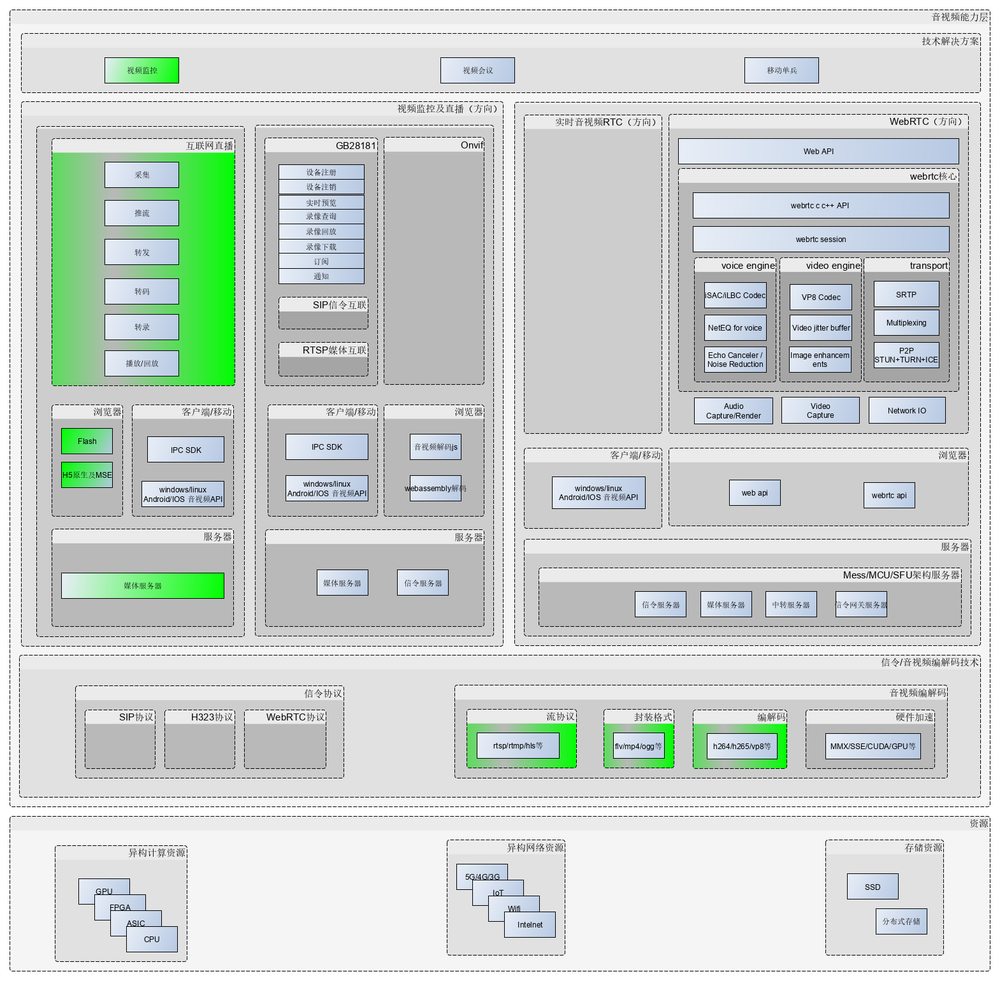
## 一、liveanalysis，音视频编解码、容器及协议

### 1.1、音视频相关协议及编解码

  protocols（流协议及其他） | formats(封装容器,通常为本地音视文件格式(如mp4)及适用于网络传输的传输流及其本地文件形式(如fmp4,ts/ps流)) | codecs（音视频编解码） | hwaccels（硬件加速） | 协议/文档 | 工具/库
  ---|---|---|---|---|---
  **rtmp** | flv tag | | | | 1. [librtmp's github](https://github.com/yixia/librtmp/tree/master/librtmp) 2. [nginx-rtmp-module(支持h265)代码](https://github.com/adwpc/nginx-rtmp-module)
  **rtmps** | | | ||
  **rtmpt** | | | ||
  **rtmpts** | | | ||
  **udt（可靠udp协议）** | | | ||
  **srt（基于udt）** | | | | | 1. [srt's github](https://github.com/Haivision/srt) 2. [srt-live-server's github](https://github.com/Edward-Wu/srt-live-server)
  **hls**(Apple HTTP Live Streaming) | m3u8+mpegts部分 | | | 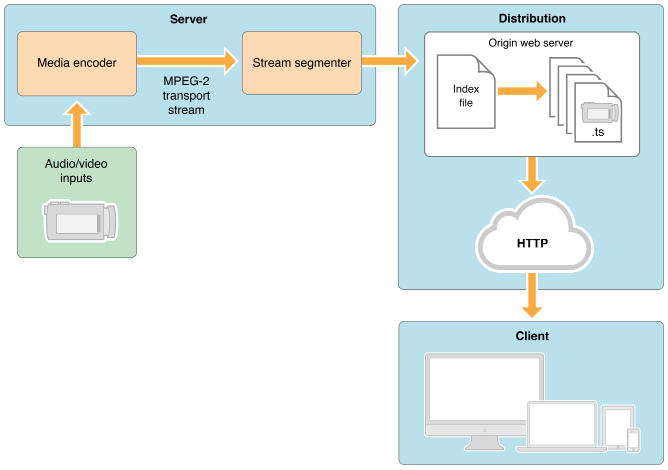 *HLS架构图* 1. H5 video标签原生支持 or H5 MSE扩展 2. 协议 - [HTTP Live Streaming draft-pantos-http-live-streaming-12](https://tools.ietf.org/html/draft-pantos-http-live-streaming-12) 3. HLS协议编码格式要求： - 视频的编码格式：H264 音频的编码格式：AAC、MP3、AC-3 - 视频的封装格式：ts - 保存 ts 索引的 m3u8 文件 |
  **hls+**|||| 非标准 | [PingOS](https://pingos.io/)
  **lhls(Low Latency HLS)**|||| 非标准 |
  **llhls**|||| 非标准 |
  **dash**(Dynamic adaptive streaming over HTTP) | mpd+m4v/m4a\|webm\|3gp | | | | 1. [video.js dash插件](https://github.com/videojs/videojs-contrib-dash.git) 2. [dash测试页](http://reference.dashif.org/dash.js/nightly/samples/dash-if-reference-player/index.html) 3. [Bento4's github](https://github.com/axiomatic-systems/Bento4) 4. [Bento4's Bin](https://share.weiyun.com/5w4fPrC) 5. [DASHEncoder2's github](https://github.com/zhanghuicuc/DASHEncoder2/tree/dev-v2) 6. [DASH website demo's github（类似bitcodin网站）](https://github.com/zhanghuicuc/dash_website_demo)
  **dash-ll**|||||
  **http-flv** | | | | H5 MSE扩展|
  **http-fmp4** | | | | H5 MSE扩展|
  **websocket-flv** | | | | H5 MSE扩展|
  **websocket-fmp4** | | | | H5 MSE扩展|
  **rtmp over quic（基于udp）** | | | ||
  **http-flv over quic（基于udp）** | | | ||
  **hls over quic（基于udp）** | | | ||
  **kmp（私有协议，基于可靠udp协议kcp）** | | | | | [媒体服务器NodeMediaServer](https://github.com/NodeMedia/NodeMediaServer)
  **rtsp** | | | | |
  **rtcp** | | | | |
  _ | **rtp** |_| | | 1. [rtptools版本库](https://gitee.com/yejinlei-mirror/rtptools)
  _ |**flv**(Flash Video) |    | | | [flv工具](https://share.weiyun.com/5h54Qqp)
 **fmp4(fragment mp4)** |**mp4**(MPEG-4 part 14) | h264视频编码+aac音频编码 | | H5 video标签原生支持 | 1. [mp4工具](https://share.weiyun.com/5pM2dwF) 2. [GPAC's github](https://github.com/gpac/gpac) 3. [mp4box.js's github](https://github.com/gpac/mp4box.js)
  _ |**m4v**(raw MPEG-4 video) | | | |
  _ |**webm** | vp8视频编码+vorbis音频编码 | | H5 video标签原生支持 |
  _ |**ogg** | theora视频编码+vorbis音频编码 | | H5 video标签原生支持 |
  _ |**hds**(HDS Muxer) |    | | |
  _ |**mpegts**(MPEG2 Transport Stream) | mpeg1video/mpeg2video视频编码+mp1/2音频编码 | | | 1. [雷霄骅 / TS_Analysis](https://gitee.com/leixiaohua/TS_Analysis) 2. [EasyICE](https://share.weiyun.com/LPCJIjEG)
  _ |**aac**(Advanced Audio Coding) | | | | [雷霄骅 / AAC_Analysis](https://gitee.com/leixiaohua/AAC_Analysis)
  _ |**adts**(ADTS AAC)||||
  _ |_ |**mpeg1video**(MPEG-1 video)    | | |
  _ |_ |**mpeg2video**(MPEG-2 video)    | | |
  _ |_ |**mpeg4**(MPEG-4 part 2)    | | |
  _ |_ |**h264**(H.264 / AVC / MPEG-4 AVC / MPEG-4 part 10)    | | | 1. [x264 github](https://code.videolan.org/videolan/x264.git) 2. [openh264 github](https://github.com/cisco/openh264) 3. [雷霄骅 / H264_Analysis](https://gitee.com/leixiaohua/H264_Analysis)
  _ |_ |**avc1**(H.264 / AVC / MPEG-4 AVC / MPEG-4 part 10)    | | |
  _ |_ |**hevc**(H.265 / HEVC (High Efficiency Video Coding))    | | |
  _ |_ |**av1**(Alliance for Open Media Video 1)    | | H5 video标签原生支持(av1/mp4, 新版浏览器webrtc同样支持) |
  _ |_ |**theora** | | |
  _ |_ |**vp8**(On2 VP8)) | | |
  _ |_ |**vorbis** | | |
  _ |_ |_|**qsv** | |

### 1.2、安防ONVIF

  _ | _ |  _
  ---|---|---

### 1.3、安防GB28181(音视频部分)

名字 | 协议 |  参考实现
---|---|---
**rtsp** | [RFC 2326](https://tools.ietf.org/html/rfc2326) , Real Time Streaming Protocol (RTSP) | [rtspdump](https://bisqwit.iki.fi/source/ms-rtsp-dump/)
**rtcp** | [RFC 3550](http://tools.ietf.org/html/rfc3550) , RTP: A Transport Protocol for Real-Time Applications [RFC 3605](https://tools.ietf.org/html/rfc3605) , Real Time Control Protocol (RTCP) attribute in Session Description Protocol (SDP) |
**rtp** | 1. 视频关键帧的封装: RTP + PSheader + PS system header + PS system Map + PES header + h264 data 2. 视频非关键帧的封装: RTP + PS header + PES header + h264 data 3. 音频帧的封装: RTP + PES header + G711  [RFC 3550](http://tools.ietf.org/html/rfc3550) , RTP: A Transport Protocol for Real-Time Applications [RFC 3551](http://tools.ietf.org/html/rfc3551) , RTP Profile for Audio and Video Conferences with Minimal Control [RFC 5761](http://tools.ietf.org/html/rfc5761) , Multiplexing RTP Data and Control Packets on a Single Port [RFC 6051](http://tools.ietf.org/html/rfc6051) , Rapid Synchronisation of RTP Flows [RFC 6184](http://tools.ietf.org/html/rfc6184) , RTP Payload Format for H.264 Video [RFC 6416](https://tools.ietf.org/html/rfc6416) , RTP Payload Format for MPEG-4 Audio/Visual Streams [RFC 5215](http://tools.ietf.org/html/rfc5215) , RTP Payload Format for Vorbis Encoded Audio [RFC 5219](https://tools.ietf.org/html/rfc5219) , A More Loss-Tolerant RTP Payload Format for MP3 Audio [RFC 7741](https://tools.ietf.org/html/rfc7741) , RTP Payload Format for VP8 Video [draft-ietf-payload-vp9-02](https://tools.ietf.org/html/draft-ietf-payload-vp9-02) , RTP Payload Format for VP9 Video draft-ietf-payload-vp9-02 [RFC 7007](http://tools.ietf.org/html/rfc7007) , Update to Remove DVI4 from the Recommended Codecs for the RTP Profile for Audio and Video Conferences with Minimal Control (RTP/AVP) [RFC 7160](https://tools.ietf.org/html/rfc7160) , Support for Multiple Clock Rates in an RTP Session [RFC 7164](https://tools.ietf.org/html/rfc7164) , RTP and Leap Seconds [Real-Time Transport Protocol (RTP) Parameters](http://www.iana.org/assignments/rtp-parameters/rtp-parameters.xhtml#rtp-parameters-1) | [jrtplib's github](https://github.com/j0r1/JRTPLIB)、[GoRTP's github](https://github.com/whtang/GoRTP)、[linephone ortp's github](https://github.com/dmonakhov/ortp)、[live555's github](https://github.com/cmberryau/live555) 

### 1.4、RTC信令控制、IM消息、WebRTC协议

  协议 | _ | _
  ---|---|---
  **h.323** | | 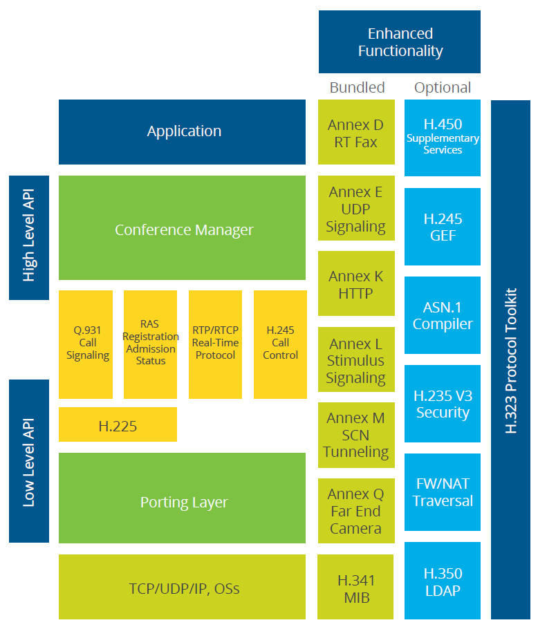 1. [H.323 Version 6 - Overview](https://www.packetizer.com/ipmc/h323/whatsnew_v6.html) 2. [h323's wiki](https://wiki.wireshark.org/H323) 3. 参考实现：[h323plus's github](https://github.com/willamowius/h323plus)
  **sip/simple** | | 1. [SIP: Session Initiation Protocol](https://www.ietf.org/rfc/rfc3261.txt) 2. 参考实现：[开源sip server & sip client 和开发库 一览](https://www.cnblogs.com/lidabo/p/7587709.html)、[baresip's github](https://github.com/alfredh/baresip)、[librc's github](https://github.com/creytiv/re)
  **xmpp/jingle** | | 1. [rfc3921:Extensible Messaging and Presence Protocol (XMPP):Instant Messaging and Presence](https://tools.ietf.org/html/rfc3921), [CN](http://wiki.jabbercn.org/RFC3921) 3. 参考实现：[jxmpp's github](https://github.com/igniterealtime/jxmpp)
  **webrtc** | | [mozilla's webrtc api](https://developer.mozilla.org/zh-CN/docs/Web/API)

### 1.5、NAT穿透ICE/STUN/TURN

  NAT/ICE/STUN/TURN | 协议、标准 | 参考实现
  ---|---|---
  _ | [RFC 5389: STUN](https://tools.ietf.org/html/rfc5389) [RFC 5780: NAT Behavior Discovery Using STUN](https://tools.ietf.org/html/rfc5780) [RFC 7064: URI Scheme for STUN](https://tools.ietf.org/html/rfc7064) [RFC 5766: TURN: Relay Extensions to STUN](https://tools.ietf.org/html/rfc5766) [RFC 5245: ICE: A Protocol for NAT for Offer/Answer Protocols](https://tools.ietf.org/html/rfc5245) [RFC 6062: TURN Extensions for TCP Allocations](https://tools.ietf.org/html/rfc6062) [RFC 7065: TURN URI](https://tools.ietf.org/html/rfc7065) [RFC 6544: TCP Candidates with ICE](https://tools.ietf.org/html/rfc6544)|

### 1.6、协议转换/网关

  协议 | 源码、项目 | 例子
  ---|---|---
  webrtc2sip | [github](https://github.com/DoubangoTelecom/webrtc2sip) | webrtc sip proxy
  OverSIP | [github](https://github.com/versatica/OverSIP) | sip over websocket 
  kurento-rtmp | [github](https://github.com/godka/kurento-rtmp) |
  rtmp-to-webrtc | [github](https://github.com/notedit/rtmp-to-webrtc) |
  kurento-rtsp2webrtc | [github](https://github.com/lulop-k/kurento-rtsp2webrtc) |
  RTSPtoWebRTC | [github](https://github.com/deepch/RTSPtoWebRTC) |
  media-server-go| [github](https://github.com/notedit/media-server-go) | webrtc媒体服务器，同时支持rtmp to webrtc、webrtc to rtmp、webrct to hls

### 1.7、实时通信技术RTC - WebRTC
  - **[WebRTC一张图](tools/liveserver/webrtc/doc/有关WebRTC.xmind)**
  - **WebRTC概述**
    *WebRTC (Web Real-Time Communications) 是一项实时通讯技术，它允许网络应用或者站点，在不借助中间媒介的情况下，建立浏览器之间点对点（Peer-to-Peer）的连接，实现视频流和（或）音频流或者其他任意数据的传输。WebRTC包含的这些标准使用户在无需安装任何插件或者第三方的软件的情况下，创建点对点（Peer-to-Peer）的数据分享和电话会议成为可能。WebRTC包含了若干相互关联的API和协议以达到这个目标。

- 实时通信技术RTC - Voip
  - [Voice over IP protocol families](https://wiki.wireshark.org/VOIPProtocolFamily)
  - [Real-Time Communications Quick Start Guide](http://rtcquickstart.org/guide/multi/index.html)

- 互联网直播技术，视频监控
  - H5音视频
    - [各浏览器MSE情况](https://caniuse.com/#feat=mediasource)
    - [各浏览器对dash、hls、smooth支持情况](https://bitmovin.com/docs/player/articles/device-and-cross-browser-support)
    - [H5音视频兼容性测试页](http://ossrs.net/mse/html5.html)
    - [H5 MSE测试页](http://ossrs.net/mse/mse.html)

- GB28181视频互联，视频监控
    - [《GBT 28181-2011 安全防范视频监控联网系统信息传输、交换、控制技术要求》](https://share.weiyun.com/5FGvp0D)
    - [《GB/T 35114-2017 公共安全视频监控联网信息安全技术要求》](https://share.weiyun.com/59txAC8)
    - [《GB/T 25724 公共安全视频监控数字视音频编解码技术要求》](https://share.weiyun.com/5xVEjAl)
    - RFC 2030 简单网络时间协议（SNTP）第四版
    - RFC 2326 RTSP：实时流协议
    - RFC 3261 SIP: 会话初始协议
    - RFC 3263 会话初始协议(SIP)：定位SIP 服务器
    - RFC 3428 会话初始协议(SIP) 即时消息扩展
    - RFC 3550 实时传输协议
    - RFC 3725 会话初始协议(SIP)中第三方呼叫控制(3PCC)的当前最佳实现
    - RFC 4566 SDP: 会话描述协议
    - RFC 3219 TRIP（Telephony Routing over IP）IP 电话路由协议
    - ITU-T Rec. G.711-1988 数字传输系统的通用部分：音频的脉冲编码调制
    - ITU-T Rec. G.723.1-1996 数字传输系统的通用部分：5.3和6.3kbit的多媒体通信传输中的双速率语音编码器
    - ITU-T Rec. G.729-1996 数字传输系统的通用部分：利用共轭结构代数码激励线形预测的8kbit/s语音编码
    - ITU-T Rec. H.264-2005 H 系列：音视频和多媒体系统，音视频服务基础－活动视频编码：通用音视频服务的先进视频编码
    - ITU-T Rec. H.264.1-2005 H 系列：音视频和多媒体系统，音视频服务基础－活动视频编码：H.264先进视频编码的一致性说明
    - GB/T GB/T 25724-2010 安全防范监控数字视音频编解码技术要求

- ONVIF视频互联，视频监控
  - ONVIF 架构[ONVIF 架构]
  - ONVIF 分析服务WSDL [ONVIF 分析服务WSDL]
  - ONVIF 解析设备服务[ONVIF 解析设备服务WSDL]
  - ONVIF 设备服务WSDL [ONVIF 设备WSDL]
  - ONVIF 设备IO 服务WSDL [ONVIF 设备IO WSDL]
  - ONVIF 显示服务WSDL [ONVIF 显示WSDL]
  - ONVIF 事件服务WSDL [ONVIF 事件WSDL]
  - ONVIF 图像服务WSDL [ONVIF 图像WSDL]
  - ONVIF 媒体服务WSDL [ONVIF 媒体WSDL]
  - ONVIF PTZ 服务WSDL [ONVIF PTZ WSDL]
  - ONVIF 记录服务WSDL [ONVIF 记录WSDL]
  - ONVIF 远程发现WSDL [ONVIF 远程发现WSDL]
  - ONVIF 重放服务WSDL [ONVIF 重放WSDL]
  - ONVIF 检索服务WSDL [ONVIF 检索WSDL]
  - ONVIF 主题XML 命名空间[ONV/IF 主题命名空间]

## 二、livesniff， 多媒体嗅探及质量评估

### 2.1、多媒体嗅探
  - livesniff工具

### 2.2、图像/视频质量分析

  - 参考资料
    - [全参考图像质量评价方法整理与实用性探讨](https://zhuanlan.zhihu.com/p/24804170)
    - [图像质量评估综述](https://zhuanlan.zhihu.com/p/32553977)
    - [Group MAD Competition - A New Methodology to Compare Objective Image Quality Models](https://ece.uwaterloo.ca/~zduanmu/cvpr16_gmad/)
    - [实时音视频质量评估方案](https://testerhome.com/topics/25127)
    - [实时音视频质量评估方案](https://blog.csdn.net/u011608531/article/details/108012438#t9)
    - [视频主观质量对比工具(Visual comparision tool based on ffplay)](https://blog.csdn.net/lrzkd/article/details/78809659?utm_medium=distribute.pc_relevant.none-task-blog-2~default~BlogCommendFromMachineLearnPai2~default-1.control&depth_1-utm_source=distribute.pc_relevant.none-task-blog-2~default~BlogCommendFromMachineLearnPai2~default-1.control)
    - [视频客观质量评价工具：MSU Video Quality Measurement Tool](https://blog.csdn.net/leixiaohua1020/article/details/11729257)
    - [音视频技术：视频质量评价方法简介](https://blog.csdn.net/netease_im/article/details/83993239)

## 三、liveaccels，多媒体加速

### 3.1、wasm，各种webassembly播放器、服务器等
    - livegowasm，livego wasm形式服务器
### 3.2、硬件编码
  - NVENC
  - Quick Sync Video(介绍：http://www.elecfans.com/d/789787.html)
    - lsmod|grep 'i915'
    - vainfo
    - http://trac.ffmpeg.org/wiki/Hardware/QuickSync
  - MMX/SSE/SSE2/SSE3/SSE4
  - GPU/CUDA

## 四、liveplayer，客户端（web、移动、pc）

### 4.1、播放器项目汇总

  播放器/库 | 源码及文档 | 分析及使用 
  --- | --- | ----
  **WEB端直播↷** | **---** | **---**
  video.js | 包含了大量扩展插件，[github](https://github.com/videojs) 1. [videojs/videojs-flash](https://github.com/videojs/videojs-flash)，支持rtmp 2. [videojs/http-streaming](https://github.com/videojs/http-streaming)，支持hls、dash等over http流协议 |
  mister-ben/videojs-flvjs | Video.js tech to use flv.js for FLV playback using MSE instead of Flash.[测试页](https://mister-ben.github.io/videojs-flvjs/)，[github](https://github.com/mister-ben/videojs-flvjs) |
  winlinvip/videojs-flow | [github](https://github.com/winlinvip/videojs-flow)，支持websocket-flv |
  playease.js | 支持http/websocket-flv、http/websocket-fmp4、dash、rtmp、hls、Original HTML5 Media Resources (eg. Ogg， Mpeg4， WebM)， [github](https://github.com/studease/playease/blob/master/test/index.html) |
  LivePlayer | [npmjs](https://www.npmjs.com/package/@liveqing/liveplayer)，[介绍文档](https://www.liveqing.com/docs/download/LivePlayer.html#%E7%9B%B8%E5%85%B3%E4%BB%8B%E7%BB%8D) |
  video-dev/hls.js | [测试页](https://hls-js.netlify.com/demo/)，[github](https://github.com/video-dev/hls.js/) |
  bilibili/flv.js | 开源h5 flv前端播放库，[github](https://github.com/bilibili/flv.js) | 
  jwplayer6 | flash播放器 |
  ckplayer | flash播放器 |
  CyberPlayer | 基于jwplayer二次开发的flash播放器，支持rtmp、flv、hls，[source](https://share.weiyun.com/5rVCKPD) |
  rx-player | 支持dash、smooth，[测试页](https://developers.canal-plus.com/rx-player/)，[github](https://github.com/canalplus/rx-player) |
  libde265 & libde265.js| 开源h265解码库，js库用到了wasm，[libde265.js's github](https://github.com/strukturag/libde265.js), [libde265's github](https://github.com/strukturag/libde265) |
  NodePlayer.js | 商业h265解码库，js库用到了wasm，[测试页](http://www.nodemedia.cn/products/node-media-player/) |
  h265player | 一套完整的Web版H.265播放器解决方案，非常适合学习交流和实际应用。基于JS码流解封装、WebAssembly(FFmpeg)视频解码，利用Canvas画布投影、AudioContext播放音频。[官网Github](https://github.com/goldvideo) | 
  **WebRTC生态↷**|**---** |**---**
  linephone | [官网](http://www.linphone.org/technical-corner/linphone?qt-technical_corner=0) | 
  jsSip | [官网](https://jssip.net/) | 支持sip(over websocket)和WebRTC的简易javascript库
  sipjs | [github](https://github.com/onsip/SIP.js), [exmaple](https://github.com/onsip/sipjs-examples) |
  PeerJS | [github](https://github.com/peers/peerjs) | PeerJS提供了一个完整可配置易于使用基于WebRTC的点对点的数据通信和媒体流のAPI
  openwebrtc | [github](https://github.com/EricssonResearch/openwebrtc) | 爱立信开源WebRTC开发套件 

### 4.2、jessibuca纯H5直播流播放器
### 4.3、实战
- call_run_nginx.sh，nginx启动脚本，会拷贝player到/
- call_run_livego.sh，livego启动脚本
- pub_rtmp.sh，推送rtmp流
- pub_rtsp.sh，推送rtsp流
- player，播放器

## 五、livevision，多媒体视觉
- 实战
    - env_mxnet.sh，mxnet cpu环境
    - env_mxnet_gpu.sh，mxnet gpu环境
    - env_imageai_sh，imageai计算机视觉库环境
    - env_imageai_gpu.sh，imageai gpu计算机视觉库环境
    - obdetect，目标检测代码

## 六、liveserver，多媒体服务器

###  6.1 、服务器汇总

  项目 | 源码 |  分析
  --- | --- | --- 
  **RTMP直播服务器及组件↷** | **---** | **---**
  red5 | [github](https://github.com/Red5/red5-server) | java版，支持rtmp， rtmpt， rtmps， rtmpe
  srs | [github](https://github.com/ossrs/srs) | 开源直播多媒体服务器，支持rtmp、hls等协议
  nginx-rtmp-module | [github](https://github.com/arut/nginx-rtmp-module) | nginx的rtmp模块
  nginx-http-flv-module | [github](https://github.com/winshining/nginx-http-flv-module) | 支持http-flv/hls/dash
  nginx-rtmp-win32(windows版支持h265)| [github](https://github.com/illuspas/nginx-rtmp-win32) | [librtmp h265](https://blog.csdn.net/qq_33795447/article/details/89457581)
  im-pingo/nginx-rtmp-module | [github](https://github.com/im-pingo/nginx-rtmp-module) | 支持hls/http-ts/http-flv/rtmp/hls/dash/h265/h264/aac/mp3/notify/pull/push 
  im-pingo/CDN-Union_H265 | [github](https://github.com/im-pingo/CDN-Union_H265) |金山云FFmpeg扩展，支持h265
  **RTSP服务器及组件↷** |**---** |**---**
  live555 | [github](https://github.com/cmberryau/live555) | 开源rtsp多媒体服务器
  easydarwin | [github](https://github.com/EasyDarwin/EasyDarwin) | 开源rtsp多媒体服务器
  livego | [github](https://github.com/gwuhaolin/livego) | 开源rtsp多媒体服务器
  v4l2rtspserver | [github](https://github.com/mpromonet/v4l2rtspserver) | 可以结合v4l2loopback(/dev/video0), 虚拟出支持RTSP的IPC 
  **WebRTC生态↷**|**---** |**---**
  / | ***VoIP*** | 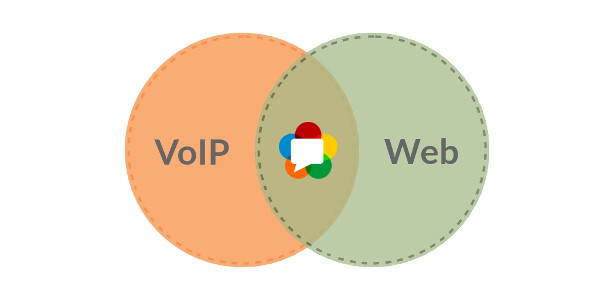 **WebRTC是VoIP**
  openmcu | [github](https://github.com/muggot/openmcu)、[gitee](https://gitee.com/yejinlei-mirror/openmcu) | 全功能的H.323，SIP和RTSP的开源多点控制单元，具有以下特性：支持通过端口1420(http://localhost:1420)上的Web界面进行配置和控制;支持多国语言;支持的协议:H.323，SIP;支持的视频编解码器：H.261，H.263，H.263 +，H.264，VP8;支持的音频编解码器:G.711，G.722，G723.1，G.726，G.729，iLBC，Speex，SILK，OPUS;支持多个不同的会议可以同时进行，使用不同的“房间”;支持实时显示呼叫统计;支持从MCU发起呼叫到远程终端;支持会议翻译为网络流。
  asterisk | [github](https://github.com/asterisk/asterisk) |
  asterisk-freepbx | [github](https://github.com/Brownster/asterisk-freepbx) |
  freeswitch | [github](https://github.com/signalwire/freeswitch) |
  kamailio | [官网](https://www.kamailio.org) | 开源sip代理服务器 
  oversip | [github](https://github.com/versatica/OverSIP) | OverSIP is a powerful and flexible SIP proxy & server by the authors of RFC 7118 (The WebSocket Protocol as a Transport for SIP)
  / | ***Signaling*** | /
  opensips | [官网](https://www.opensips.org/) | 开源sip代理服务器 
  gnugk | [官网](https://www.gnugk.org) | 基于openh323开源voip服务器 
  / | ***Media Servers*** | /
  AppRTC | [github](https://github.com/webrtc/apprtc) [webserver.cn](https://www.webrtcserver.cn/),[测试服务器](https://apprtc.webrtcserver.cn/) | 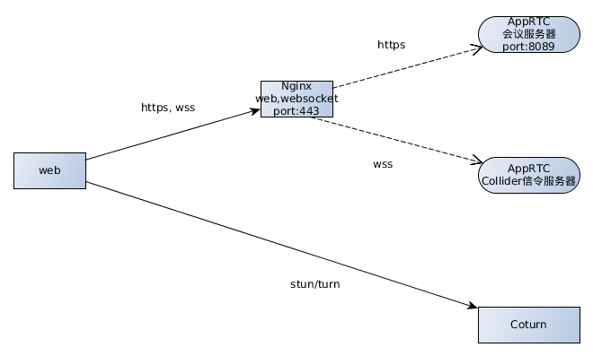
   | [github](https://github.com/medooze/media-server) | 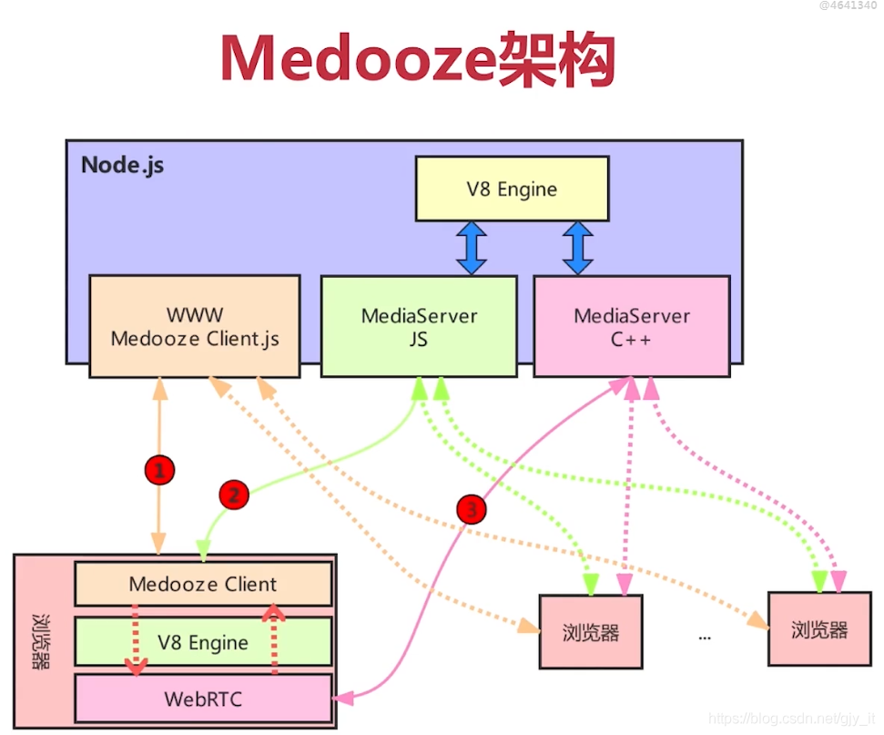 Medooze 支持 RTP/RTCP、SRTP/SRCP 等相关协议，从而可以实现与 WebRTC 终端进行互联。除此之外，Medooze 还可以接入 RTP 流、RTMP 流等，因此你可以使用 GStreamer/FFmpeg 向 Medooze 推流，这样进入到同一个房间的其他 WebRTC 终端就可以看到 / 听到由 GStream/FFmpeg 推送上来的音视频流了。另外，Medooze 还支持录制功能，即上图中的 Recorder 模块的作用，可以通过它将房间内的音视频流录制下来，以便后期回放。 Medooze 的控制逻辑层是通过 Node.js 实现的，Medooze 通过 Node.js 对外提供了完整的控制逻辑操作相关的 API，通过这些 API 你可以很容易的控制 Medooze 的行为了。 Medooze 与 Mediasoup 相比，两者在核心层实现的功能都差不多，但 Medooze 的功能更强大，包括了录制、推 RTMP 流、播放 FLV 文件等相关的操作，而 Mediasoup 则没有这些功能。 Medooze 也有一些缺点，尽管 Medooze 也是 C++ 开发的流媒体服务务器，使用了异步 IO 事件处理机制，但它使用的异步 IO 事件处理的 API 是 poll，poll 在处理异步 IO 事件时，与 Linux 下最强劲的异步 IO 事件 API epoll 相比要逊色不少，这导致它在接收 / 发送音视频包时性能比 Mediasoup 要稍差一些。 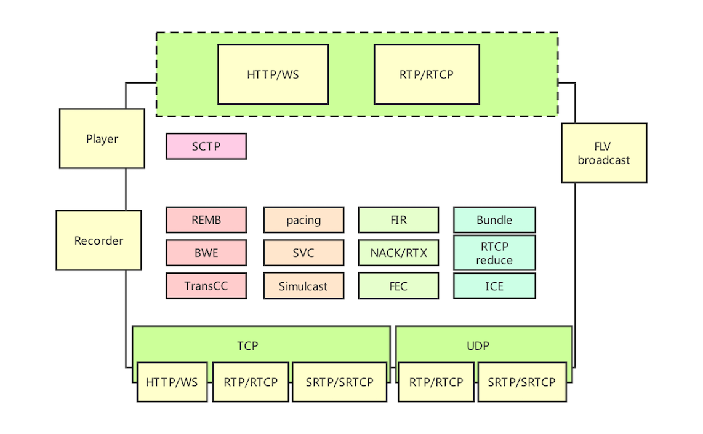 
  SimpleWebRTC | [github](https://github.com/simplewebrtc/SimpleWebRTC) | 
  EasyRTC | [github](https://github.com/priologic/easyrtc) |
  OpenWebRTC | [github](https://github.com/EricssonResearch/openwebrtc) |
   | [github](https://github.com/versatica/mediasoup),[测试服务器](https://letsmeet.no/) | 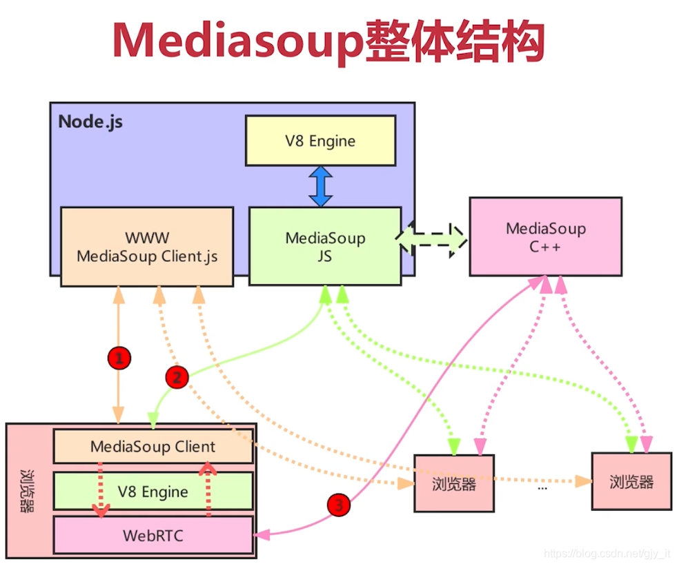
  ant media server | [github](https://github.com/ant-media) | 
  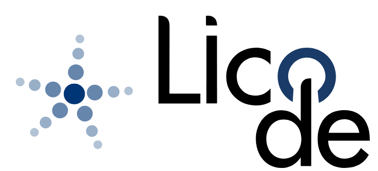 | [github](https://github.com/lynckia/licode) | licode 从功能层面来讲分成三部分，即 Nuve 、ErizoController 和 ErizoAgent 三部分，它们之间通过消息队列进行通信。1. Nuve 是一个 Web 服务，用于管理用户、房间、产生 token 以及房间的均衡负载等相关工作。它使用 MangoDB 存储房间和 token 信息，但不存储用户信息。2. ErizoController，用于管理控制，信令和非音视频数据都通过它接收。它通过消息队列与 Nuve 进行通信，也就是说 Nuve 可以通过消息队列对 ErizoController 进行控制。3. ErizoAgent，用于音视频流媒体数据的传输，可以分布式布署。ErizoAgent 与 ErizoController 的通信也是通过消息队列，信令消息通过 ErizoController 接收到后，再通过消息队列发给 ErizoAgent，从而实现对 ErizoAgent 进行控制。 licode 不仅仅是一个 SFU 流媒体服务器，它还包括了与流媒体相关的业务管理系统、信令系统、流媒体服务器以及客户端 SDK 等等，可以说它是一个比较完善的产品。 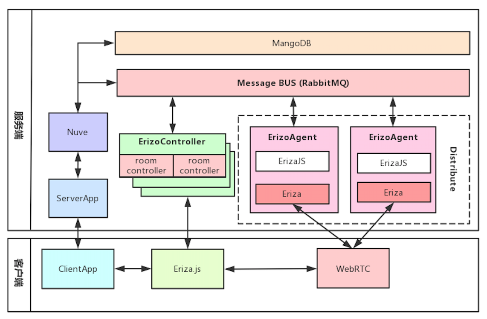
  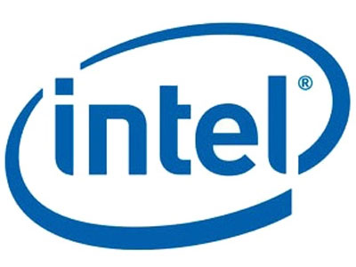  | [github](https://github.com/open-webrtc-toolkit) | 英特尔开源WebRTC开发套件OWT，基于licode
   | [github](https://github.com/jitsi) [测试服务器](https://meet.jit.si/)| 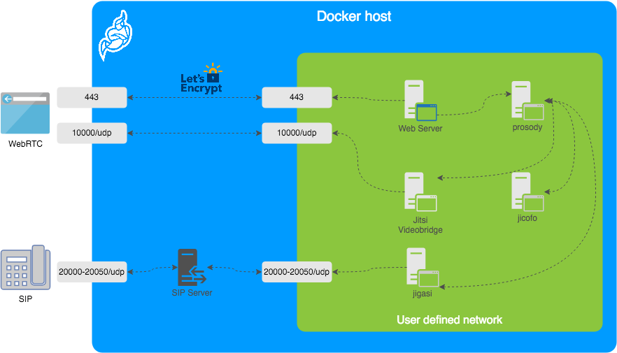 Jitsi不仅是WebRTC媒体服务器，而且还有一个完整的平台。 Jitsi系列产品包括Jitsi Videobridge（媒体中继，SFU），Jitsi Meet（会议网络客户端），Jicofo（Jitsi Conference Focus），Jigasi（Jitsi Gateway to SIP）和Jitsi SIP Phone。 它还使用Jingle（XMPP）和功能齐全的Web界面实现自己的信令控制。
   | [github](https://github.com/Kurento) | 基于WebRTC开源MCU框架，架构图  它也不仅仅是一个媒体服务器，而是构建了一个工具包。Kurento的主要优点是通过引入媒体工作流(meidia workflow)的概念实现了多功能性，它允许在代码中定义媒体流以何种方式传输以及传到到哪里。这就允许WebRTC开发者将非常有趣的功能进行集成，例如计算机视觉（例如识别QR码，面部检测），实时媒体修正和与RTP（VoIP）服务的互操作。 Kurento还可以在单个实例中配置成SFU或MCU（或者同时使用）。
   | [github](https://github.com/meetecho/janus-gateway)、[测试服务器](https://janus.conf.meetecho.com/demos.html) | 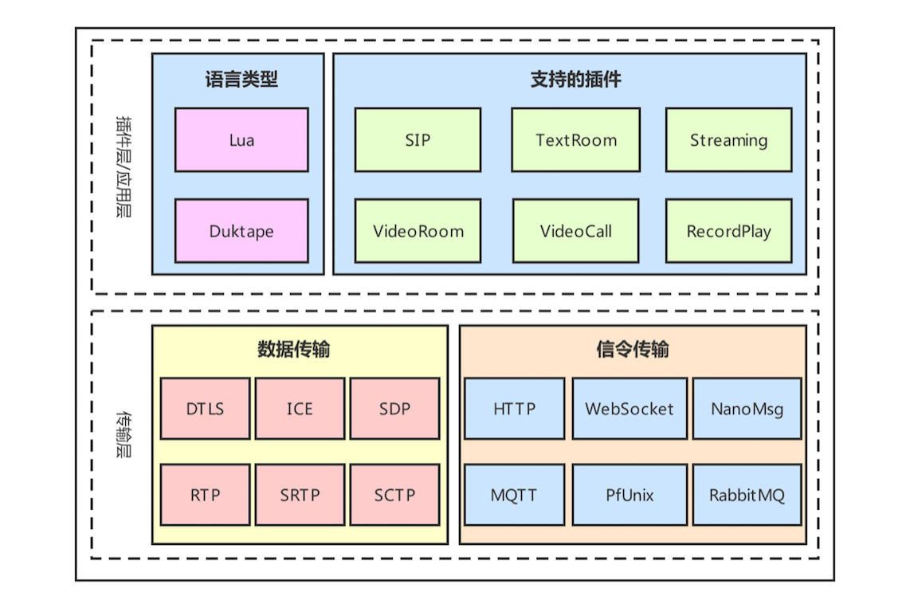
  / | ***Gateways*** | /
   | |
  / | ***NAT traversal*** | /
  coturn | [github](https://github.com/coturn/coturn) | 开源stun/turn穿透服务器
  restund | [github](https://github.com/otalk/restund) |
  turnserver | [github](https://github.com/pannzh/TurnServer) |
  reTurnServer | |
   / | ***Plugins and SDKs*** | /
  Pion | [github](https://github.com/pion/webrtc) | go实现的WebRTC API，包罗万象 
  Temasys | [github](https://github.com/Temasys) | 

### 6.2、SRS媒体服务器

- srstools，srs直播工具相关工具
  - doc
    - [分发RTMP流](https://github.com/ossrs/srs/wiki/v1_CN_DeliveryRTMP)
    - [分发HLS（m3u8）2.0](https://github.com/ossrs/srs/wiki/v2_CN_DeliveryHLS)、[3.0](https://github.com/ossrs/srs/wiki/v3_CN_DeliveryHLS)
    - [分发HLS（只有音频）](https://github.com/ossrs/srs/wiki/v2_CN_DeliveryHLS#hlsaudioonly)、[3.0](https://github.com/ossrs/srs/wiki/v3_CN_DeliveryHLS#hlsaudioonly)
    - [不中断配置重载](https://github.com/ossrs/srs/wiki/v1_CN_Reload)
    - [Gop缓存 2.0](https://github.com/ossrs/srs/wiki/v2_CN_LowLatency#gop-cache)、[3.0](https://github.com/ossrs/srs/wiki/v3_CN_LowLatency#gop-cache)
    - [Forward模式 2.0](https://github.com/ossrs/srs/wiki/v1_CN_Forward)、[3.0](https://github.com/ossrs/srs/wiki/v3_CN_Forward)
    - [对推到SRS中的RTMP进行转码（via FFmpeg）2.0](https://github.com/ossrs/srs/wiki/v2_CN_FFMPEG)、[3.0](https://github.com/ossrs/srs/wiki/v3_CN_FFMPEG)
    - [HTTP回调 2.0](https://github.com/ossrs/srs/wiki/v2_CN_HTTPCallback)、[3.0](https://github.com/ossrs/srs/wiki/v3_CN_HTTPCallback)
    - [带宽测试](https://github.com/ossrs/srs/wiki/v1_CN_BandwidthTestTool)
    - [HTTP API 2.0](https://github.com/ossrs/srs/wiki/v2_CN_HTTPApi)、[3.0](https://github.com/ossrs/srs/wiki/v3_CN_HTTPApi)
    - [采集并推流（via FFmpeg）](https://github.com/ossrs/srs/wiki/v1_CN_Ingest)
    - [DVR功能（SRS支持将RTMP流录制成flv文件）2.0](https://github.com/ossrs/srs/wiki/v2_CN_DVR)、[3.0](https://github.com/ossrs/srs/wiki/v3_CN_DVR)
    - [SRS日志功能（输出到控制台或文件）](https://github.com/ossrs/srs/wiki/v1_CN_SrsLog)
    - [内/嵌HTTP服务器 2.0](https://github.com/ossrs/srs/wiki/v2_CN_SampleHTTP)、[3.0](https://github.com/ossrs/srs/wiki/v3_CN_SampleHTTP)
    - [SRS支持点播FLV流](https://github.com/ossrs/srs/wiki/v2_CN_FlvVodStream)
  - 源码分析
    - SRS边缘(edge)，所谓边缘edge服务器，就是边缘直播缓存服务器，配置时指定为remote模式和origin*（指定一个或多个源站IP），这个边缘edge服务器就是源站的缓存了
      - edge边缘节点，播放（SrsEdgeStatePlay标记）
      - edge边缘节点，从源站拉流和采集（SrsEdgeStateIngestConnected标记）
        - SrsEdgeUpstream::connect
      - edge边缘节点，推流到源站（SrsEdgeStatePublish标记）
        - SrsEdgeForwarder::start
- 实战living目录
   - Forward模式
     - start_srs_compose.sh，SRS Forward模式集群docker-compose编排，支持rtmp(11936)、HLS(11937)、HTTP-FLV(11938)、HDS(11939)
     - start_srs_stack.sh，SRS Forward模式集群docker swarm/stack编排，支持rtmp(11936)、HLS(11937)、HTTP-FLV(11938)、HDS(11939)
     - start_srs_k8s.sh
    - edge模式
- 资料

   - [WebRTC-Developer-Tools-Landscape](https://bloggeek.me/download/11768/)
   - [Comparative study of WebRTC SFUs for Video Conferencing](https://uploads-ssl.webflow.com/5c6853c495409838d874a0d2/5cbed66cae2b88609106befa_IPTComm_2018_LoadTesting-12%5B23229%5D.pdf)

### 6.3、ZLMediaKit媒体服务器
### 6.4、Monibuca媒体服务器
### 6.5、EasyDarwin媒体服务器
### 4.6、实战
   - pull_srs.sh，拉取srs版本库脚本
   - build_srs，编译srs release脚本，需放入srs版本库中
   - build_srs_gprof.sh，编译加入gprof性能工具
   - centos6.5_dev.sh，容器开发环境，已经集成了gcc、gdb等工具
   - gperf，google性能工具相关脚本
   - clangtools，Apple clang/llvm相关工具
   - valgrind，linux下valgring内存、cpu分析工具
   - install_livego.sh，纯go实现的支持rtmp、hls、httpflv协议的轻量级直播服务器
   - install_easydarwin，纯go实现的支持rtsp的直播服务器
   - install_live555.sh，c++实现的流媒体项目
   - ipc_sipserver，sip服务器

## 七、livetools，多媒体工具

### 7.1、ffmpeg

### 7.2、gstreamer

### 7.3、nginx

## 八、livesafe，多媒体安全

- ❀全方位保护❀

  层级|方案|实战
  ---|---|---
  协议级|信息安全: 防盗链|
  协议级|信息安全: 软件授权机制|
  协议级|软件保护：定制协议|
  协议级|软件保护：嵌入水印|
  协议级|软件保护：隐写术|
  二进制级|软件保护：二进制乱序、混淆|
  二进制级|软件保护：二进制加密|
  二进制级|软件保护：防调试|
  二进制级|软件保护：防篡改|
  二进制级|软件保护：基于虚拟机运行时|
  代码级|软件保护：软件授权协议 *开源软件协议*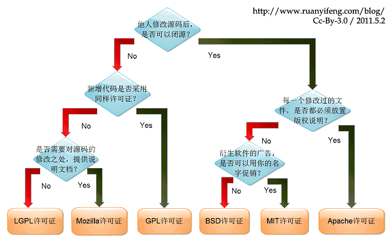 *如何选择license？* 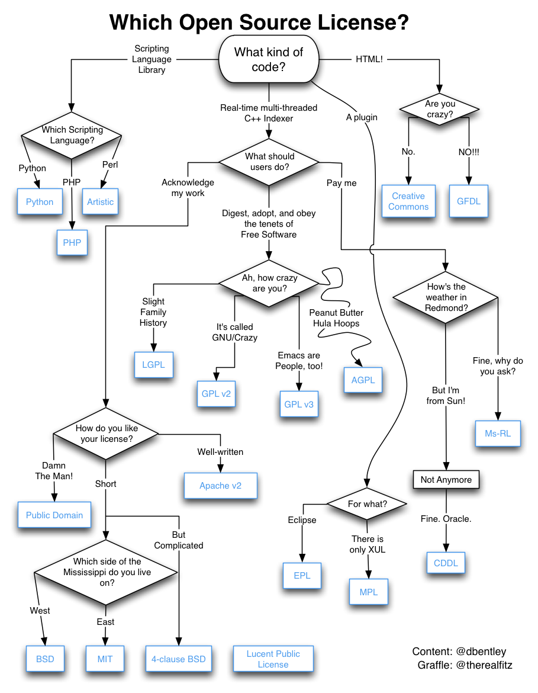 *开源许可证和一般著作权的区别* 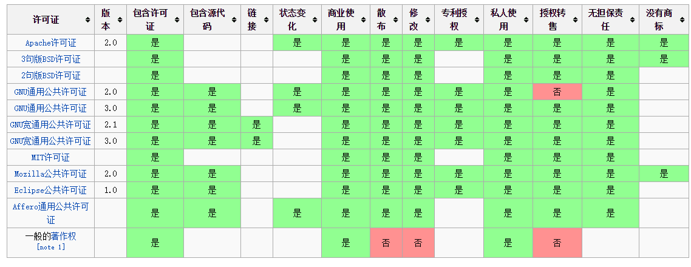|
  容器级|防止攻击：容器加固|
  操作系统级|防止攻击：防ddos攻击|
  硬件级|软件保护：加密狗和锁|
  硬件级|软件保护：可信启动|
  硬件级|软件保护：定制硬件|

- [开源软件协议介绍](https://gitee.com/oschina/git-osc/wikis/License)

## 八、livenv， 环境安装

- k8环境及工具
  - install_minikube.sh
  - install_kubeadm.sh
  - install_kubectl.sh
  - install_minikube.sh
- web assembly工具链
  - install_emscripten.sh
  - install_emsdk.sh
- X11 GUI in Docker
  - start_docker_ubuntu-desktop.sh
- 国产CPU
  - 龙芯CPU
    - [龙芯开源社区-项目快速导航](http://www.loongnix.org/index.php/%E9%A1%B9%E7%9B%AE)
    - [龙芯全系 qemu 模拟器](https://gitee.com/loongsonlab/qemu)
    - install_qemu_loogson.sh, 龙芯全系qemu模拟器
- 国产操作系统
  - [uos操作系统](https://www.chinauos.com/applyfor)

## 九、其他

### 9.1 流媒体地址

- rtmp，rtmp://202.69.69.180:443/webcast/bshdlive-pc
- rtmp，rtmp://1011.lssplay.aodianyun.com/demo/game
- rtmp，rtmp://play.nodemedia.io/live/ljq
- kmp，kmp://play.nodemedia.io/live/ljq
- http-flv(h265)，http://alplay.nodemedia.cn/live/cam_178.flv
- http-flv(h265)，http://alplay.nodemedia.cn/live/cam_180.flv
- http-flv(h265)，http://alplay.nodemedia.cn/live/cam_112.flv
- https-flv(h264)， https://sf1-hscdn-tos.pstatp.com/obj/media-fe/xgplayer_doc_video/flv/xgplayer-demo-720p.flv
- rtsp，rtsp://184.72.239.149/vod/mp4:BigBuckBunny_115k.mov
- rtsp，rtsp://170.93.143.139/rtplive/470011e600ef003a004ee33696235daa
- hls，https://devimages.apple.com.edgekey.net/streaming/examples/bipbop_4x3/bipbop_4x3_variant.m3u8
- hls，http://220.161.87.62:8800/hls/0/index.m3u8
- hls，http://220.161.87.62:8800/hls/1/index.m3u8
- mp4，http://www.w3school.com.cn/i/movie.mp4
- av1/mp4, https://media.vued.vanthink.cn/video.av1.mp4

### 9.2、工具

- [wireshark's Captures](https://wiki.wireshark.org/SampleCaptures)
- [Axinom Media Tools](https://tools.axinom.com/)

## 其他资料

1. [webmproject](https://github.com/webmproject)