# 有关WebRTC

## 一. WebRTC概述及索引

### 1 WebRTC协议栈


### 2 WebRTC简化流程

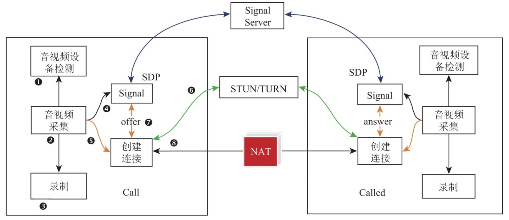
涉及主体:
1. Call方
1. Called方
1. Signal服务器
1. STUN/TURN服务器

### 3 浏览器WebRTC组件

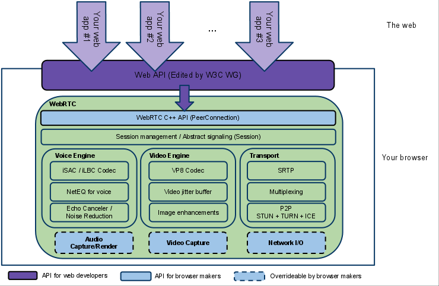

核心组件:

1. Web API
2. WebRTC C++ API
2. JSEP
3. Transport
4. Video Engine
5. Voice Engine

---

## 二. WebRTC原理

### 1 信令部分

#### 1.1 WebSocket/SSE/XHR/Other


#### 1.1.1 WebSocket(Web套接口, 服务器“push”模式, 长连接)及Socket.IO

​         **WebSockets** 是一种先进的技术。它可以在用户的浏览器和服务器之间打开交互式通信会话。使用此API，您可以向服务器发送消息并接收事件驱动的响应，而无需通过轮询服务器的方式以获得响应。

​		**Socket.io**是一个[WebSocket](https://www.w3cschool.cn/websocket_protocol/)库，包括了客户端的js和服务器端的[nodejs](https://www.w3cschool.cn/nodejs/)，它的目标是构建可以在不同浏览器和移动设备上使用的实时应用。它会自动根据浏览器从WebSocket、[AJAX](https://www.w3cschool.cn/ajax/)长轮询、Iframe流等等各种方式中选择最佳的方式来实现网络实时应用。但注意: **Socket.IO不是原生的WebSockets**。

- 参考资料
  - [MDN WebSockets](https://developer.mozilla.org/zh-CN/docs/Web/API/WebSockets_API)
  - [RFC 6455 — The WebSocket Protocol](https://tools.ietf.org/html/rfc6455)
  - [WebSocket API Specification](https://www.w3.org/TR/websockets/)
  - [WebSockets - Send & Receive Messages](https://www.tutorialspoint.com/websockets/websockets_send_receive_messages.htm)
  - [Introducing WebSockets: Bringing Sockets to the Web](https://www.html5rocks.com/en/tutorials/websockets/basics/)
  - [WebSockets 简介：将套接字引入网络](https://www.html5rocks.com/zh/tutorials/websockets/basics/)
  - [WebSocket 教程](https://www.ruanyifeng.com/blog/2017/05/websocket.html)
  - [html5rocks tutorials]( http://www.html5rocks.com/en/tutorials/websockets/basics/)
  - [JS实时通信三把斧系列之一: websocket](https://blog.5udou.cn/#/blog/detail/JSShi-Shi-Tong-Xin-San-Ba-Fu-Xi-Lie-Zhi-Yi-websocket62)
  - [JS实时通信三把斧系列之二: socket.io](https://blog.5udou.cn/#/blog/detail/JSShi-Shi-Tong-Xin-San-Ba-Fu-Xi-Lie-Zhi-Er-socketio40)
  - <<HTML5 WebSocket权威指南>>

#### 1.1.2 SSE(服务器发送事件, 服务器“push”模式, 长连接)

- 参考资料
  - [MDN Server-sent events](https://developer.mozilla.org/zh-CN/docs/Web/API/Server-sent_events)
  - [MDN 使用服务器发送事件](https://developer.mozilla.org/zh-CN/docs/Web/API/Server-sent_events/Using_server-sent_events)
  - [html5rocks tutorials](http://www.html5rocks.com/en/tutorials/eventsource/basics/[)
  - [JS实时通信三把斧系列之三: eventsource](https://blog.5udou.cn/#/blog/detail/JSShi-Shi-Tong-Xin-San-Ba-Fu-Xi-Lie-Zhi-San-eventsource55)

#### 1.1.3 XHR(AJAX XMLHttpRequest, 客户端“pull”模式, polling)

​         **XMLHttpRequest**(XHR) 是一种创建 AJAX请求的JavaScript API。它的方法提供了在浏览器和服务器之间发送请求的能力。

- 参考资料
  - [MDN XMLHttpRequest](https://developer.mozilla.org/zh-CN/docs/Glossary/XHR_(XMLHttpRequest))

#### 1.1.5 Comet彗星技术(混合技术, 服务器“push”模式)

- 实现方式有两种:

  - 基于Ajax的long polling
  - 基于iframe及htmlfile的流（streaming）方式
- 参考资料
  - [Comet技术详解：基于HTTP长连接的Web端实时通信技术](http://www.52im.net/thread-334-1-1.html)
  - [开源Comet服务器iComet：支持百万并发的Web端即时通讯方案](http://www.52im.net/thread-330-1-1.html)

#### 1.2 XMPP/SIP

##### 1.2.1 XMPP(可扩展消息处理和现场协议)
​         XMPP(Extensible Messaging and Presence Protocol,可扩展消息处理和现场协议) 是一种网络即时通讯协议或者说是开放消息协议，它基于XML，具有很强的扩展性，被广泛使用在即时通讯软件、网络游戏聊天、Web聊天及Web消息推送、联网的实时文档协作工具、移动设备的消息推送等场景。

- XMPP/WS(XMPP over WebSocket)

- XMPP over HTTP(BOSH)

  ​		BOSH(Bidirectional-streams Over Synchronous HTTP)是一种在客户端和服务器端之间通过HTTP的请求/响应进行客户端和服务器双向通信的技术，BOSH在XMPP系列规范中的XEP-0124中定义，应用场合为基于浏览器的客户端访问XMPP服务器。

  

- 参考资料
  - [xep-0124](https://xmpp.org/extensions/xep-0124.html)
  - [xep-0340](https://xmpp.org/extensions/xep-0340.html)
  - [jitsi/strophejs](https://github.com/jitsi/strophejs), XMPP JS Client
  - [jitsi/Smack](https://github.com/jitsi/Smack),  XMPP Java Client
  - XMPP.js, XMPP JS Client
  - Prosody, XMPP Server Written in Lua
  - Openfire, XMPP Server Written in Java
  - Tigase, XMPP Server Written in Java
  - ejabberd, XMPP Server Written in Erlang
  - [strophe/strophejs](https://github.com/strophe/strophejs/) 及 [plugins](https://github.com/metajack/strophejs-plugins)
  - [xmpp-ftw/xmpp-ftw-demo](https://github.com/xmpp-ftw/xmpp-ftw-demo)

#### 1.3 HTTP

#### 1.3.1 HTTP及REST

- HTTP/1.0 vs HTTP/1.1
  - 增加了 PUT、DELETE 等新的方法；
  - 增加了缓存管理和控制；
  - 明确了连接管理，允许长连接；
  - 允许响应数据分块（chunked），利于传输大文件；
  - 强制要求 Host 头，让互联网主机托管成为可能；
- REST成熟度
  - 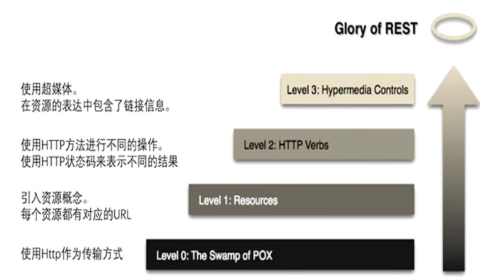

- 参考资料
  - [WEB端即时通讯：HTTP长连接、长轮询（long polling）详解](http://www.52im.net/thread-224-1-1.html)
  - [WEB端即时通讯：不用WebSocket也一样能搞定消息的即时性](http://www.52im.net/thread-296-1-1.html)

#### 1.3.2 HTTPS

- Openssl使用
- Let's Encrypt使用, https://letsencrypt.org/zh-cn/docs/
  - 免费申请证书
  - nginx配置证书

- wireshark分析https
  - #配置浏览器导出SSL Key
    export SSLKEYLOGFILE="$HOME/keylog.log"
    #wireshark中配置SSL Key
    首选项->协议->TLS(Master-Secret log filename), 指定SSL Key文件路径
  - 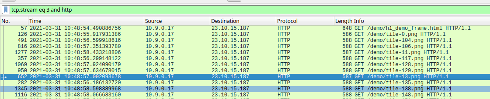

- 参考资料
  - <<HTTPS权威指南>>
  - <<深入浅出HTTPS>>
  - rfc2818: HTTP Over TLS

#### 1.3.3 HTTP2

- 参考资料
  - rfc7540: Hypertext Transfer Protocol version 2
  - rfc7541: HPACK - Header Compression for HTTP/2
  - rfc6797: HPACK - HTTP Strict Transport Security
  - http1.1 vs http2, https://http2.akamai.com/demo
  - HTTP2详解, https://http2-explained.haxx.se/zh
  - HTTP 2.0 协议详解, https://github.com/zqjflash/http2-protocol
  - Better HTTP/2 Prioritization for a Faster Web, https://blog.cloudflare.com/better-http-2-prioritization-for-a-faster-web/
  - http2支持清单, https://github.com/httpwg/http2-spec/wiki/Implementations
  - NGINX_HTTP2_White_Paper_v4, https://www.nginx.com/wp-content/uploads/2015/09/NGINX_HTTP2_White_Paper_v4.pdf
  - 使用HTTP/2提升性能的7个建议, https://www.w3ctech.com/topic/1563
  - HTTP性能极限优化, https://taohui.blog.csdn.net/article/details/103952639
  - HTTP/2资料汇总, https://imququ.com/post/http2-resource.html
  - The HTTP/2 Module in NGINX, https://www.nginx.com/blog/http2-module-nginx/
  - HTTP/2 in GO系列, https://github.com/DigDeeply/http2-in-go
  - http2-go, https://github.com/Jxck/http2
  - Nginx实现HTTP/2——原理、实践与数据分析, https://blog.csdn.net/zhuyiquan/article/details/52585941

#### 1.3.4 HTTP3

- http/1 vs https vs http/2 vs http/3

   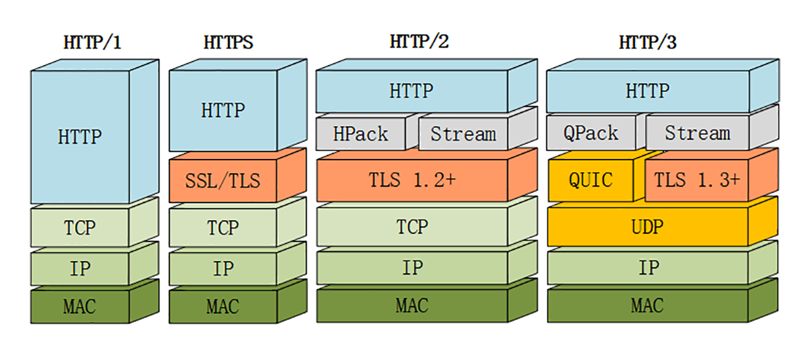

- 参考资料

  - QUIC RFC: https://tools.ietf.org/html/draft-ietf-quic-transport-24
  - QUIC with TLS RFC: https://quicwg.org/base-drafts/draft-ietf-quic-tls.html#name-introduction
  - 中文QUIC RFC: http://docs.wxclimb.top/draft-ietf-quic-transport-zh.html#fc-credit
  - HTTP3详解, https://http3-explained.haxx.se/zh/
  - QUIC & HTTP/3 Support：主流浏览器和服务端对 HTTP/3 的支持情况, https://sysin.org/article/QUIC-HTTP3-Support/
  - HTTP/HTTPS/HTTP2/HTTP3/QUIC/WebSocket协议详解, https://segmentfault.com/a/1190000021390130?utm_source=tag-newest
  - HTTP/3：起源, https://github.com/xitu/gold-miner/blob/master/TODO1/http-3-from-root-to-tip.md
  - [caddy, 支持http3 go编写的web服务器](https://github.com/caddyserver/caddy)
  - [网络编程懒人入门(十)：一泡尿的时间，快速读懂QUIC协议](http://www.52im.net/thread-2816-1-1.html)

#### 1.4 SDP/JSEP

#### 1.4.1 JSEP-Javascript会话描述协议

- JSEP State Machine

  ```shell
                      setRemote(OFFER)               setLocal(PRANSWER)
                          /-----\                               /-----\
                          |     |                               |     |
                          v     |                               v     |
           +---------------+    |                +---------------+    |
           |               |----/                |               |----/
           |  have-        | setLocal(PRANSWER)  | have-         |
           |  remote-offer |------------------- >| local-pranswer|
           |               |                     |               |
           |               |                     |               |
           +---------------+                     +---------------+
                ^   |                                   |
                |   | setLocal(ANSWER)                  |
  setRemote(OFFER)  |                                   |
                |   V                  setLocal(ANSWER) |
           +---------------+                            |
           |               |                            |
           |               |<---------------------------+
           |    stable     |
           |               |<---------------------------+
           |               |                            |
           +---------------+          setRemote(ANSWER) |
                ^   |                                   |
                |   | setLocal(OFFER)                   |
  setRemote(ANSWER) |                                   |
                |   V                                   |
           +---------------+                     +---------------+
           |               |                     |               |
           |  have-        | setRemote(PRANSWER) |have-          |
           |  local-offer  |------------------- >|remote-pranswer|
           |               |                     |               |
           |               |----\                |               |----\
           +---------------+    |                +---------------+    |
                          ^     |                               ^     |
                          |     |                               |     |
                          \-----/                               \-----/
                      setLocal(OFFER)               setRemote(PRANSWER)
  ```

- 参考资料

  - [RFC 8829 JavaScript Session Establishment Protocol (JSEP)](https://www.rfc-editor.org/rfc/rfc8829.html), JavaScript会话建立协议

#### 1.4.2 SDP

- SDP整体结构
  - 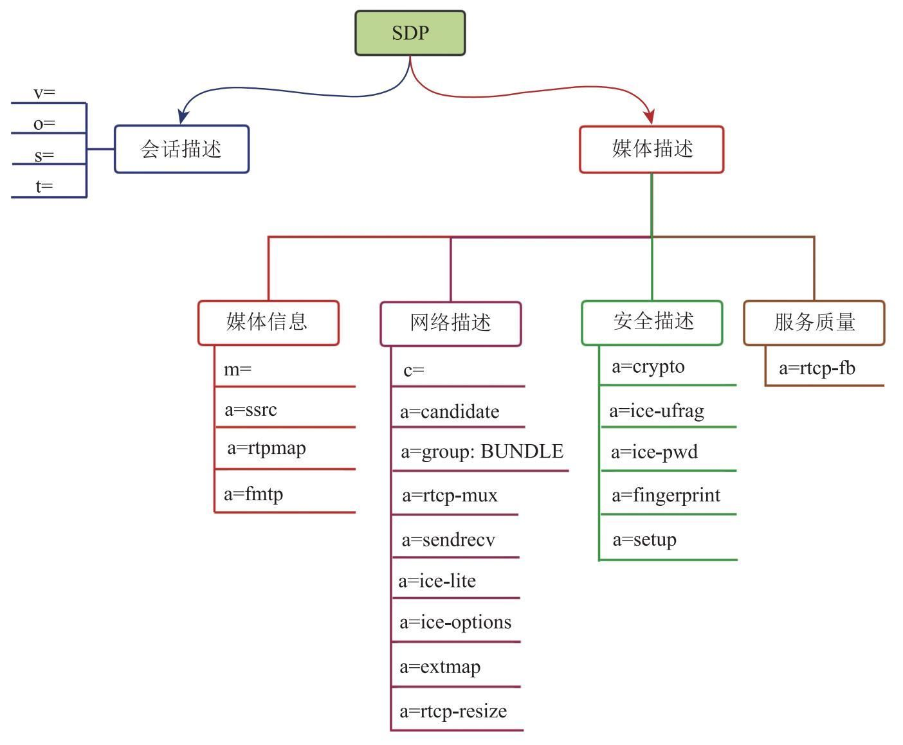

#### 1.5 UDP vs TCP

##### 1.5.1 Media Path 首选 UDP

1. TCP: 可靠性“牺牲”实时性, 
   1. “发送” -> “确认” -> “丢包” -> “重传”, 保证不丢失, 不乱序(不抖动)；
   2. 增加网络吞吐率, 采用延迟确认和Nagle算法；
2. UDP: 本身简单, 速度“快”, 那如何解决丢包, 延迟, 抖动问题?
   1. NACK/RTX, RTCP消息类型, 由接收端向发送端报告一段时间内丢包情况；RTX指发送端重传丢失包, 并使用新的SSRC；
   2. FEC前向纠错, 使用异或操作传输数据, 在丢包时用于重传, 适合随机少量丢包场景；
   3. JitterBufer防抖动, 将抖动较小乱序包恢复成有序包；
   4. NetEQ, 音频控制, 以实现防抖动；
   5. 拥塞控制

### 2 通信部分

#### 2.1 STUN/TURN/ICE

##### 2.1.1  ICE

​         交互式连通性建立（Interactive Connectivity Establishment - ICE）是一个允许实时对等端发现对方并且彼此连接的**框架**。ICE可以找到媒体传输的最短路径, 同时允许我们穿过防火墙和NAT进行工作.

1. ICE 代理向操作系统查询本地 IP 地址；
2. 如果有配置,ICE 代理会查询外部 STUN 服务器,以取得本地端的公共 IP 和端口号；
3. 如果有配置,ICE 代理会将 TURN 服务器追加为最后一个候选项；假如端到端的连接失败,数据将通过指定的中间设备转发。

###### 1) ICE流程


###### 2) ICE candidate类型

| 类型             | 别名  | 如何传给对端     | 用法                                                         |
| ---------------- | ----- | ---------------- | ------------------------------------------------------------ |
| 主机候选项       | host  | 信令服务器       | 从网卡中获取的本地传输地址，如果此地址位于NAT之后，则为内网地址 |
| 服务器反射候选项 | srflx | 信令服务器       | 从发送给Stun服务器的Binding检查中获取的传输地址。如果此地址位于NAT之后，则为最外层NAT的公网地址 |
| 对端反射候选项   | prflx | Stun Binding请求 | 从对端发送的Stun Binding请求获取的传输地址。这是一种在连接检查期间新发生的候选项 |
| 中继候选项       | relay | 信令服务器       | 媒体中继服务器的传输地址。通过使用TURN Allocate请求获取      |

###### 3) 参考资料
- [jitsi/ice4j](https://github.com/jitsi/ice4j)	

##### 2.1.2  STUN

​		这里介绍STUN两种用法: 1. 获取服务器反射地址srflx；  2. 借助STUN获取NAT类型以及不同NAT的穿透性；

###### 1) 获取srflx


- 方法一

  ```sh
  curl -L ip.tool.lu                      
  当前IP: 112.17.99.6
  归属地: 中国 浙江省 杭州市
  ```

- 方法二

  ```sh
  turnutils_stunclient 123.60.88.103                   
  
  ========================================
  RFC 5780 response 1
  0: IPv4. Response origin: : 123.60.88.103:3478
  0: IPv4. Other addr: : 123.60.88.103:3479
  0: IPv4. UDP reflexive addr: 112.17.99.6:36874
  ```


###### 2) RFC3489中NAT类型, 检测及穿透性
- RFC3489中的NAT类型

| 图示                                               | 说明                                                         |
| -------------------------------------------------- | ------------------------------------------------------------ |
|  | **Full Cone NAT - 完全锥型NAT:**<br />所有从同一内网主机IP和端口号发送过来的请求都会被映射成同一个外网IP和端口号，并且任何一个外网主机都可以通过这个映射的外网IP和端口号向这台内网主机发送包。由于对外部请求的来源无任何限制，因此这种方式虽然足够简单，但却不安全。<br /><br />流量out, 根据Key生成一个 “洞” 记录<br />key: (内网主机IP, 内网主机Port)<br />value: (<br/>     NAT主机Port<br /> )<br /><br />流量in<br />for  洞  in 所有洞:<br />         if remote.dst.port) == NAT主机Port:<br />                   NAT主机 转发流量  (内网主机IP ，内网主机Port) |
|               | **Restricted Cone NAT - IP限制锥型NAT:**<br />所有从同一个内网主机IP和端口号发送的过来的请求都会被映射成同一个外网IP和端口号。与完全锥型不同的是，外网主机只能够向先前已经向它发送过数据包的内网主机发送包。这意味着，NAT设备只向内转发那些来自于当前已知的外部主机的数据包，从而保障了外部请求来源的安全性。<br /><br />流量out, 根据Key生成一个 “洞” 记录<br />key: (内网主机IP, 内网主机Port)<br />value: (<br/>     NAT主机Port<br /><br />     //远程主机IP插入列表<br />     **[(远程主机IP), ...]**<br /> )<br /><br />流量in<br />for  洞  in 所有洞:<br />         if remote.dst.port  == NAT主机Port && remote.ip in **[远程主机IP, ...]**:<br />                   NAT主机 转发流量  (内网主机IP ，内网主机Port) |
|                   | **Port Restricted Cone NAT - 端口限制锥型NAT:**<br />与限制锥型NAT很相似，只不过它包括端口号。也就是说，一台IP地址X和端口P的外网主机想给内网主机发送包，必须是这台内网主机先前已经给这个IP地址X和端口号P发送过数据包。端口号P这一要求进一步强化了对外部报文请求来源的限制，从而较Restrictd Cone更具安全性。<br /><br />流量out, 根据Key生成一个 “洞” 记录<br />key: (内网主机IP, 内网主机Port)<br />value: (<br/>      NAT主机Port<br /><br />     //远程主机IP和Port插入列表<br />     **[(远程主机IP, 远程主机Port), ...]**<br /> )<br /><br />流量in<br />for  洞  in 所有洞:<br />         if remote.dst.port  == NAT主机Port && (remote.ip, remote.port) in **[(远程主机IP, 远程主机Port), ...]**:<br />                   NAT主机 转发流量  (内网主机IP ，内网主机Port) |
|  | **Symmetric NAT - 对称NAT:**<br />所有从同一个内网主机IP和端口号发送到一个特定目的IP和端口号的请求，都会被映射到同一个IP和端口号，如果同一台主机使用相同的源地址和端口号发送包，但是发往不同的目的地，NAT将会使用不同的映射。此外，只有收到的数据的外网主机才可以反过来向内网主机发送包。<br /><br />流量out, Key相比端口限制锥型NAT更严格, 因此会生成更多的“洞”<br />key: (内网主机IP, 内网主机Port, 远程主机IP, 远程主机Port)<br />value: (<br/>      NAT主机Port<br /><br />      (远程主机IP, 远程主机Port)<br /> )<br /><br />流量in<br />for  洞  in 所有洞:<br />         if remote.dst.port  == NAT主机Port && (remote..src.ip, remote.src.port) == (远程主机IP, 远程主机Port):<br />                   NAT主机 转发流量  (内网主机IP ，内网主机Port) |
|                                                    |                                                              |
- NAT类型检测

  - NAT类型判断算法整体流程大至是，先判断防火墙是否阻止所有udp包进来，再判断是否是公网ip，再判断是否为全锥型，然后判断是否是对称型，最后判断是否是端口或地址限制型。
  - 下面描述详细的判断过程,过程中需要与3台具有不同IP的服务器交互辅助。我们把这3台服务器称之为“协调服务器”,分别称为s1,s2,s3。
  - 判断路由器防火墙是否防止所有UDP包进入 客户端向s1:30017发送一UDP包，s1收到后直接返回一udp数据包，如果客记端收不到s1的回包，那么判定为阻止所有udp,判断结束,否则进入一下判断。为了降低udp在网络中丢失，此过程可以重复多次。
  - 判断主机是否直连公网 客户端收到s1回复，s1在处理时取出客户端的ip放入回复包里，客户商解析出数据区的ip与本机本地取出的所有ip对比，看是否存在匹配。存在匹配即认定当前主机是直接连接在公网上的，中间没有经过任何网关路由器,判断结束,否则进入一下判断。
  - 判断当前网络的网关路由器是否为全锥型 客户端向s1:30017端口发送消息请求s1通知s3从不同于30017端口回一个udp消息包，如果客户端能收到s3的回复。那判定为全锥型nat，否则进入下一步判断。
  - 判断是否为对称型nat 客户端分别向s1:30018,s2:30018发送udp消息，s1,s2收到包后，取出客户端的ip:port放入数据包发送回给客户端。客户端这样就取回自己的两份公网ip:port数据,客户端对比这两个地址，如果这两ip:port不一样那么就是客户端网关就是对称型。否则就是锥型，要么是地址限制型，要么是端口限制型。就需要继续向下判断了。
  - 判断是地址限制型还是端口限制型nat 客户端向s1:30018发消息，请求s1从另一个端口回复一个消息比如端口6000。如果客户端收到了s1所回复的消息，那么判定为地址限制型而非端口限制型。否则收不到回复就判定为端口限制型。因为s1从非30018端口回复消息补路由器阻止了。
  
  
  

​															*NAT检测原理 : https://datatracker.ietf.org/doc/html/rfc3489#page-22*


```sh
➜  webrtc git:(master) ✗ pystun -H stun.voipbuster.com -d
DEBUG:pystun:Do Test1
DEBUG:pystun:sendto: ('stun.voipbuster.com', 3478)
DEBUG:pystun:recvfrom: ('77.72.169.210', 3478)
DEBUG:pystun:Result: {'ExternalIP': '154.18.175.68', 'Resp': True, 'ExternalPort': 45598, 'ChangedPort': 3479, 'SourcePort': 3478, 'SourceIP': '77.72.169.210', 'ChangedIP': '77.72.169.211'}
DEBUG:pystun:Do Test2
DEBUG:pystun:sendto: ('stun.voipbuster.com', 3478)
DEBUG:pystun:recvfrom: ('77.72.169.210', 3478)
DEBUG:pystun:sendto: ('stun.voipbuster.com', 3478)
DEBUG:pystun:recvfrom: ('77.72.169.210', 3478)
DEBUG:pystun:sendto: ('stun.voipbuster.com', 3478)
DEBUG:pystun:recvfrom: ('77.72.169.210', 3478)
DEBUG:pystun:sendto: ('stun.voipbuster.com', 3478)
DEBUG:pystun:sendto: ('stun.voipbuster.com', 3478)
DEBUG:pystun:sendto: ('stun.voipbuster.com', 3478)
DEBUG:pystun:sendto: ('stun.voipbuster.com', 3478)
DEBUG:pystun:Result: {'ExternalIP': None, 'Resp': False, 'ExternalPort': None, 'ChangedPort': None, 'SourcePort': None, 'SourceIP': None, 'ChangedIP': None}
DEBUG:pystun:Do Test1
DEBUG:pystun:sendto: ('77.72.169.211', 3479)
DEBUG:pystun:recvfrom: ('77.72.169.211', 3479)
DEBUG:pystun:Result: {'ExternalIP': '91.240.163.98', 'Resp': True, 'ExternalPort': 46085, 'ChangedPort': 3478, 'SourcePort': 3479, 'SourceIP': '77.72.169.211', 'ChangedIP': '77.72.169.210'}
NAT Type: Symmetric NAT
External IP: 91.240.163.98
External Port: 46085

➜  bin git:(master) ✗ sudo pystun -H 123.60.88.103 -d      
DEBUG:pystun:Do Test1
DEBUG:pystun:sendto: ('123.60.88.103', 3478)
DEBUG:pystun:recvfrom: ('123.60.88.103', 3478)
DEBUG:pystun:Result: {'ExternalIP': '112.17.99.6', 'Resp': True, 'ExternalPort': 26881, 'ChangedPort': 3479, 'SourcePort': 3478, 'SourceIP': '123.60.88.103', 'ChangedIP': '123.60.88.103'}
DEBUG:pystun:Do Test2
DEBUG:pystun:sendto: ('123.60.88.103', 3478)
DEBUG:pystun:sendto: ('123.60.88.103', 3478)
DEBUG:pystun:sendto: ('123.60.88.103', 3478)
DEBUG:pystun:sendto: ('123.60.88.103', 3478)
DEBUG:pystun:Result: {'ExternalIP': None, 'Resp': False, 'ExternalPort': None, 'ChangedPort': None, 'SourcePort': None, 'SourceIP': None, 'ChangedIP': None}
DEBUG:pystun:Do Test1
DEBUG:pystun:sendto: ('123.60.88.103', 3479)
DEBUG:pystun:sendto: ('123.60.88.103', 3479)
DEBUG:pystun:sendto: ('123.60.88.103', 3479)
DEBUG:pystun:sendto: ('123.60.88.103', 3479)
DEBUG:pystun:Result: {'ExternalIP': None, 'Resp': False, 'ExternalPort': None, 'ChangedPort': None, 'SourcePort': None, 'SourceIP': None, 'ChangedIP': None}
NAT Type: Meet an error, when do Test1 on Changed IP and Port
External IP: None
External Port: None


#pystun检测代码, https://github1s.com/jtriley/pystun/blob/HEAD/stun/__init__.py#L105-L182
```

- 不同NAT组合的穿透性


- 具体分析

  | 图示及说明                                                   |
  | ------------------------------------------------------------ |
  | <br />**借助第三方Proxy,  Full Cone-Full Cone, 可以通信** |
  | <br />**借助第三方Proxy,  Full cone/restricted-restricted, 可以通信** |
  | <br />**借助第三方Proxy, Full cone/IP restricted-symmetric, 可以通信** |
  
###### 3) RFC5389/5780中的NAT类型, 检测及穿透性

| Mapping | Filtering |
| ---- | ---- |
|      |      |
| | |
|      |      |
| | |
|      |      |

- RFC3489与RFC5780 NAT对应关系

  


##### 2.1.3  TURN

1. 参考资料
   - [jitsi/turnserver](https://github.com/jitsi/turnserver)
   - [TURN REST Server API](https://www.ietf.org/proceedings/87/slides/slides-87-behave-10.pdf)

##### 2.1.4  coturn搭建及测试

- turnserver配置
- 测试, 使用check
- 测试NAT, 使用nat
- 测试stun, 使用stunclient
- 测试turn, 使用uclient和peer
  - PEER: peer -v
  - PEER: tcpdump -n ip host 192.168.0.230 or 192.168.0.188 and udp -XX
  - UCLIENT: turnutils_uclient -v TURNSERVER_IP -u USERNAME -w PASS  -e PEER_IP

##### 2.1.5  参考资料

- [RFC 3489: STUN - Simple Traversal of User Datagram Protocol (UDP) Through Network Address Translators (NATs)](https://datatracker.ietf.org/doc/html/rfc3489), [CN](rfc/RFC3489_CN.pdf)
- [RFC 4787: Network Address Translation (NAT) Behavioral Requirements for Unicast UDP](https://datatracker.ietf.org/doc/html/rfc4787)
- [RFC 5389: Session Traversal Utilities for NAT (STUN)](https://tools.ietf.org/html/rfc5389), [CN](rfc/RFC5389_CN.pdf)
- [RFC 5769: Test Vectors for Session Traversal Utilities for NAT (STUN)](https://datatracker.ietf.org/doc/html/rfc5769)
- [RFC 5780: NAT Behavior Discovery Using STUN](https://tools.ietf.org/html/rfc5780)
- [RFC 7064: URI Scheme for STUN](https://tools.ietf.org/html/rfc7064)
- [RFC 5766: TURN: Relay Extensions to STUN](https://tools.ietf.org/html/rfc5766)
- [RFC 5245: ICE: A Protocol for NAT for Offer/Answer Protocols](https://tools.ietf.org/html/rfc5245), [CN](rfc/RFC5245_CN.pdf)
- [RFC 6062: TURN Extensions for TCP Allocations](https://tools.ietf.org/html/rfc6062)
- [RFC 7065: TURN URI](https://tools.ietf.org/html/rfc7065)
- [RFC 6544: TCP Candidates with ICE](https://tools.ietf.org/html/rfc6544)


#### 2.2 mDNS
### 3 数据部分

#### 3.1 SRTP / SRTCP

##### 3.1.1 SRTP安全实时传输协议

- SRTP over UDP
  - 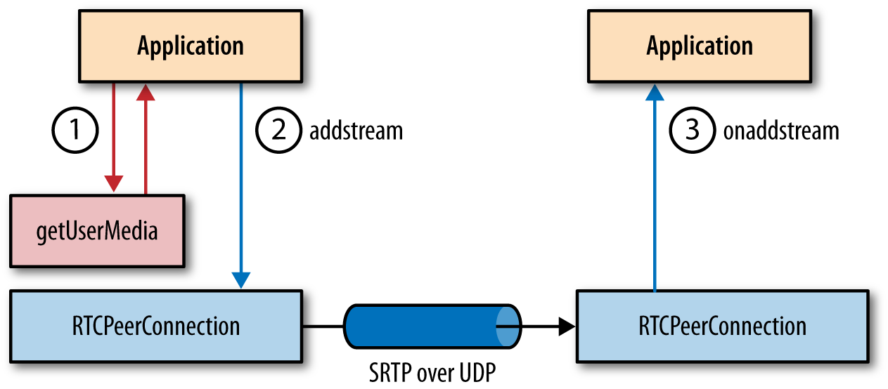

- 过程

  - 通信双方：通过DTLS握手，协商生成一对密钥；
  - 数据发送方：将音视频数据封装成RTP包，将控制数据封装成RTCP包；
  - 数据发送方：利用加密密钥，对RTP包、RTCP包进行加密，生成SRTP包、SRTCP包；
  - 数据发送方：通过UDP传输SRTP包、SRTCP包；
- SRTP格式
  - 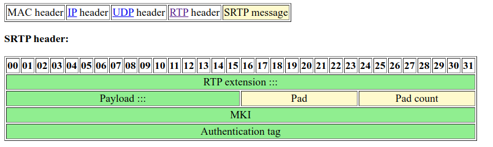

- RTP格式
  - 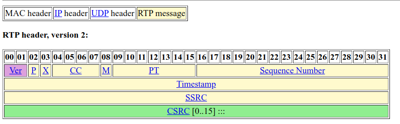

##### 3.1.2 SRTCP安全实时传输控制协议

#### 3.2 SCTP流控制传输协议

​    数据通道采用SCTP构建。最初设计用于PSTN电话协议SS7消息

- WebRTC 对 RTCDataChannel 接口及其传输协议有哪些要求?
  - 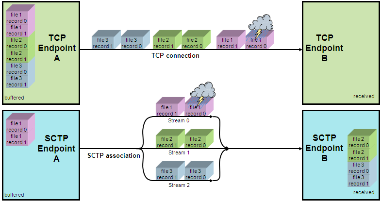 
  - 传输层必须支持多个独立信道的复用:
    - 每个信道必须支持有序或乱序交付；
    - 每个信道必须支持可靠或不可靠交付；
    - 每个信道可以支持应用定义的优先级；
  - 传输层必须提供一个面向消息的 API
    - 每条应用消息都可能在传输层被分段和组装；
  - 传输层必须实现流量和拥塞控制机制
  - 传输层必须保证数据的机密性和完整性
- SCTP格式
  - 
  - 
  - 

- 参考资料
  - <<UNIX网络编程>> 3rd, 第9, 10, 23章
  - <<WEB性能优化指南> > 18.5.3 通过 SCTP 交付应用数据,  18.6 DataChannel
  - SCTP in Go, https://2013.asiabsdcon.org/papers/abc2013-P7A-paper.pdf
  - rfc3758: Stream Control Transmission Protocol (SCTP) Partial Reliability Extension
  - rfc4895: Authenticated Chunks for the Stream Control Transmission Protocol (SCTP)
  - rfc5061: Stream Control Transmission Protocol (SCTP) Dynamic Address Reconfiguration

#### 3.3 Codec

### 4 安全部分

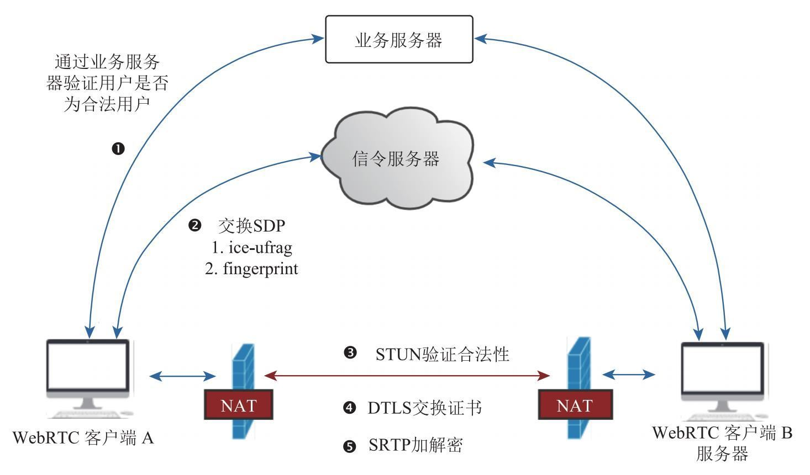

#### 4.1 TLS

- 参考资料
  - rfc2246: The TLS Protocol Version 1.0
  - rfc4346: The Transport Layer Security (TLS) Protocol Version 1.1
  - rfc5246: The Transport Layer Security (TLS) Protocol Version 1.2
  - rfc5746: Transport Layer Security (TLS) Renegotiation Indication Extension
  - rfc8446: The Transport Layer Security (TLS) Protocol Version 1.3
  - rfc7507: TLS Fallback Signaling Cipher Suite Value (SCSV) for Preventing Protocol Downgrade Attacks
  - TLS协议分析 与 现代加密通信协议设计, https://blog.helong.info/blog/2015/09/06/tls-protocol-analysis-and-crypto-protocol-design/
  - TLS 握手优化详解, https://imququ.com/post/optimize-tls-handshake.html
  - 图解SSL/TLS协议, http://www.ruanyifeng.com/blog/2014/09/illustration-ssl.html
  - SSL/TLS协议运行机制的概述, http://www.ruanyifeng.com/blog/2014/02/ssl_tls.html
  - SSL/TLS发展历史和SSLv3.0协议详解, http://www.bewindoweb.com/271.html

#### 4.2 DTLS

- DTLS图示
  - 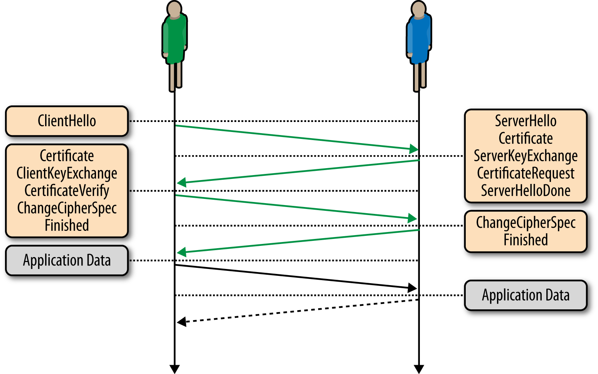
    - 通信双方：通过DTLS握手，协商生成一对密钥；
    - 发送方：对数据进行加密；
    - 发送方：通过UDP传输加密数据；
    - 接收方：对加密数据进行解密；
- 参考资料
  - rfc4347: Datagram Transport Layer Security
  - rfc5763: Framework for Establishing a Secure Real-time Transport Protocol (SRTP) Security Context Using Datagram Transport Layer Security (DTLS)
  - rfc5764: Datagram Transport Layer Security (DTLS) Extension to Establish Keys for the Secure Real-time Transport Protocol (SRTP)
  - rfc6347: Datagram Transport Layer Security Version 1.2

### 5 浏览器侧API

- 浏览器组件, [src](https://github1s.com/yejinlei/webrtc-src)


- 简单呼叫流程


#### 5.1 Web API

#### 5.1.1  MediaStream API

##### 1) 获取媒体流方式

- 摄像头/话筒
- 屏幕共享
- canvas
- 媒体元素

##### 2) 媒体流MediaStream定义
##### 3) 媒体流属性
##### 4) 媒体流Events

- addtrack事件
- removetrack事件

##### 5) 媒体轨道MediaStreamTrack定义
##### 6) 媒体轨道属性
##### 7) 媒体轨道Events

#### 5.1.2  RTCPeerConnection API

##### 1) RTCConfiguration成员
  - 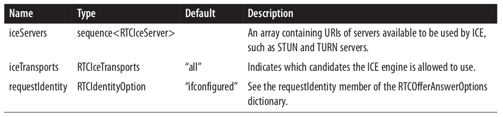
##### 2) RTCIceServer成员
  - 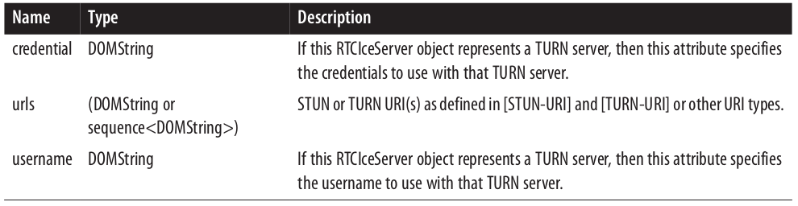

##### 3) RTCPeerConnection构造函数, RTCPeerConnection(configuration)
##### 4) RTCPeerConnection方法
  - createOffer (RTCSessionDescriptionCallback successCallback, RTCPeerCon‐
    nectionErrorCallback failureCallback, optional RTCOfferOptions options)|
  - createAnswer (RTCSessionDescriptionCallback successCallback, RTCPeerCon‐
    nectionErrorCallback failureCallback, optional RTCOfferAnswerOptions op‐
    tions)
  - setLocalDescription (RTCSessionDescription description, VoidFunction success‐
    Callback, RTCPeerConnectionErrorCallback failureCallback)
  - setRemoteDescription (RTCSessionDescription description, VoidFunction suc‐
    cessCallback, RTCPeerConnectionErrorCallback failureCallback)
  - updateIce (RTCConfiguration configuration)
  - addIceCandidate (RTCIceCandidate candidate, VoidFunction successCallback,
    RTCPeerConnectionErrorCallback failureCallback)
  - getConfiguration ()
  - getLocalStreams ()
  - getRemoteStreams ()
  - getStreamById (DOMString streamId)
  - addStream (MediaStream stream)
  - removeStream (MediaStream stream)
  - close ()
##### 5) RTCPeerConnection属性
  - 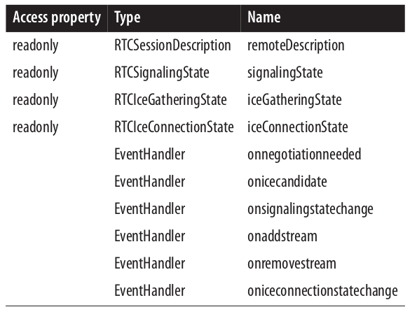

##### 6) RTCSignalingState信令状态
  - 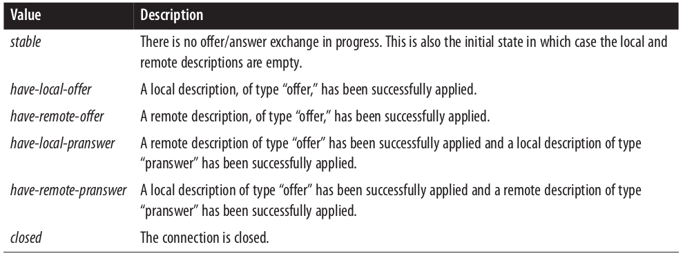

##### 7) RTCIceGatheringState ICE收集状态
  - 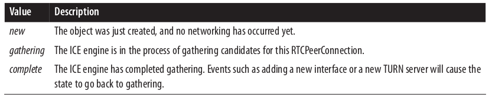

##### 8) RTCIceConnectionState ICE连接状态及转换
  - 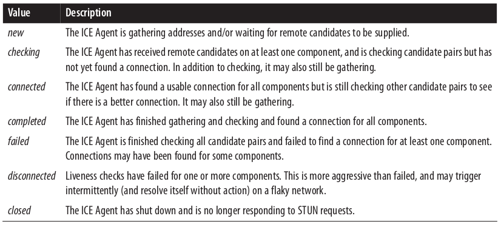
  - 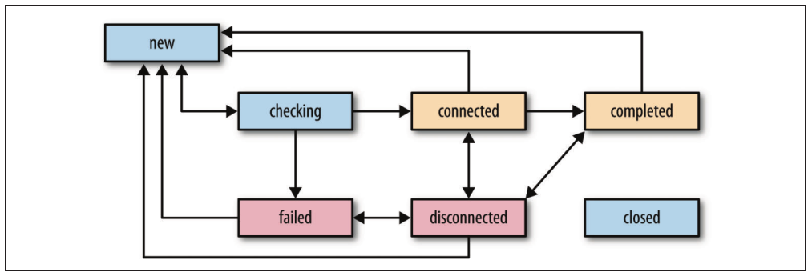

##### 9) 其他
  - RTCIceCandidateType 代表ICE候选地址的类型
  - RTCIceParameters
    - usernameFragment, 用户名
    - password, 密码

  - RTCIceCandidatePair, 候选地址对
    - RTCIceCandidate local,  本地
    - RTCIceCandidate remote, 远端


#### 5.1.3  RTCDataChannel API

### 6 Native API

#### 6.1 Chromium C/C++实现

#### 6.2 Golang实现

- [pion/example-webrtc-applications](https://github.com/pion/example-webrtc-applications) and more [examples](https://github.com/pion/webrtc/tree/master/examples)

#### 6.3 Rust实现

- [webrtc-rs/crate webrtc](https://docs.rs/webrtc/0.3.0/webrtc/)
- [webrtc-rs/examples](https://github.com/webrtc-rs/examples/tree/main/examples)

### 7 参考资料

- [MDN WebRTC API](https://developer.mozilla.org/zh-CN/docs/Web/API/WebRTC_API)
- [Media Capture and Streams](https://w3c.github.io/mediacapture-main/)
- [webrtc samples](https://yejinlei.gitee.io/webrtc-samples/)


---
## 三. WebRTC例子解读及DIY

### 1 [WebRTC Samples](https://yejinlei.gitee.io/webrtc-samples/)官方例子

#### 1. [getUserMedia](https://developer.mozilla.org/en-US/docs/Web/API/Navigator/getUserMedia), 本地媒体流

##### 1) [Basic getUserMedia demo](https://yejinlei.gitee.io/webrtc-samples/src/content/getusermedia/gum/)

 - ```javascript
   //
   //getUserMedia函数基本用法
   //
   
   //约束: 视频打开, 音频关闭
   const constraints = window.constraints = {
     audio: false,
     video: true
   };
   
   //init函数中创建Media对象
   const stream = await navigator.mediaDevices.getUserMedia(constraints);
   handleSuccess(stream);
   
   //handleSuccess函数主要给video.srcObject附上Media对象
   window.stream = stream;
   video.srcObject = stream;
   
   //添加click监听事件函数init
   document.querySelector('#showVideo').addEventListener('click', e => init(e));
   ```

##### 2) [Use getUserMedia with canvas](https://yejinlei.gitee.io/webrtc-samples/src/content/getusermedia/canvas/)

- ```javascript
  //
  //从video对象中截图
  //
  
  //video对象长宽赋给canvas对象, 调用drawImage截图
  const button = document.querySelector('button');
  button.onclick = function() {
    canvas.width = video.videoWidth;
    canvas.height = video.videoHeight;
    canvas.getContext('2d').drawImage(video, 0, 0, canvas.width, canvas.height);
  };
  
  //直接调用getUserMedia
  navigator.mediaDevices.getUserMedia(constraints).then(handleSuccess).catch(handleError);
  ```

##### 3) [Use getUserMedia with canvas and CSS filters](https://yejinlei.gitee.io/webrtc-samples/src/content/getusermedia/filter/)

- ```javascript
  //
  //从video对象中截图, 再通过canvas.classname设置过滤样式
  //
  
  const filterSelect = document.querySelector('select#filter');
  
  //通过canvas.classname来设置截图样式
  snapshotButton.onclick = function() {
    canvas.className = filterSelect.value;
    canvas.getContext('2d').drawImage(video, 0, 0, canvas.width, canvas.height);
  };
  ```

##### 4) [Choose camera resolution](https://yejinlei.gitee.io/webrtc-samples/src/content/getusermedia/resolution/)

- ```javascript
  //
  //改变视频流分辨率
  //
  
  //预设分辨率
  function getMedia(constraints) {
    //通过track对象停止视频流
    if (stream) {
      stream.getTracks().forEach(track => {
        track.stop();
      });
    }
  
    clearErrorMessage();
    videoblock.style.display = 'none';
    //通过预设constraints重新创建本地视频流
    navigator.mediaDevices.getUserMedia(constraints)
        //gotStream函数中, stream赋值给video对象
        .then(gotStream)
        .catch(e => {
          errorMessage('getUserMedia', e.message, e.name);
        });
  }
  
  //调整分辨率
  function constraintChange(e) {
    widthOutput.textContent = e.target.value;
    const track = window.stream.getVideoTracks()[0];
    let constraints;
    if (aspectLock.checked) {
      constraints = {
        width: {exact: e.target.value},
        aspectRatio: {
          exact: video.videoWidth / video.videoHeight
        }
      };
    } else {
      constraints = {width: {exact: e.target.value}};
    }
    clearErrorMessage();
    console.log('applying ' + JSON.stringify(constraints));
    //track轨道对象直接应用约束, 没有重新创建视频流
    track.applyConstraints(constraints)
        .then(() => {
          console.log('applyConstraint success');
          displayVideoDimensions('applyConstraints');
        })
        .catch(err => {
          errorMessage('applyConstraints', err.name);
        });
  }
  ```

##### 5) [Audio-only getUserMedia() output to local audio element](https://yejinlei.gitee.io/webrtc-samples/src/content/getusermedia/audio/)

##### 6) [Audio-only getUserMedia() displaying volume](https://yejinlei.gitee.io/webrtc-samples/src/content/getusermedia/volume/)

##### 7) [Record stream](https://yejinlei.gitee.io/webrtc-samples/src/content/getusermedia/record/)

- ```javascript
  //
  //视频流录制
  //
  
  //录制
  function startRecording() {
      //调用MediaRecorder创建媒体录制对象, options用于设置编解码格式
      mediaRecorder = new MediaRecorder(window.stream, options);
      //设置事件触发函数
      mediaRecorder.onstop
      mediaRecorder.ondataavailable = handleDataAvailable;
      mediaRecorder.start();
  }
  //recordedBlobs用于存放音视频数据
  function handleDataAvailable(event) {
    console.log('handleDataAvailable', event);
    if (event.data && event.data.size > 0) {
      recordedBlobs.push(event.data);
    }
  }
      
  //播放
  const playButton = document.querySelector('button#play');
  playButton.addEventListener('click', () => {
    const superBuffer = new Blob(recordedBlobs, {type: 'video/webm'});
    //const recordedVideo = document.querySelector('video#recorded');  recordedVideo是video对象
    recordedVideo.src = null;
    recordedVideo.srcObject = null;
    //创建内存url,赋值给video.src
    recordedVideo.src = window.URL.createObjectURL(superBuffer);
    recordedVideo.controls = true;
    recordedVideo.play();
  });
  
  //下载
  downloadButton.addEventListener('click', () => {
    const blob = new Blob(recordedBlobs, {type: 'video/webm'});
    const url = window.URL.createObjectURL(blob);
    //创建<a>超链接对象, 挂载到<body>
    const a = document.createElement('a');
    a.style.display = 'none';
    a.href = url;
    a.download = 'test.webm';
    document.body.appendChild(a);
    //模拟点击下载
    a.click();
    setTimeout(() => {
      document.body.removeChild(a);
      window.URL.revokeObjectURL(url);
    }, 100);
  });
  ```

##### 8) [Screensharing with getDisplayMedia](https://yejinlei.gitee.io/webrtc-samples/src/content/getusermedia/getdisplaymedia/)

- ```javascript
  //
  //共享桌面及应用界面
  //
  
  const startButton = document.getElementById('startButton');
  startButton.addEventListener('click', () => {
    //创建视频流共享对象
    navigator.mediaDevices.getDisplayMedia({video: true})
        .then(handleSuccess, handleError);
  });
  
  
  function handleSuccess(stream) {
    startButton.disabled = true;
    const video = document.querySelector('video');
    //还是要赋值给video对象, 本地才可显示
    video.srcObject = stream;
  
    //track对象设置"ended"监听事件,用于停止共享
    stream.getVideoTracks()[0].addEventListener('ended', () => {
      errorMsg('The user has ended sharing the screen');
      startButton.disabled = false;
    });
  }
  ```

##### 9) [Control camera pan, tilt, and zoom](https://yejinlei.gitee.io/webrtc-samples/src/content/getusermedia/pan-tilt-zoom/)

#### 2. Devices, 设备

##### 1) [Choose camera, microphone and speaker](https://yejinlei.gitee.io/webrtc-samples/src/content/devices/input-output/)

- ```javascript
  //
  //枚举设备
  //
  
  //枚举设备
  navigator.mediaDevices.enumerateDevices().then(gotDevices).catch(handleError);
  ```

##### 2) [Choose media source and audio output](https://yejinlei.gitee.io/webrtc-samples/src/content/devices/multi/)

#### 3. Stream capture, 视频捕获

##### 1) [Stream from a video element to a video element](https://yejinlei.gitee.io/webrtc-samples/src/content/capture/video-video/)

- ```javascript
  //
  //从已有本地视频流中捕获 再拷贝到另外一个
  //
  
  const leftVideo = document.getElementById('leftVideo');
  const rightVideo = document.getElementById('rightVideo');
  
  leftVideo.addEventListener('canplay', () => {
    let stream;
    const fps = 0;
    
    if (leftVideo.captureStream) {
      stream = leftVideo.captureStream(fps);
    } else if (leftVideo.mozCaptureStream) {
      stream = leftVideo.mozCaptureStream(fps);
    } else {
      console.error('Stream capture is not supported');
      stream = null;
    }
    
    //从video.captureStream/mozCaptureStream捕获中获取视频流对象, 重新赋值给新的video对象
    rightVideo.srcObject = stream;
  });
  ```

##### 2) [Stream from a video element to a peer connection](https://yejinlei.gitee.io/webrtc-samples/src/content/capture/video-pc/)

- ```javascript
  //
  //通过peerconnection捕获视频流
  //必须chrome://flags/#enable-experimental-web-platform-features, 否则right video无法显示
  
  'use strict';
  
  const leftVideo = document.getElementById('leftVideo');
  const rightVideo = document.getElementById('rightVideo');
  
  let stream;
  
  function call()
  ```

  

##### 3) [Stream from a canvas element to a video element](https://yejinlei.gitee.io/webrtc-samples/src/content/capture/canvas-video/)

##### 4) [Stream from a canvas element to a peer connection](https://yejinlei.gitee.io/webrtc-samples/src/content/capture/canvas-pc/)

##### 5) [Record a stream from a canvas element](https://yejinlei.gitee.io/webrtc-samples/src/content/capture/canvas-record/)

##### 6) [Guiding video encoding with content hints](https://yejinlei.gitee.io/webrtc-samples/src/content/capture/video-contenthint/)

#### 4. [RTCPeerConnection](https://developer.mozilla.org/en-US/docs/Web/API/RTCPeerConnection), 对等连接

##### 1) [Basic peer connection demo](https://yejinlei.gitee.io/webrtc-samples/src/content/peerconnection/pc1/)

##### 2) [Peer connection using Perfect Negotiation](https://yejinlei.gitee.io/webrtc-samples/src/content/peerconnection/perfect-negotiation/)

##### 3) [Audio-only peer connection demo](https://yejinlei.gitee.io/webrtc-samples/src/content/peerconnection/audio/)

##### 4) [Change bandwidth on the fly](https://yejinlei.gitee.io/webrtc-samples/src/content/peerconnection/bandwidth/)

##### 5) [Change codecs before the call](https://yejinlei.gitee.io/webrtc-samples/src/content/peerconnection/change-codecs/)

##### 6) [Upgrade a call and turn video on](https://yejinlei.gitee.io/webrtc-samples/src/content/peerconnection/upgrade/)

##### 7) [Multiple peer connections at once](https://yejinlei.gitee.io/webrtc-samples/src/content/peerconnection/multiple/)

##### 8) [Forward the output of one PC into another](https://yejinlei.gitee.io/webrtc-samples/src/content/peerconnection/multiple-relay/)

##### 9) [Munge SDP parameters](https://yejinlei.gitee.io/webrtc-samples/src/content/peerconnection/munge-sdp/)

- ```ini
  //Create offer按钮, 生成Offer SDP
  v=0
  o=- 3041379334355670373 2 IN IP4 127.0.0.1
  s=-
  t=0 0
  a=group:BUNDLE 0 1 2
  a=msid-semantic: WMS MiqBzs5zOU3uR9DBubzFNPleXxKIiCtU4ujy
  m=audio 9 UDP/TLS/RTP/SAVPF 111 103 104 9 0 8 106 105 13 110 112 113 126
  c=IN IP4 0.0.0.0
  a=rtcp:9 IN IP4 0.0.0.0
  a=ice-ufrag:zArQ
  a=ice-pwd:28cuGRNDC0NKLlLNG89L6kMo
  a=ice-options:trickle
  a=fingerprint:sha-256 10:6F:86:29:42:05:1B:C0:B1:69:5C:7F:11:2C:B8:F5:71:46:71:05:4F:55:2E:B7:B6:B2:FB:57:B4:E4:AE:39
  a=setup:actpass
  a=mid:0
  a=extmap:1 urn:ietf:params:rtp-hdrext:ssrc-audio-level
  a=extmap:2 http://www.webrtc.org/experiments/rtp-hdrext/abs-send-time
  a=extmap:3 http://www.ietf.org/id/draft-holmer-rmcat-transport-wide-cc-extensions-01
  a=extmap:4 urn:ietf:params:rtp-hdrext:sdes:mid
  a=extmap:5 urn:ietf:params:rtp-hdrext:sdes:rtp-stream-id
  a=extmap:6 urn:ietf:params:rtp-hdrext:sdes:repaired-rtp-stream-id
  a=sendrecv
  a=msid:MiqBzs5zOU3uR9DBubzFNPleXxKIiCtU4ujy b270edda-aca7-4ecc-a0a9-21e6fa3fe595
  a=rtcp-mux
  a=rtpmap:111 opus/48000/2
  a=rtcp-fb:111 transport-cc
  a=fmtp:111 minptime=10;useinbandfec=1
  a=rtpmap:103 ISAC/16000
  a=rtpmap:104 ISAC/32000
  a=rtpmap:9 G722/8000
  a=rtpmap:0 PCMU/8000
  a=rtpmap:8 PCMA/8000
  a=rtpmap:106 CN/32000
  a=rtpmap:105 CN/16000
  a=rtpmap:13 CN/8000
  a=rtpmap:110 telephone-event/48000
  a=rtpmap:112 telephone-event/32000
  a=rtpmap:113 telephone-event/16000
  a=rtpmap:126 telephone-event/8000
  a=ssrc:2698265112 cname:QsqLlLsN8y0YlyR7
  a=ssrc:2698265112 msid:MiqBzs5zOU3uR9DBubzFNPleXxKIiCtU4ujy b270edda-aca7-4ecc-a0a9-21e6fa3fe595
  a=ssrc:2698265112 mslabel:MiqBzs5zOU3uR9DBubzFNPleXxKIiCtU4ujy
  a=ssrc:2698265112 label:b270edda-aca7-4ecc-a0a9-21e6fa3fe595
  m=video 9 UDP/TLS/RTP/SAVPF 96 97 98 99 100 101 102 122 127 121 125 107 108 109 124 120 123
  c=IN IP4 0.0.0.0
  a=rtcp:9 IN IP4 0.0.0.0
  a=ice-ufrag:zArQ
  a=ice-pwd:28cuGRNDC0NKLlLNG89L6kMo
  a=ice-options:trickle
  a=fingerprint:sha-256 10:6F:86:29:42:05:1B:C0:B1:69:5C:7F:11:2C:B8:F5:71:46:71:05:4F:55:2E:B7:B6:B2:FB:57:B4:E4:AE:39
  a=setup:actpass
  a=mid:1
  a=extmap:14 urn:ietf:params:rtp-hdrext:toffset
  a=extmap:2 http://www.webrtc.org/experiments/rtp-hdrext/abs-send-time
  a=extmap:13 urn:3gpp:video-orientation
  a=extmap:3 http://www.ietf.org/id/draft-holmer-rmcat-transport-wide-cc-extensions-01
  a=extmap:12 http://www.webrtc.org/experiments/rtp-hdrext/playout-delay
  a=extmap:11 http://www.webrtc.org/experiments/rtp-hdrext/video-content-type
  a=extmap:7 http://www.webrtc.org/experiments/rtp-hdrext/video-timing
  a=extmap:8 http://tools.ietf.org/html/draft-ietf-avtext-framemarking-07
  a=extmap:9 http://www.webrtc.org/experiments/rtp-hdrext/color-space
  a=extmap:4 urn:ietf:params:rtp-hdrext:sdes:mid
  a=extmap:5 urn:ietf:params:rtp-hdrext:sdes:rtp-stream-id
  a=extmap:6 urn:ietf:params:rtp-hdrext:sdes:repaired-rtp-stream-id
  a=sendrecv
  a=msid:MiqBzs5zOU3uR9DBubzFNPleXxKIiCtU4ujy 905ade41-2a9b-456d-9a99-a2d8019c8ad6
  a=rtcp-mux
  a=rtcp-rsize
  a=rtpmap:96 VP8/90000
  a=rtcp-fb:96 goog-remb
  a=rtcp-fb:96 transport-cc
  a=rtcp-fb:96 ccm fir
  a=rtcp-fb:96 nack
  a=rtcp-fb:96 nack pli
  a=rtpmap:97 rtx/90000
  a=fmtp:97 apt=96
  a=rtpmap:98 VP9/90000
  a=rtcp-fb:98 goog-remb
  a=rtcp-fb:98 transport-cc
  a=rtcp-fb:98 ccm fir
  a=rtcp-fb:98 nack
  a=rtcp-fb:98 nack pli
  a=fmtp:98 profile-id=0
  a=rtpmap:99 rtx/90000
  a=fmtp:99 apt=98
  a=rtpmap:100 VP9/90000
  a=rtcp-fb:100 goog-remb
  a=rtcp-fb:100 transport-cc
  a=rtcp-fb:100 ccm fir
  a=rtcp-fb:100 nack
  a=rtcp-fb:100 nack pli
  a=fmtp:100 profile-id=2
  a=rtpmap:101 rtx/90000
  a=fmtp:101 apt=100
  a=rtpmap:102 H264/90000
  a=rtcp-fb:102 goog-remb
  a=rtcp-fb:102 transport-cc
  a=rtcp-fb:102 ccm fir
  a=rtcp-fb:102 nack
  a=rtcp-fb:102 nack pli
  a=fmtp:102 level-asymmetry-allowed=1;packetization-mode=1;profile-level-id=42001f
  a=rtpmap:122 rtx/90000
  a=fmtp:122 apt=102
  a=rtpmap:127 H264/90000
  a=rtcp-fb:127 goog-remb
  a=rtcp-fb:127 transport-cc
  a=rtcp-fb:127 ccm fir
  a=rtcp-fb:127 nack
  a=rtcp-fb:127 nack pli
  a=fmtp:127 level-asymmetry-allowed=1;packetization-mode=0;profile-level-id=42001f
  a=rtpmap:121 rtx/90000
  a=fmtp:121 apt=127
  a=rtpmap:125 H264/90000
  a=rtcp-fb:125 goog-remb
  a=rtcp-fb:125 transport-cc
  a=rtcp-fb:125 ccm fir
  a=rtcp-fb:125 nack
  a=rtcp-fb:125 nack pli
  a=fmtp:125 level-asymmetry-allowed=1;packetization-mode=1;profile-level-id=42e01f
  a=rtpmap:107 rtx/90000
  a=fmtp:107 apt=125
  a=rtpmap:108 H264/90000
  a=rtcp-fb:108 goog-remb
  a=rtcp-fb:108 transport-cc
  a=rtcp-fb:108 ccm fir
  a=rtcp-fb:108 nack
  a=rtcp-fb:108 nack pli
  a=fmtp:108 level-asymmetry-allowed=1;packetization-mode=0;profile-level-id=42e01f
  a=rtpmap:109 rtx/90000
  a=fmtp:109 apt=108
  a=rtpmap:124 red/90000
  a=rtpmap:120 rtx/90000
  a=fmtp:120 apt=124
  a=rtpmap:123 ulpfec/90000
  a=ssrc-group:FID 821957126 899597706
  a=ssrc:821957126 cname:QsqLlLsN8y0YlyR7
  a=ssrc:821957126 msid:MiqBzs5zOU3uR9DBubzFNPleXxKIiCtU4ujy 905ade41-2a9b-456d-9a99-a2d8019c8ad6
  a=ssrc:821957126 mslabel:MiqBzs5zOU3uR9DBubzFNPleXxKIiCtU4ujy
  a=ssrc:821957126 label:905ade41-2a9b-456d-9a99-a2d8019c8ad6
  a=ssrc:899597706 cname:QsqLlLsN8y0YlyR7
  a=ssrc:899597706 msid:MiqBzs5zOU3uR9DBubzFNPleXxKIiCtU4ujy 905ade41-2a9b-456d-9a99-a2d8019c8ad6
  a=ssrc:899597706 mslabel:MiqBzs5zOU3uR9DBubzFNPleXxKIiCtU4ujy
  a=ssrc:899597706 label:905ade41-2a9b-456d-9a99-a2d8019c8ad6
  m=application 9 UDP/DTLS/SCTP webrtc-datachannel
  c=IN IP4 0.0.0.0
  a=ice-ufrag:zArQ
  a=ice-pwd:28cuGRNDC0NKLlLNG89L6kMo
  a=ice-options:trickle
  a=fingerprint:sha-256 10:6F:86:29:42:05:1B:C0:B1:69:5C:7F:11:2C:B8:F5:71:46:71:05:4F:55:2E:B7:B6:B2:FB:57:B4:E4:AE:39
  a=setup:actpass
  a=mid:2
  a=sctp-port:5000
  a=max-message-size:262144
  ```

- ```ini
  //Create answer按钮, 生成Answer SDP
  v=0
  o=- 330257339392149097 2 IN IP4 127.0.0.1
  s=-
  t=0 0
  a=group:BUNDLE 0 1 2
  a=msid-semantic: WMS
  m=audio 9 UDP/TLS/RTP/SAVPF 111 103 104 9 0 8 106 105 13 110 112 113 126
  c=IN IP4 0.0.0.0
  a=rtcp:9 IN IP4 0.0.0.0
  a=ice-ufrag:RqxT
  a=ice-pwd:9Tkxyzc2OdKs5bVNlBNE8zsB
  a=ice-options:trickle
  a=fingerprint:sha-256 D2:6B:F6:50:44:1B:E6:16:5A:62:A4:7B:6B:3D:07:1C:1B:1E:8E:99:63:8A:95:20:11:43:87:52:D7:4B:FE:1B
  a=setup:active
  a=mid:0
  a=extmap:1 urn:ietf:params:rtp-hdrext:ssrc-audio-level
  a=extmap:2 http://www.webrtc.org/experiments/rtp-hdrext/abs-send-time
  a=extmap:3 http://www.ietf.org/id/draft-holmer-rmcat-transport-wide-cc-extensions-01
  a=extmap:4 urn:ietf:params:rtp-hdrext:sdes:mid
  a=extmap:5 urn:ietf:params:rtp-hdrext:sdes:rtp-stream-id
  a=extmap:6 urn:ietf:params:rtp-hdrext:sdes:repaired-rtp-stream-id
  a=recvonly
  a=rtcp-mux
  a=rtpmap:111 opus/48000/2
  a=rtcp-fb:111 transport-cc
  a=fmtp:111 minptime=10;useinbandfec=1
  a=rtpmap:103 ISAC/16000
  a=rtpmap:104 ISAC/32000
  a=rtpmap:9 G722/8000
  a=rtpmap:0 PCMU/8000
  a=rtpmap:8 PCMA/8000
  a=rtpmap:106 CN/32000
  a=rtpmap:105 CN/16000
  a=rtpmap:13 CN/8000
  a=rtpmap:110 telephone-event/48000
  a=rtpmap:112 telephone-event/32000
  a=rtpmap:113 telephone-event/16000
  a=rtpmap:126 telephone-event/8000
  m=video 9 UDP/TLS/RTP/SAVPF 96 97 98 99 100 101 102 122 127 121 125 107 108 109 124 120 123
  c=IN IP4 0.0.0.0
  a=rtcp:9 IN IP4 0.0.0.0
  a=ice-ufrag:RqxT
  a=ice-pwd:9Tkxyzc2OdKs5bVNlBNE8zsB
  a=ice-options:trickle
  a=fingerprint:sha-256 D2:6B:F6:50:44:1B:E6:16:5A:62:A4:7B:6B:3D:07:1C:1B:1E:8E:99:63:8A:95:20:11:43:87:52:D7:4B:FE:1B
  a=setup:active
  a=mid:1
  a=extmap:14 urn:ietf:params:rtp-hdrext:toffset
  a=extmap:2 http://www.webrtc.org/experiments/rtp-hdrext/abs-send-time
  a=extmap:13 urn:3gpp:video-orientation
  a=extmap:3 http://www.ietf.org/id/draft-holmer-rmcat-transport-wide-cc-extensions-01
  a=extmap:12 http://www.webrtc.org/experiments/rtp-hdrext/playout-delay
  a=extmap:11 http://www.webrtc.org/experiments/rtp-hdrext/video-content-type
  a=extmap:7 http://www.webrtc.org/experiments/rtp-hdrext/video-timing
  a=extmap:8 http://tools.ietf.org/html/draft-ietf-avtext-framemarking-07
  a=extmap:9 http://www.webrtc.org/experiments/rtp-hdrext/color-space
  a=extmap:4 urn:ietf:params:rtp-hdrext:sdes:mid
  a=extmap:5 urn:ietf:params:rtp-hdrext:sdes:rtp-stream-id
  a=extmap:6 urn:ietf:params:rtp-hdrext:sdes:repaired-rtp-stream-id
  a=recvonly
  a=rtcp-mux
  a=rtcp-rsize
  a=rtpmap:96 VP8/90000
  a=rtcp-fb:96 goog-remb
  a=rtcp-fb:96 transport-cc
  a=rtcp-fb:96 ccm fir
  a=rtcp-fb:96 nack
  a=rtcp-fb:96 nack pli
  a=rtpmap:97 rtx/90000
  a=fmtp:97 apt=96
  a=rtpmap:98 VP9/90000
  a=rtcp-fb:98 goog-remb
  a=rtcp-fb:98 transport-cc
  a=rtcp-fb:98 ccm fir
  a=rtcp-fb:98 nack
  a=rtcp-fb:98 nack pli
  a=fmtp:98 profile-id=0
  a=rtpmap:99 rtx/90000
  a=fmtp:99 apt=98
  a=rtpmap:100 VP9/90000
  a=rtcp-fb:100 goog-remb
  a=rtcp-fb:100 transport-cc
  a=rtcp-fb:100 ccm fir
  a=rtcp-fb:100 nack
  a=rtcp-fb:100 nack pli
  a=fmtp:100 profile-id=2
  a=rtpmap:101 rtx/90000
  a=fmtp:101 apt=100
  a=rtpmap:102 H264/90000
  a=rtcp-fb:102 goog-remb
  a=rtcp-fb:102 transport-cc
  a=rtcp-fb:102 ccm fir
  a=rtcp-fb:102 nack
  a=rtcp-fb:102 nack pli
  a=fmtp:102 level-asymmetry-allowed=1;packetization-mode=1;profile-level-id=42001f
  a=rtpmap:122 rtx/90000
  a=fmtp:122 apt=102
  a=rtpmap:127 H264/90000
  a=rtcp-fb:127 goog-remb
  a=rtcp-fb:127 transport-cc
  a=rtcp-fb:127 ccm fir
  a=rtcp-fb:127 nack
  a=rtcp-fb:127 nack pli
  a=fmtp:127 level-asymmetry-allowed=1;packetization-mode=0;profile-level-id=42001f
  a=rtpmap:121 rtx/90000
  a=fmtp:121 apt=127
  a=rtpmap:125 H264/90000
  a=rtcp-fb:125 goog-remb
  a=rtcp-fb:125 transport-cc
  a=rtcp-fb:125 ccm fir
  a=rtcp-fb:125 nack
  a=rtcp-fb:125 nack pli
  a=fmtp:125 level-asymmetry-allowed=1;packetization-mode=1;profile-level-id=42e01f
  a=rtpmap:107 rtx/90000
  a=fmtp:107 apt=125
  a=rtpmap:108 H264/90000
  a=rtcp-fb:108 goog-remb
  a=rtcp-fb:108 transport-cc
  a=rtcp-fb:108 ccm fir
  a=rtcp-fb:108 nack
  a=rtcp-fb:108 nack pli
  a=fmtp:108 level-asymmetry-allowed=1;packetization-mode=0;profile-level-id=42e01f
  a=rtpmap:109 rtx/90000
  a=fmtp:109 apt=108
  a=rtpmap:124 red/90000
  a=rtpmap:120 rtx/90000
  a=fmtp:120 apt=124
  a=rtpmap:123 ulpfec/90000
  m=application 9 UDP/DTLS/SCTP webrtc-datachannel
  c=IN IP4 0.0.0.0
  b=AS:30
  a=ice-ufrag:RqxT
  a=ice-pwd:9Tkxyzc2OdKs5bVNlBNE8zsB
  a=ice-options:trickle
  a=fingerprint:sha-256 D2:6B:F6:50:44:1B:E6:16:5A:62:A4:7B:6B:3D:07:1C:1B:1E:8E:99:63:8A:95:20:11:43:87:52:D7:4B:FE:1B
  a=setup:active
  a=mid:2
  a=sctp-port:5000
  a=max-message-size:262144
  ```


##### 10) [Use pranswer when setting up a peer connection](https://yejinlei.gitee.io/webrtc-samples/src/content/peerconnection/pr-answer/)

##### 11) [Constraints and stats](https://yejinlei.gitee.io/webrtc-samples/src/content/peerconnection/constraints/)

##### 12) [More constraints and stats](https://yejinlei.gitee.io/webrtc-samples/src/content/peerconnection/old-new-stats/)

##### 13) [Display createOffer output for various scenarios](https://yejinlei.gitee.io/webrtc-samples/src/content/peerconnection/create-offer/)

- ```ini
  //
  v=0
  o=- 7026005074271717407 2 IN IP4 127.0.0.1
  s=-
  t=0 0
  a=group:BUNDLE 0 1
  a=msid-semantic: WMS 897cb167-9b83-4abe-a917-58af06006e7a
  m=audio 9 UDP/TLS/RTP/SAVPF 111 103 104 9 0 8 110 112 113 126
  c=IN IP4 0.0.0.0
  a=rtcp:9 IN IP4 0.0.0.0
  a=ice-ufrag:OZX+
  a=ice-pwd:gsSkEUCV5kgoJ7JD0r9qiQEN
  a=ice-options:trickle
  a=fingerprint:sha-256 57:AB:9D:76:50:F4:41:F9:89:13:60:97:1E:A1:99:6A:80:35:D4:5D:73:D0:73:38:F4:E3:9B:72:C3:A2:99:79
  a=setup:actpass
  a=mid:0
  a=extmap:1 urn:ietf:params:rtp-hdrext:ssrc-audio-level
  a=extmap:2 http://www.webrtc.org/experiments/rtp-hdrext/abs-send-time
  a=extmap:3 http://www.ietf.org/id/draft-holmer-rmcat-transport-wide-cc-extensions-01
  a=extmap:4 urn:ietf:params:rtp-hdrext:sdes:mid
  a=extmap:5 urn:ietf:params:rtp-hdrext:sdes:rtp-stream-id
  a=extmap:6 urn:ietf:params:rtp-hdrext:sdes:repaired-rtp-stream-id
  a=sendonly
  a=msid:897cb167-9b83-4abe-a917-58af06006e7a 57693906-9944-4960-9ea3-c34e884823ef
  a=rtcp-mux
  a=rtpmap:111 opus/48000/2
  a=rtcp-fb:111 transport-cc
  a=fmtp:111 minptime=10;useinbandfec=1
  a=rtpmap:103 ISAC/16000
  a=rtpmap:104 ISAC/32000
  a=rtpmap:9 G722/8000
  a=rtpmap:0 PCMU/8000
  a=rtpmap:8 PCMA/8000
  a=rtpmap:110 telephone-event/48000
  a=rtpmap:112 telephone-event/32000
  a=rtpmap:113 telephone-event/16000
  a=rtpmap:126 telephone-event/8000
  a=ssrc:2664500959 cname:sv6d414Wj0DzWsBk
  a=ssrc:2664500959 msid:897cb167-9b83-4abe-a917-58af06006e7a 57693906-9944-4960-9ea3-c34e884823ef
  a=ssrc:2664500959 mslabel:897cb167-9b83-4abe-a917-58af06006e7a
  a=ssrc:2664500959 label:57693906-9944-4960-9ea3-c34e884823ef
  m=video 9 UDP/TLS/RTP/SAVPF 96 97 98 99 100 101 102 122 127 121 125 107 108 109 124 120 123
  c=IN IP4 0.0.0.0
  a=rtcp:9 IN IP4 0.0.0.0
  a=ice-ufrag:OZX+
  a=ice-pwd:gsSkEUCV5kgoJ7JD0r9qiQEN
  a=ice-options:trickle
  a=fingerprint:sha-256 57:AB:9D:76:50:F4:41:F9:89:13:60:97:1E:A1:99:6A:80:35:D4:5D:73:D0:73:38:F4:E3:9B:72:C3:A2:99:79
  a=setup:actpass
  a=mid:1
  a=extmap:14 urn:ietf:params:rtp-hdrext:toffset
  a=extmap:2 http://www.webrtc.org/experiments/rtp-hdrext/abs-send-time
  a=extmap:13 urn:3gpp:video-orientation
  a=extmap:3 http://www.ietf.org/id/draft-holmer-rmcat-transport-wide-cc-extensions-01
  a=extmap:12 http://www.webrtc.org/experiments/rtp-hdrext/playout-delay
  a=extmap:11 http://www.webrtc.org/experiments/rtp-hdrext/video-content-type
  a=extmap:7 http://www.webrtc.org/experiments/rtp-hdrext/video-timing
  a=extmap:8 http://tools.ietf.org/html/draft-ietf-avtext-framemarking-07
  a=extmap:9 http://www.webrtc.org/experiments/rtp-hdrext/color-space
  a=extmap:4 urn:ietf:params:rtp-hdrext:sdes:mid
  a=extmap:5 urn:ietf:params:rtp-hdrext:sdes:rtp-stream-id
  a=extmap:6 urn:ietf:params:rtp-hdrext:sdes:repaired-rtp-stream-id
  a=recvonly
  a=rtcp-mux
  a=rtcp-rsize
  a=rtpmap:96 VP8/90000
  a=rtcp-fb:96 goog-remb
  a=rtcp-fb:96 transport-cc
  a=rtcp-fb:96 ccm fir
  a=rtcp-fb:96 nack
  a=rtcp-fb:96 nack pli
  a=rtpmap:97 rtx/90000
  a=fmtp:97 apt=96
  a=rtpmap:98 VP9/90000
  a=rtcp-fb:98 goog-remb
  a=rtcp-fb:98 transport-cc
  a=rtcp-fb:98 ccm fir
  a=rtcp-fb:98 nack
  a=rtcp-fb:98 nack pli
  a=fmtp:98 profile-id=0
  a=rtpmap:99 rtx/90000
  a=fmtp:99 apt=98
  a=rtpmap:100 VP9/90000
  a=rtcp-fb:100 goog-remb
  a=rtcp-fb:100 transport-cc
  a=rtcp-fb:100 ccm fir
  a=rtcp-fb:100 nack
  a=rtcp-fb:100 nack pli
  a=fmtp:100 profile-id=2
  a=rtpmap:101 rtx/90000
  a=fmtp:101 apt=100
  a=rtpmap:102 H264/90000
  a=rtcp-fb:102 goog-remb
  a=rtcp-fb:102 transport-cc
  a=rtcp-fb:102 ccm fir
  a=rtcp-fb:102 nack
  a=rtcp-fb:102 nack pli
  a=fmtp:102 level-asymmetry-allowed=1;packetization-mode=1;profile-level-id=42001f
  a=rtpmap:122 rtx/90000
  a=fmtp:122 apt=102
  a=rtpmap:127 H264/90000
  a=rtcp-fb:127 goog-remb
  a=rtcp-fb:127 transport-cc
  a=rtcp-fb:127 ccm fir
  a=rtcp-fb:127 nack
  a=rtcp-fb:127 nack pli
  a=fmtp:127 level-asymmetry-allowed=1;packetization-mode=0;profile-level-id=42001f
  a=rtpmap:121 rtx/90000
  a=fmtp:121 apt=127
  a=rtpmap:125 H264/90000
  a=rtcp-fb:125 goog-remb
  a=rtcp-fb:125 transport-cc
  a=rtcp-fb:125 ccm fir
  a=rtcp-fb:125 nack
  a=rtcp-fb:125 nack pli
  a=fmtp:125 level-asymmetry-allowed=1;packetization-mode=1;profile-level-id=42e01f
  a=rtpmap:107 rtx/90000
  a=fmtp:107 apt=125
  a=rtpmap:108 H264/90000
  a=rtcp-fb:108 goog-remb
  a=rtcp-fb:108 transport-cc
  a=rtcp-fb:108 ccm fir
  a=rtcp-fb:108 nack
  a=rtcp-fb:108 nack pli
  a=fmtp:108 level-asymmetry-allowed=1;packetization-mode=0;profile-level-id=42e01f
  a=rtpmap:109 rtx/90000
  a=fmtp:109 apt=108
  a=rtpmap:124 red/90000
  a=rtpmap:120 rtx/90000
  a=fmtp:120 apt=124
  a=rtpmap:123 ulpfec/90000
  ```
  
  

##### 14) [Use RTCDTMFSender](https://yejinlei.gitee.io/webrtc-samples/src/content/peerconnection/dtmf/)

##### 15) [Display peer connection states](https://yejinlei.gitee.io/webrtc-samples/src/content/peerconnection/states/)

##### 16) [ICE candidate gathering from STUN/TURN servers](https://yejinlei.gitee.io/webrtc-samples/src/content/peerconnection/trickle-ice/)

- 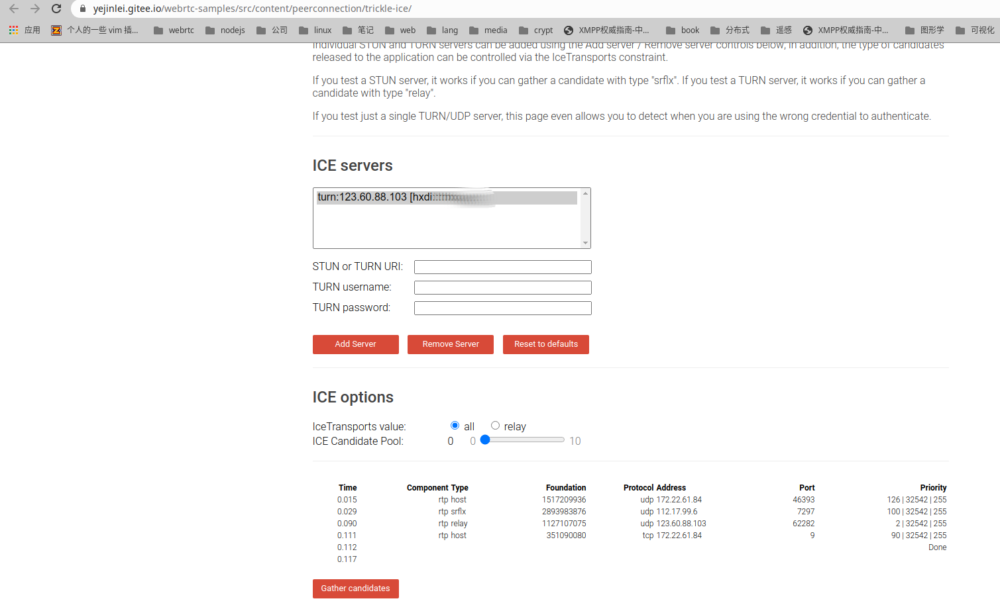

##### 17) [Do an ICE restart](https://yejinlei.gitee.io/webrtc-samples/src/content/peerconnection/restart-ice/)

##### 18) [Web Audio output as input to peer connection](https://yejinlei.gitee.io/webrtc-samples/src/content/peerconnection/webaudio-input/)

##### 19) [Peer connection as input to Web Audio](https://yejinlei.gitee.io/webrtc-samples/src/content/peerconnection/webaudio-output/)

##### 20) [Measure how long renegotation takes](https://yejinlei.gitee.io/webrtc-samples/src/content/peerconnection/negotiate-timing/)

#### 5. [RTCDataChannel](https://developer.mozilla.org/en-US/docs/Web/API/RTCDataChannel), 数据通道

##### 1) [Transmit text](https://yejinlei.gitee.io/webrtc-samples/src/content/datachannel/basic/)

##### 2) [Transfer a file](https://yejinlei.gitee.io/webrtc-samples/src/content/datachannel/filetransfer/)

##### 3) [Transfer data](https://yejinlei.gitee.io/webrtc-samples/src/content/datachannel/datatransfer/)

##### 4) [Messaging](https://yejinlei.gitee.io/webrtc-samples/src/content/datachannel/messaging/)

#### 6. Insertable Streams, 可插入流

##### 1) [End to end encryption using WebRTC Insertable Streams](https://yejinlei.gitee.io/webrtc-samples/src/content/insertable-streams/endtoend-encryption)

##### 2) [Video analyzer using WebRTC Insertable Streams](https://yejinlei.gitee.io/webrtc-samples/src/content/insertable-streams/video-analyzer)

##### 3) [Video processing using MediaStream Insertable Streams](https://yejinlei.gitee.io/webrtc-samples/src/content/insertable-streams/video-processing)

##### 4) [Audio processing using MediaStream Insertable Streams](https://yejinlei.gitee.io/webrtc-samples/src/content/insertable-streams/audio-processing)

### 2 Pion examples

#### 1. Media API

```go
//准备Config
config := webrtc.Configuration{
ICEServers: []webrtc.ICEServer{
		{
        	URLs: []string{"stun:stun.l.google.com:19302"},
    	},
	},
}


//创建PeerConnection
peerConnection, err := webrtc.NewPeerConnection(config)
if err != nil {
    panic(err)
}
defer func() {
    if cErr := peerConnection.Close(); cErr != nil {
        fmt.Printf("cannot close peerConnection: %v\n", cErr)
    }
}()
```

#### 2. Data Channel API

##### 1) [Pion to Pion](https://github.com/pion/webrtc/blob/master/examples/pion-to-pion)

#### 3. Miscellaneous
#### 4. 参考资料

1. [pion/webrtc examples](https://github.com/pion/webrtc/tree/master/examples)
2. [pion/example-webrtc-applications](https://github.com/pion/example-webrtc-applications)

### 3 [WebRTC.rs examples](https://github.com/webrtc-rs/examples)
### 4 [node-webrtc examples](https://github.com/node-webrtc/node-webrtc-examples)

---

## 四. 开源解决方案

### 1 Stun/Turn服务器 - coturn(TODO)

4. 参考资料

- [快速理解P2P技术中的NAT穿透原理](http://www.52im.net/thread-1055-1-1.html)
- [Netmanias 对于 RFC 3489 与 STUN (RFC 5389/5780) 的对比解读](https://netmanias.com/en/post/techdocs/6065/nat-network-protocol/stun-rfc-3489-vs-stun-rfc-5389-5780)
- [http://www.ctiforum.com/news/guonei/524504.html](http://www.ctiforum.com/news/guonei/524504.html)
- [WebRTC TURN协议初识及turnserver实践](https://zhuanlan.zhihu.com/p/71025431)
- [WebRTC音视频传输基础：NAT穿透](https://blog.jianchihu.net/webrtc-av-transport-basis-nat-traversal.html)
- [RFC3489 STUN之客户端所处环境探测流程与部分属性含义说明](https://www.cnblogs.com/oldmanlv/p/5643060.html)
- [[NAPT(以此类型讨论)](https://www.cnblogs.com/freezlz/p/5483231.html)](https://www.cnblogs.com/freezlz/p/5483231.html)
- [STUN (RFC 3489) vs. STUN (RFC 5389/5780)](https://www.netmanias.com/en/?m=view&id=techdocs&tag=248&no)
- [NAT Behavior Discovery Using Classic STUN (RFC 3489)](https://www.netmanias.com/en/post/techdocs/6066/nat-network-protocol/nat-behavior-discovery-using-classic-stun-rfc-3489)
- [NAT Behavioral Requirements, as Defined by the IETF (RFC 4787) - Part 1. Mapping Behavior](https://www.netmanias.com/en/?m=view&id=techdocs&no=6058&tag=248)
- [NAT Behavioral Requirements, as Defined by the IETF (RFC 4787) - Part 2. Filtering Behavior](https://www.netmanias.com/en/?m=view&id=techdocs&tag=248&no=6062)

​		*开源项目*
- [pion/turn](https://github.com/pion/turn)

- [wolfcs/stund](https://gitee.com/wolfcs/stund)


#### ☞ stun/turn服务器工具  - turnserver启动及trickle-ice页面测试

- 命令行方式

  - turnserver -n -o -u **user:userpassword** -a -r **123.60.88.103:3478** #-n 不使用配置文件；-o 后台运行；-u 用户名:密码； -a 长期验证；  -r 公网IP:协议端口

    ```shell
    #打开浏览器
    chromium-browser --no-sandbox https://yejinlei.gitee.io/webrtc-samples/src/content/peerconnection/trickle-ice/
    
    #人工输入
    STUN or TURN URI: turn:123.60.88.103:3478    #这里使用turn:xxx.xxx.xxx.xxx & IceTransports value: 选择all, 会同时测试stun和turn协议, 如果使用stun, 只测试stun 
    TURN username:user
    TURN password:userpassword
    
    #返回信息
    Time	Component	Type	Foundation	Protocol Address	  Port	Priority
    0.007	rtp	host	1517209936	udp	172.22.61.84	52834	126 | 32542 | 255
    0.026	rtp	srflx	2893983876	udp	112.17.99.6	    51413	100 | 32542 | 255
    0.094	rtp	relay	659902998	udp	192.168.0.52	49338	2 | 32542 | 255
    0.107	rtp	host	351090080	tcp	172.22.61.84	    9	90 | 32542 | 255
    0.108	                                                                 Done
    ```
    *备注说明 :*

    - host, 浏览器所在本机IP
    - srflx, 浏览器所在外网IP, reflexive
    - relay, turn服务器所在内网主机IP
    - udp/tcp,  stun协议同时支持udp和tcp, 上述结果表明tcp协议只获取host IP, udp可以获取所有IP

  - turnserver -n -o -u user:userpassword -a -r 123.60.88.103:3478 **--stun-only**    #只开启stun

  - turnserver -n -o -u user:userpassword -a -r 123.60.88.103:3478 **--no-stun**        #只开启turn

- 使用turnserver.conf配置文件方式

```shell
#网络接口设备
relay-device=eth0
listening-ip=192.168.0.188
#stun/turn监听端口
listening-port=3478
tls-listening-port=5349
#公网IP/内网主机IP
external-ip=123.60.88.103/192.168.0.188
#webrtc必须
lt-cred-mech
#openssl req -x509 -newkey rsa:2048 -keyout /etc/turn_server_pkey.pem -out /etc/turn_server_cert.pem -days 99999 -nodes
cert=/etc/turn_server_cert.pem
pkey=/etc/turn_server_pkey.pem
pidfile=”/var/run/turnserver.pid”
mobility
#帐号/密码
user=hxdi:pass
#webrtc必须, 任意设置
realm=hxdi
```

#### ☞ coturn其他工具

##### nat类型发现工具 - turnutils_natdiscovery

```sh
turnutils_natdiscovery -m -f stun.stunprotocol.org     #18.191.223.12是stun.stunprotocol.org真实IP              

-= Mapping Behavior Discovery =-

========================================
RFC 5780 response 1
No ALG: Mapped == XOR-Mapped
0: IPv4. Response origin: : 18.191.223.12:3478
0: IPv4. Other addr: : 18.219.110.18:3479
0: IPv4. UDP reflexive addr: 202.101.191.36:10006
0: IPv4. Local addr: : 0.0.0.0:47291

========================================
RFC 5780 response 2
No ALG: Mapped == XOR-Mapped
0: IPv4. Response origin: : 18.219.110.18:3478
0: IPv4. Other addr: : 18.191.223.12:3479
0: IPv4. UDP reflexive addr: 202.101.191.36:10007
0: IPv4. Local addr: : 0.0.0.0:47291

========================================
RFC 5780 response 3
No ALG: Mapped == XOR-Mapped
1: IPv4. Response origin: : 18.191.223.12:3479
1: IPv4. Other addr: : 18.219.110.18:3478
1: IPv4. UDP reflexive addr: 202.101.191.36:10008
1: IPv4. Local addr: : 0.0.0.0:47291

========================================
NAT with Address and Port Dependent Mapping!       #
========================================

-= Filtering Behavior Discovery =-

========================================
RFC 5780 response 4
No ALG: Mapped == XOR-Mapped
1: IPv4. Response origin: : 18.191.223.12:3478
1: IPv4. Other addr: : 18.219.110.18:3479
1: IPv4. UDP reflexive addr: 202.101.191.36:10012
1: IPv4. Local addr: : 0.0.0.0:48128
STUN receive timeout..
STUN receive timeout..

========================================
NAT with Address and Port Dependent Filtering!
========================================

#@@@@@@@@@@@@@@@@@@@@@@@@@@@@@@@@@@@@@@@@@@@@@@@@@@@@@@@@@@@@@@@@@@@@@@@@@@@

turnutils_natdiscovery -m -f 123.60.88.103 -L 172.22.61.84       

-= Mapping Behavior Discovery =-

========================================
RFC 5780 response 1
No ALG: Mapped == XOR-Mapped
0: IPv4. Response origin: : 192.168.0.52:3478
0: IPv4. Other addr: : 192.168.0.52:3479
0: IPv4. UDP reflexive addr: 202.101.191.36:9452
0: IPv4. Local addr: : 0.0.0.0:55249
STUN receive timeout..

========================================
NAT with Endpoint Independent Mapping!
========================================

-= Filtering Behavior Discovery =-

========================================
RFC 5780 response 2
No ALG: Mapped == XOR-Mapped
3: IPv4. Response origin: : 192.168.0.52:3478
3: IPv4. Other addr: : 192.168.0.52:3479
3: IPv4. UDP reflexive addr: 202.101.191.36:9471
3: IPv4. Local addr: : 0.0.0.0:46084
STUN receive timeout..
STUN receive timeout..

========================================
NAT with Address and Port Dependent Filtering!
========================================
```


##### stun客户端工具 - turnutils_stunclient

```sh
turnutils_stunclient stun.stunprotocol.org
========================================
RFC 5780 response 1
0: IPv4. Response origin: : 18.191.223.12:3478        #18.191.223.12是stun.stunprotocol.org真实IP
0: IPv4. Other addr: : 18.219.110.18:3479
0: IPv4. UDP reflexive addr: 202.101.191.36:4758

nslookup stun.stunprotocol.org
Server:         8.8.8.8
Address:        8.8.8.8#53

Non-authoritative answer:
Name:   stun.stunprotocol.org
Address: 18.191.223.12
Name:   stun.stunprotocol.org
Address: 2600:1f16:8c5:101::108

#@@@@@@@@@@@@@@@@@@@@@@@@@@@@@@@@@@@@@@@@@@@@@@@@@@@@@@@@@@@@@@@@@@@@@@@@@@@

turnutils_stunclient 123.60.88.103        
========================================
RFC 5780 response 1
0: IPv4. Response origin: : 192.168.0.52:3478       #192.168.0.52是内网主机IP, 123.60.88.103是映射地址
0: IPv4. Other addr: : 192.168.0.52:3479
0: IPv4. UDP reflexive addr: 202.101.191.36:5028
```


##### turn客户端工具 - turnutils_uclient

```sh
turnutils_uclient -u user -w userpassword -L 172.22.61.84 -v 123.60.88.103
========================================
0: IPv4. Connected from: 172.22.61.84:45169
0: IPv4. Connected to: 123.60.88.103:3478
0: allocate sent
0: allocate response received: 
0: allocate sent
0: allocate response received: 
0: success
0: IPv4. Received relay addr: 192.168.0.52:49916
0: clnet_allocate: rtv=16712490065460457036
0: refresh sent
0: refresh response received: 
0: success
0: IPv4. Connected from: 172.22.61.84:43969
0: IPv4. Connected to: 123.60.88.103:3478
0: IPv4. Connected from: 172.22.61.84:44946
0: IPv4. Connected to: 123.60.88.103:3478
0: allocate sent
0: allocate response received: 
0: allocate sent
0: allocate response received: 
0: success
0: IPv4. Received relay addr: 192.168.0.52:49917
0: clnet_allocate: rtv=0
0: refresh sent
0: refresh response received: 
0: success
0: allocate sent
0: allocate response received: 
0: allocate sent
0: allocate response received: 
0: success
0: IPv4. Received relay addr: 192.168.0.52:61004
0: clnet_allocate: rtv=6257617103726301502
0: refresh sent
0: refresh response received: 
0: success
0: channel bind sent
0: cb response received: 
0: channel bind: error 403 (Forbidden IP)
```

##### turn回显工具 - turnutils_peer,  需要turnutils_uclient配合

```sh
#开启turn服务器, 参考turnserver, 地址123.60.88.103 

#在机器A上, 开启turnutils_peer, 地址10.13.4.102
./turnutils_peer -v 123.60.88.103

#在机器B上, 使用turnutils_uclient, 地址172.22.61.84, 与A建立连接后, 会收到A发送的消息
turnutils_uclient -u user -w  uerpassword -L 172.22.61.84 -v 123.60.88.103 -e 10.13.4.102  #-e 10.13.4.102, 此处为A内网主机IP
========================================
0: IPv4. Connected from: 172.22.61.84:50104                               
0: IPv4. Connected to: 123.60.88.103:3478                               
0: allocate sent                                                         
0: allocate response received:             
0: allocate sent                                                         
0: allocate response received:
0: success
0: IPv4. Connected from: 172.22.61.84:56766
0: IPv4. Connected to: 123.60.88.103:3478
0: IPv4. Connected from: 172.22.61.84:41803
0: IPv4. Connected to: 123.60.88.103:3478
0: allocate sent
0: allocate response received: 
0: allocate sent
0: allocate response received: 
0: success
0: IPv4. Received relay addr: 192.168.0.52:64033
0: clnet_allocate: rtv=0
0: refresh sent
0: refresh response received: 
0: success
0: allocate sent
0: allocate response received: 
0: allocate sent
0: allocate response received: 
0: success
0: IPv4. Received relay addr: 192.168.0.52:57208
0: clnet_allocate: rtv=12521194767362737480
0: refresh sent
0: refresh response received: 
0: success
0: channel bind sent
0: cb response received: 
0: success: 0x64d4
0: channel bind sent
0: cb response received: 
0: success: 0x64d4
0: channel bind sent
0: cb response received: 
0: success: 0x5d9f
0: channel bind sent
0: cb response received: 
0: success: 0x5d9f
0: channel bind sent
0: cb response received: 
0: success: 0x7761
1: Total connect time is 1
1: start_mclient: msz=2, tot_send_msgs=0, tot_recv_msgs=0, tot_send_bytes ~ 0, tot_recv_bytes ~ 0
2: start_mclient: msz=2, tot_send_msgs=0, tot_recv_msgs=0, tot_send_bytes ~ 0, tot_recv_bytes ~ 0
3: start_mclient: msz=2, tot_send_msgs=0, tot_recv_msgs=0, tot_send_bytes ~ 0, tot_recv_bytes ~ 0
4: start_mclient: msz=2, tot_send_msgs=0, tot_recv_msgs=0, tot_send_bytes ~ 0, tot_recv_bytes ~ 0
5: start_mclient: msz=2, tot_send_msgs=5, tot_recv_msgs=0, tot_send_bytes ~ 500, tot_recv_bytes ~ 0
6: start_mclient: msz=2, tot_send_msgs=10, tot_recv_msgs=0, tot_send_bytes ~ 1000, tot_recv_bytes ~ 0
7: start_mclient: msz=2, tot_send_msgs=10, tot_recv_msgs=0, tot_send_bytes ~ 1000, tot_recv_bytes ~ 0
8: start_mclient: msz=2, tot_send_msgs=10, tot_recv_msgs=0, tot_send_bytes ~ 1000, tot_recv_bytes ~ 0
9: start_mclient: msz=2, tot_send_msgs=10, tot_recv_msgs=0, tot_send_bytes ~ 1000, tot_recv_bytes ~ 0
10: start_mclient: msz=2, tot_send_msgs=10, tot_recv_msgs=0, tot_send_bytes ~ 1000, tot_recv_bytes ~ 0
11: start_mclient: msz=2, tot_send_msgs=10, tot_recv_msgs=0, tot_send_bytes ~ 1000, tot_recv_bytes ~ 0
12: start_mclient: msz=2, tot_send_msgs=10, tot_recv_msgs=0, tot_send_bytes ~ 1000, tot_recv_bytes ~ 0
13: start_mclient: msz=2, tot_send_msgs=10, tot_recv_msgs=0, tot_send_bytes ~ 1000, tot_recv_bytes ~ 0
14: start_mclient: msz=2, tot_send_msgs=10, tot_recv_msgs=0, tot_send_bytes ~ 1000, tot_recv_bytes ~ 0
14: done, connection 0x7fbd55223010 closed.
15: start_mclient: msz=1, tot_send_msgs=10, tot_recv_msgs=0, tot_send_bytes ~ 1000, tot_recv_bytes ~ 0
15: done, connection 0x7fbd558e3010 closed.
15: start_mclient: tot_send_msgs=10, tot_recv_msgs=0
15: start_mclient: tot_send_bytes ~ 1000, tot_recv_bytes ~ 0
15: Total transmit time is 14
15: Total lost packets 10 (100.000000%), total send dropped 0 (0.000000%)
15: Average round trip delay 0.000000 ms； min = 4294967295 ms, max = 0 ms
15: Average jitter -nan ms； min = 4294967295 ms, max = 0 ms
```


### 2 [webRTC.io](https://github.com/webRTC-io)

### 3 [SimpleWebRTC](https://github.com/simplewebrtc/SimpleWebRTC)

### 4 Kurent分析与实践

#### 4.1 源码分析


#### 4.2 部署

- 部署stun/turn(略)

- 启动KMS服务, 容器方式

  ```sh
  #运行KMS, run_kms.sh, 开启ws端口8888
  sudo docker run --privileged --network=host --rm \                                                          
      -e DOMAIN_OR_PUBLIC_IP=123.60.88.103 \
      -e KMS_STUN_IP="123.60.88.103" \
      -e KMS_STUN_PORT="3478" \
      -e CERTIFICATE_TYPE=selfsigned \
      -e KMS_TURN_URL=hxdi:pass@123.60.88.103:3478 \
      -v /var/run/docker.sock:/var/run/docker.sock \
  yejinlei/kurento-media-server
  ```
  
- 设置java环境

  ```sh
  #curl -s "https://get.sdkman.io" | zsh
  #source ~/.sdkman/bin/sdkman-init.sh
  #sdk install java 8.0.302-open
  #sudo apt install maven
  sdk use java 8.0.302-open
  ```
  
- 启动KAS服务

  ```sh
  //kurento-group-call, 开启https端口8443
  sudo mvn -U clean spring-boot:run -Dkms.url=ws://127.0.0.1:8888/kurento -DKMS_STUN_IP=123.60.88.103 -DKMS_STUN_PORT=3478 -DKMS_TURN_URL=hxdi:pass@123.60.88.103:3478
  ```

### 5 Jitsi分析与实践


#### 5.1 分析与定制

> 总入口: https://gitee.com/yejinlei/jitsi-meet-all,  下载所有子项目 git clone --recurse-submodules https://gitee.com/yejinlei/jitsi-meet-all 
>
> |目录docker-jitsi-meet:   https://gitee.com/yejinlei/docker-jitsi-meet.git   #容器制作及部署工程
>
> ​		|base,  rootfs/usr/bin/debs/*.deb 含制作容器时需要用到的包, 即包仓库
>
> ​		|web, web服务容器制作
>
> ​		|prosody, xmpp服务容器制作
>
> ​		|jvb, sfu服务容器制作
>
> ​		|jicofo, 会议服务容器制作
>
> |目录jitsi-meet: https://gitee.com/yejinlei/jitsi-meet.git                                    # web服务的统一构建工程, 最终生成deb需要放入docker-jitsi-meet
>
> |目录lib-jitsi-meet: https://gitee.com/yejinlei/lib-jitsi-meet.git                     #Web服务核心代码 , 最终生成结果文件需要放入jitsi-meet
>
> |目录jitsi-videobridge: https://gitee.com/yejinlei/jitsi-videobridge.git          #Video  SFU服务 , 最终生成结果文件需要放入docker-jitsi-meet
>
> |目录jicofo: https://gitee.com/yejinlei/jicofo.git                                                      #会议服务, 最终生成结果文件需要放入docker-jitsi-meet

##### 5.1.0 容器编排(docker-jitsi-meet)

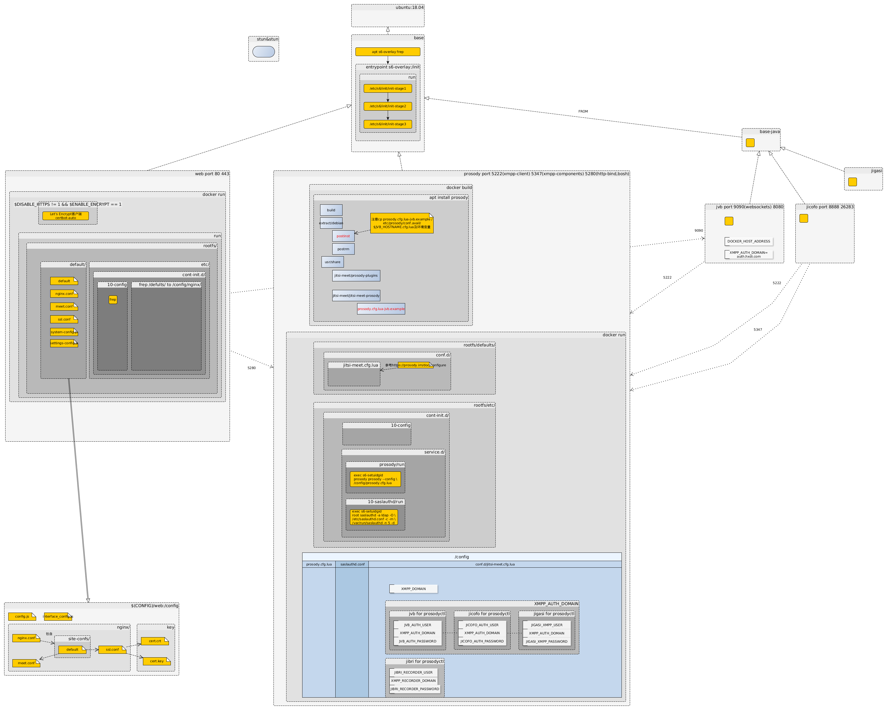

##### 5.1.1 Web, 内置web服务器及Web网页含WebRTC Client服务

###### 1) Web业务构建

- Web核心业务源码构建(目录lib-jitsi-meet)
  - ```shell
    nvm use v15.0.1
    npm install -g npm
    npm install webpack -g
    npm install --save-dev webpack-cli -g
    npm i
    ```
  
- 统一源码构建(目录jitsi-meet)

  - ```shell
    nvm use v15.0.1
    npm install -g npm
    npm install --save webpack webpack-cli
    make all
    ```
  
 - 原库中缺少deploy-local.sh文件, 用于拷贝文件到deb制作目录

    - 拷贝jitsi-meet-web包所需文件
    - 拷贝jitsi-meet-web-config包所需文件
    - 拷贝prosody-plugins包所需文件

###### 2) Web服务打包及容器化

- 制作deb(目录jitsi-meet)
  - 准备文件
    - jitsi-meet-web包主要文件
      - index.html
      - interface_config.js
      - pwa-worker.js
      - manifest.json
      - connection_optimization
        - do_external_connect.js
      - libs/*.js *.wasm
      - scripts/*.sh
      - static
        - close.js
        - close3.js
    - jitsi-meet-web-config包文件
      - config.js
      - jitsi-meet.example #nginx的站点配置, 对接jvb服务
    - dpkg制作deb
- 容器制作(目录docker-jitsi-meet/web), 参考Dockerfiler
  - 安装cron, nginx-extras
  - 安装官方jitsi-meet-web, jitsi-meet-web-config #web业务及nginx配置
  - 安装socat  #acme.sh脚本中会用到, acme.sh用于申请免费ssl证书-let's encrypt

- 容器运行
  - 容器中的PID1程序, s6
    - rootfs/etc/**cont-init.d**/10-config     #初始化阶段
      - tpl /defaults/nginx.conf > /config/nginx/nginx.conf
      - tpl /defaults/meet.conf > /config/nginx/meet.conf
      - tpl /defaults/ssl.conf > /config/nginx/ssl.conf
      - tpl /defaults/default > /config/nginx/site-confs/default
      - tpl /defaults/system-config.js >> /config/config.js
      - tpl /defaults/settings-config.js >> /config/config.js
    - rootfs/etc/**services.d**/cron                  #运行阶段
    - rootfs/etc/**services.d**/nginx                #运行阶段
  - 环境变量(通过命令查找: grep -nr '.Env'), 很多功能开关通过环境变量动态设置
    - **nginx.conf**, nginx全局配置文件
      - NGINX_WORKER_PROCESSES, 默认: 4
      - NGINX_WORKER_CONNECTIONS, 默认: 768
      - NGINX_RESOLVER, 默认:127.0.0.11
    - **default**, 所有站点默认配置
      - [x] DISABLE_HTTPS
      - [x] ENABLE_HTTP_REDIRECT
      - [x] ENABLE_IPV6
    - **meet.conf**, 站点配置文件
      - [x] ENABLE_COLIBRI_WEBSOCKET, 默认: 1
      - [x] ENABLE_XMPP_WEBSOCKET, 默认: 1
      - [ ] DEPLOYMENTINFO_SHARD, 默认: 1
      - [ ] ENABLE_FLOC, 默认: 0
      - [x] XMPP_BOSH_URL_BASE
      - [x] XMPP_DOMAIN 
      - [ ] ETHERPAD_URL_BASE
    - **ssl.conf**, nginx支持https配置文件
      - [x] ENABLE_LETSENCRYPT, 默认: 0
      - [ ] LETSENCRYPT_DOMAIN
      - [ ] ENABLE_HSTS, 默认: 1

###### 4) 参考资料

- [npm中文文档](https://www.npmjs.cn/)
- [Webpack](https://webpack.js.org/) 及 [中文文档](https://webpack.docschina.org/)
- [Nginx WebSocket proxying](http://nginx.org/en/docs/http/websocket.html)
- [Developer Guide (Web)](https://jitsi.github.io/handbook/docs/dev-guide/dev-guide-web)
- [构建软件包](https://www.debian.org/doc/manuals/maint-guide/build.zh-cn.html)
- [Debian 新维护者手册](https://www.debian.org/doc/manuals/maint-guide/index.zh-cn.html)

##### 5.1.2 Prosody, 提供XMPP信令交换及认证服务
###### 1) Prosody, XMPP服务器

- **prosody core plugins**, [doc](https://prosody.im/doc/modules), [code](https://github.com/bjc/prosody/tree/master/plugins)

  - [pubsub](https://prosody.im/doc/modules/mod_pubsub)模块

  - [ping](https://prosody.im/doc/modules/mod_ping)模块

  - roster模块

  - saslauth模块

  - tls模块

  - dialback模块

  - disco模块

  - private模块

  - vcard模块

  - limits模块

  - version模块

  - uptime模块

  - time模块

  - pep模块

  - register模块

  - admin_adhoc模块

  - posix模块

  - websocket模块

    - nginx方向代理

    - ```nginx
      location /xmpp-websocket {
          proxy_pass http://localhost:5280/xmpp-websocket;
          proxy_http_version 1.1;
          proxy_set_header Connection "Upgrade";
          proxy_set_header Upgrade $http_upgrade;
      
          proxy_set_header Host $host;
          proxy_set_header X-Forwarded-For $proxy_add_x_forwarded_for;
          proxy_set_header X-Forwarded-Proto $scheme;
          proxy_read_timeout 900s;
      }
      ```

    - 参考资料

      - [prosody WebSockets](https://prosody.im/doc/websocket)
    
  - [bosh](https://prosody.im/doc/modules/mod_bosh)模块

    - nginx反向代理

    - ```nginx
      location /http-bind {
          proxy_pass  http://localhost:5280/http-bind;
          proxy_set_header Host $host;
          proxy_set_header X-Forwarded-For $proxy_add_x_forwarded_for;
          proxy_set_header X-Forwarded-Proto $scheme;
          proxy_buffering off;
          tcp_nodelay on;
      }
      ```

    - 参考资料

      - [Setting up a BOSH server](https://prosody.im/doc/setting_up_bosh)

- **jitsi plugins**([jitsi-meet/resources/prosody-plugins](https://gitee.com/yejinlei/jitsi-meet/tree/HXDI/resources/prosody-plugins))

  - ├── ext_events.lib.lua
    ├── mod_auth_jitsi-anonymous.lua
    ├── mod_auth_token.lua
    ├── mod_av_moderation.lua
    ├── mod_av_moderation_component.lua
    ├── mod_client_proxy.lua
    ├── mod_conference_duration.lua
    ├── mod_conference_duration_component.lua
    ├── mod_external_services.lua
    ├── mod_filter_iq_jibri.lua
    ├── mod_filter_iq_rayo.lua
    ├── mod_jiconop.lua
    ├── mod_jitsi_session.lua
    ├── mod_limits_exception.lua
    ├── mod_muc_allowners.lua
    ├── mod_muc_call.lua
    ├── mod_muc_domain_mapper.lua
    ├── mod_muc_lobby_rooms.lua
    ├── mod_muc_max_occupants.lua
    ├── mod_muc_meeting_id.lua
    ├── mod_muc_poltergeist.lua
    ├── mod_muc_size.lua
    ├── mod_muc_transcription_filter.lua
    ├── mod_polls.lua
    ├── mod_poltergeist_component.lua
    ├── mod_presence_identity.lua
    ├── mod_reservations.lua
    ├── mod_roster_command.lua
    ├── mod_roster_command.patch
    ├── mod_smacks.lua
    ├── mod_speakerstats.lua
    ├── mod_speakerstats_component.lua
    ├── mod_token_verification.lua
    ├── mod_turncredentials.lua
    ├── mod_websocket_session_event.patch
    ├── muc_owner_allow_kick.patch
    ├── poltergeist.lib.lua
    ├── token
    │   └── util.lib.lua
    └── util.lib.lua

###### 2) SASL认证(Simple Authentication and Security Layer, 简单验证和安全层, 一种用来扩充C/S模式验证能力的机制)
###### 3) 容器化

- 容器制作, 参考Dockerfile
  - 安装lua5.2及lua相关库
  - 安装jitsi-meet-prosody*.deb
    - 用户管理, 使用 “prosodyctl adduser”
- 容器运行
  - 容器中的PID1程序, s6
    - rootfs/etc/**cont-init.d**/10-config     #初始化阶段, 结合环境变量及tpl模板, 配置prosody
      - tpl /defaults/saslauthd.conf > /etc/saslauthd.conf
      - tpl /defaults/prosody.cfg.lua > /config/prosody.cfg.lua
      - tpl /defaults/conf.d/jitsi-meet.cfg.lua > /config/conf.d/jitsi-meet.cfg.lua
    - rootfs/etc/**services.d**/prosody                      #运行阶段
    - rootfs/etc/**services.d**/10-saslauthd           #运行阶段
  - 环境变量
    - **prosody.cfg.lua**
      - LOG_LEVEL, 默认: info
      - GLOBAL_MODULES, 用于设置prosody插件, 例如: bosh, http_files
      - GLOBAL_CONFIG
    - **saslauthd.conf**
      - [ ] AUTH_TYPE, 默认: internal, 其他还有ldap, jwt
      - [ ] LDAP_URL
      - [ ] LDAP_BASE
      - [ ] LDAP_BINDDN
      - [ ] LDAP_BINDPW
      - [ ] LDAP_FILTER
      - [ ] LDAP_VERSION, 默认: 3
      - [ ] LDAP_AUTH_METHOD, 默认: bind
      - [ ] LDAP_USE_TLS, 默认: 0
      - [x] XMPP_DOMAIN, 共用
      - [ ] LDAP_TLS_CHECK_PEER, 默认: 0
      - [ ] LDAP_TLS_CACERT_FILE, 默认: /etc/ssl/certs/ca-certificates.crt
      - [ ] LDAP_TLS_CACERT_DIR, 默认: /etc/ssl/certs
      - [ ] LDAP_TLS_CIPHERS
      - [ ] LDAP_START_TLS, 默认: 0
    - **jitsi-meet.cfg.lua**
      - [x] XMPP_MODULES
      - [x] ENABLE_AUTH, 默认: 0, 身份认证开关
      - [ ] ENABLE_GUESTS. 默认: 0
      - [ ] AUTH_TYPE, 默认: internal, 共用
      - [ ] JWT_ASAP_KEYSERVER, 默认:
      - [ ] JWT_ALLOW_EMPTY, 默认: 0
      - [ ] JWT_AUTH_TYPE, 默认: token
      - [ ] JWT_TOKEN_AUTH_MODULE, 默认: token_verification
      - [ ] JWT_ACCEPTED_ISSUERS
      - [ ] JWT_ACCEPTED_AUDIENCES
      - [ ] JWT_APP_ID
      - [ ] JWT_APP_SECRET
      - [ ] JWT_ASAP_KEYSERVER
      - [x] ENABLE_LOBBY, 默认: 0
      - [ ] ENABLE_AV_MODERATION, 默认: 0
      - [ ] DISABLE_POLLS, 默认: false
      - [x] ENABLE_XMPP_WEBSOCKET, 默认: 1
      - [x] PUBLIC_URL, 默认: https://localhost:8443
      - [x] TURNS_HOST
      - [x] TURN_PORT, 默认: 443
      - [x] TURNS_PORT, 默认: 443
      - [x] JICOFO_AUTH_USER
      - [x] JVB_AUTH_USER
      - [x] TURN_CREDENTIALS
      - [x] XMPP_MUC_DOMAIN
      - [x] XMPP_CROSS_DOMAIN, 默认: “”
      - [x] XMPP_DOMAIN
      - [x] XMPP_AUTH_DOMAIN
      - [x] XMPP_GUEST_DOMAIN
      - [x] XMPP_RECORDER_DOMAIN
      - [x] XMPP_INTERNAL_MUC_DOMAIN, 默认: muc
      - [x] XMPP_INTERNAL_MUC_MODULES

###### 3) 参考资料

- [xmpp clients](https://xmpp.org/software/clients/)
- [Real-Time Communications Quick Start Guide](http://rtcquickstart.org/guide/multi/)
- [prosody webSockets](https://prosody.im/doc/websocket)
- [prosody  bosh](https://prosody.im/doc/setting_up_bosh)
- [简单验证和安全层 (Simple Authentication and Security Layer, SASL) 介绍](https://docs.oracle.com/cd/E26926_01/html/E25912/sasl.intro.20.html)
- ‹‹XMPP权威指南›› book
- ‹‹Practical Protocols XMPP›› book
- [xmpp-ftw/xmpp-ftw](https://github.com/xmpp-ftw/xmpp-ftw)

##### 5.1.3 jicofo, 提供会议管理服务

###### 1) 容器化
- 容器运行
  - 环境变量
    - [ ] SENTRY_DSN, 默认: 0
    - [x] ENABLE_AUTH, 默认: 0
    - [x] ENABLE_SCTP, 默认: 0
    - [x] AUTH_TYPE, 默认: internal
    - [ ] ENABLE_RECORDING, 默认: 0
    - [ ] ENABLE_OCTO, 默认: 0
    - [ ] ENABLE_AUTO_LOGIN, 默认: 1
    - [x] XMPP_DOMAIN
    - [x] XMPP_AUTH_DOMAIN
    - [ ] MAX_BRIDGE_PARTICIPANTS
    - [ ] BRIDGE_AVG_PARTICIPANT_STRESS
    - [ ] BRIDGE_STRESS_THRESHOLD
    - [ ] OCTO_BRIDGE_SELECTION_STRATEGY
    - [ ] JICOFO_ENABLE_BRIDGE_HEALTH_CHECKS
    - [x] JVB_BREWERY_MUC, brewery-jid = "{{ .Env.JVB_BREWERY_MUC }}@{{ .Env.XMPP_INTERNAL_MUC_DOMAIN }}"
    - [x] XMPP_INTERNAL_MUC_DOMAIN
    - [x] ENABLE_CODEC_VP8 
    - [x] ENABLE_CODEC_VP9
    - [x] ENABLE_CODEC_H264
    - [ ] ENABLE_AUTO_OWNER 
    - [ ] JICOFO_CONF_INITIAL_PARTICIPANT_WAIT_TIMEOUT
    - [ ] JICOFO_CONF_SINGLE_PARTICIPANT_TIMEOUT 
    - [x] JICOFO_ENABLE_HEALTH_CHECKS
    - [ ] JIBRI_REQUEST_RETRIES
    - [ ] JIBRI_PENDING_TIMEOUT
    - [ ] JIGASI_SIP_URI
    - [ ] JICOFO_SHORT_ID, 默认: 1
    - [x] JICOFO_AUTH_USER
    - [x] JICOFO_AUTH_PASSWORD
    - [x] XMPP_MUC_DOMAIN
    - [x] JICOFO_RESERVATION_ENABLED, 默认: false
    - [ ] JICOFO_RESERVATION_REST_BASE_URL

###### 2) 参考资料

##### 5.1.4 JVB, 提供SFU服务

###### 1) 容器化

- 容器运行
  - 环境变量
    - [ ] ENABLE_COLIBRI_WEBSOCKET, 默认: 1
    - [ ] ENABLE_OCTO, 默认: 0
    - [ ] JVB_TCP_PORT, 默认: 4443
    - [ ] JVB_TCP_MAPPED_PORT, 默认: JVB_TCP_PORT
    - [x] PUBLIC_URL, 默认: https://localhost:8443
    - [ ] JVB_WS_DOMAIN, 默认: PUBLIC_URL_DOMAIN
    - [ ] JVB_WS_SERVER_ID, 默认: LOCAL_ADDRESS
    - [ ] JVB_PORT
    - [ ] JVB_TCP_HARVESTER_DISABLED, 默认: true
    - [x] XMPP_SERVER
    - [x] XMPP_AUTH_DOMAIN
    - [x] JVB_AUTH_USER
    - [x] JVB_AUTH_PASSWORD
    - [x] JVB_BREWERY_MUC,  MUC_JIDS = "{{ .Env.JVB_BREWERY_MUC }}@{{ .Env.XMPP_INTERNAL_MUC_DOMAIN }}"
    - [x] XMPP_INTERNAL_MUC_DOMAIN
    - [ ]  HOSTNAME
    - [ ] JVB_OCTO_BIND_ADDRESS, 默认: 0.0.0.0
    - [ ] JVB_OCTO_PUBLIC_ADDRESS
    - [ ] JVB_OCTO_BIND_PORT, 默认: 4096
    - [ ] JVB_OCTO_REGION, 默认: europe
    - [x] JVB_STUN_SERVERS
    - [ ] SENTRY_DSN, 默认: 0
    - [x] DOCKER_HOST_ADDRESS
    - [x] LOCAL_ADDRES

###### 2) 参考资料

### 6 Janus分析与实践

#### 6.1 源码分析

##### 6.1.1 核心代码

- Janus组件及架构
  - 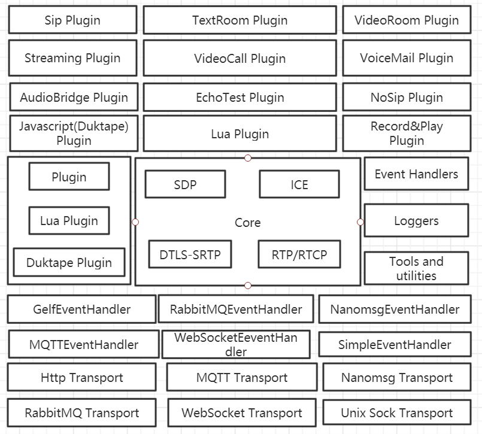

- 源码关系(By Doxygen)
  - 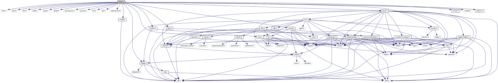
- 重要流程和机制
  - main函数入口流程, [janus.c](https://github1s.com/meetecho/janus-gateway/blob/master/janus.c)
    - cmdline_parser函数, 解析命令参数
    - janus_config_parse函数, 解析配置文件
    - janus_config_get_create函数, 创建categories大分类
    - janus_events_init函数, 初始化事件
    - janus_log_init函数
    - janus_auth_init函数
    - janus_ice_init函数
    - SSL_library_init函数
    - janus_dtls_srtp_init函数
    - janus_sctp_init函数
    - janus_events_init函数
  - 配置管理
    - janus_config_get_create函数, 创建categories大分类: “general”, “certificates”, “nat”, “media”, “transports”, “plugins”, “events”, “loggers”
  - Event事件处理机制, [doc](https://janus.conf.meetecho.com/docs/eventhandlers.html)
    - 事件类型
    - 事件格式
  - Transports信令传输机制, [doc](https://janus.conf.meetecho.com/docs/rest.html)
    - *struct* janus_transport数据结构
    - struct janus_transport_callbacks数据结构
    - struct janus_transport_session数据结构
    - [WebSockets Interface doc](https://janus.conf.meetecho.com/docs/rest.html#WS)
    - [RabbitMQ interface doc](https://janus.conf.meetecho.com/docs/rest.html#rabbit)
    - [MQTT interface doc](https://janus.conf.meetecho.com/docs/rest.html#apimqtt)
    - [Nanomsg interface doc](https://janus.conf.meetecho.com/docs/rest.html#apinanomsg)
    - [UnixSockets interface doc](https://janus.conf.meetecho.com/docs/rest.html#unix) 
  - Plugin插件机制
    - *struct* janus_plugin数据结构
      - init(): 该函数是插件的初始化函数，像读取配置文件等操作都应该在这个函数中实现。
      - destroy(): 插件被关闭的时候调用
      - get_api_compatibility(): 该方法只需要返回Janus的API版本即可，用于控制不同Janus版本是否兼容
      - get_version(): 返回版本号(例如 3)
      - get_version_string(): 返回[字符串)格式的版本号(例如, "v1.0.1")格式的版本号(例如, "v1.0.1")格式的版本号(例如, "v1.0.1")
      - get_description(): 返回插件的详细信息
      - get_name(): 返回插件的短名子
      - get_package():返回插件的唯一包标识 (例如., "janus.plugin.myplugin");
      - create_session(): 在你和对端之间创建一个session
      - handle_message(): 对方发送给你的消息
      - handle_admin_message(): 来自Admin API的消息
      - setup_media(): 告诉你对端的peerConnection已经准备好了
      - incoming_rtp(): 对端发过来的 rtp 包
      - incoming_rtcp(): 对端发过来的 rtcp 消息
      - incoming_data(): 对端通过 SCTP DataChannel 发过来的数据
      - data_ready(): 数据可以通过 SCTP DataChannel 发送了
      - slow_link(): 对端发过来很多 NACKs ，网络路径延迟很大。
      - hangup_media(): 对端的 PeerConnection 关闭了
      - query_session(): 在你与对端的 session中查询指定信息
      - destroy_session(): 消息session
    - 插件管理相关,  [auth.c](https://github1s.com/meetecho/janus-gateway/blob/master/auth.c)
      - janus_auth_allow_plugin函数
- 其他函数
  - janus_config_get, 获取配置参数
  - *struct* janus_ice_handle
    - app, 存放janus_plugin指针

  - janus_ice_handle_create, [ice.c](https://github1s.com/meetecho/janus-gateway/blob/master/ice.c)

##### 6.1.2 demo分析

###### 1) video call [demo](https://janus.conf.meetecho.com/videocalltest.html), [doc](https://janus.conf.meetecho.com/docs/videocall.html)

###### 2) Streaming [demo](https://janus.conf.meetecho.com/streamingtest.html)

###### 3) video room [demo](https://janus.conf.meetecho.com/videoroomtest.html)

### 7 Licode分析与实践

##### 7.1 安装与部署, 参考[Dockerfile](https://github1s.com/lynckia/licode/blob/HEAD/Dockerfile)

1. [installUbuntuDeps.sh](https://github1s.com/lynckia/licode/blob/HEAD/scripts/installUbuntuDeps.sh)安装运行环境
   1. check_sudo, 安装sudo命令
   2. install_apt_deps
   3. install_nvm_node, 通过nvm安装指定版本nodejs
   4. apt install python gcc, 通过apt安装python及gcc编译环境等
   5. install_mongodb, 安装mongodb数据库
   6. install_conan, 安装C++包管理器
   7. check_proxy, 为npm检查代理
   8. install_openssl, 安装node匹配的openssl
   9. install_libsrtp, 安装编译libsrtp
   10. install_opus, 安装编译opus
   11. install_libnice, 安装编译libnice
   12. install_cpplint, 安装cpplint
2. [installErizo.sh](https://github1s.com/lynckia/licode/blob/HEAD/scripts/installErizo.sh), 最小安装
   1. install_erizo, 通过conan安装[erizo/utils/conan-include-paths/conanfile.py](https://github1s.com/lynckia/licode/blob/HEAD/erizo/utils/conan-include-paths/conanfile.py)
   2. install_erizo_api, 通过npm安装node-gyp
      1. node-gyp根据配置[binding.gyp](https://github1s.com/lynckia/licode/blob/HEAD/erizoAPI/binding.gyp)编译C/C++代码
   3. install_erizo_controller
      1. erizo_controller/installErizo_controller.sh
         1. npm install, 为[erizoController.js](https://github1s.com/lynckia/licode/blob/HEAD/erizo_controller/erizoController/erizoController.js)安装依赖, 例如socket.io等
         2. cd erizoClient, 切换目录
            1. gulp erizo, gulp使用[gulpfile.js](https://github1s.com/lynckia/licode/blob/HEAD/erizo_controller/erizoClient/gulpfile.js)**构建erizo.js**
   4. install_spine, 构建NativeClient **erizofc.js**
3. [installNuve.sh](https://github1s.com/lynckia/licode/blob/HEAD/scripts/installNuve.sh)
   1. install_nuve
      1. nuve/installNuve.sh
         1. npm install, 安装依赖
         2. nuveClient/tools/compile.sh
            1. ../../node_modules/google-closure-compiler-js/cmd.js ../src/N.js ../src/N.API.js > ../build/nuve.js, **构建nuve.js**
   2. populate_mongo
4. installBasicExample.sh
   1. extras/basic_example目录下, npm install
   2. copy erizo_controller/erizoClient/dist/assets public/
5. [initDockerLicode.sh](https://github1s.com/lynckia/licode/blob/HEAD/extras/docker/initDockerLicode.sh)
   1. run_nuve
      1. node nuve/nuveAPI/nuve.js. **启动Nuve服务**
   2. run_erizoController
      1. node erizo_controller/erizoController/[erizoController.js](https://github1s.com/lynckia/licode/blob/HEAD/erizo_controller/erizoController/erizoController.js), **启动EC服务**
   3. run_erizoAgent
      1. node erizo_controller/erizoAgent/[erizoAgent.js](https://github1s.com/lynckia/licode/blob/HEAD/erizo_controller/erizoAgent/erizoAgent.js), **启动EA服务**
   4. run_basicExample
      1. copy nuve/nuveClient/dist/nuve.js到extras/basic_example/basicServer.js目录下
      2. node [basicServer.js](https://github1s.com/lynckia/licode/blob/HEAD/extras/basic_example/basicServer.js), **启动Web服务, 提供Nuve API**

##### 7.2 源码分析

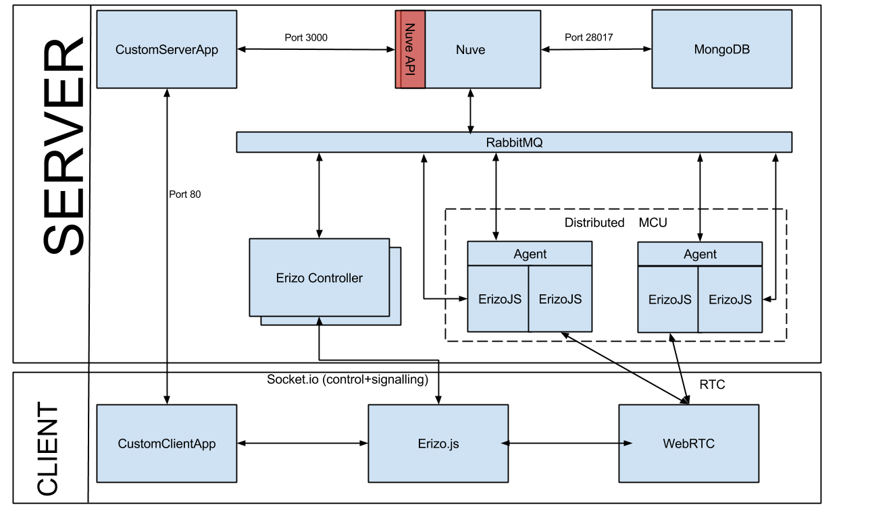

###### 7.2.1 Nuve(业务管理服务)

###### 7.2.2 Erizo Cntroller(简称EC, 信令服务)

###### 7.2.3 ErizoAgent(简称EA, 媒体服务) / ErizoJS(简称EJ, 媒体转发实体)

###### 7.2.4 Erizo.js

## 五. RFC汇总及参考资料

1. [RFC2119] Bradner, S., "Key words for use in RFCs to Indicate Requirement Levels", BCP 14, RFC 2119, DOI 10.17487/RFC2119, March 1997, <https://www.rfc-editor.org/info/rfc2119>.
2. [RFC3261] Rosenberg, J., Schulzrinne, H., Camarillo, G., Johnston, A., Peterson, J., Sparks, R., Handley, M., and E. Schooler, "SIP: Session Initiation Protocol", RFC 3261, DOI 10.17487/RFC3261, June 2002, <https://www.rfc-editor.org/info/rfc3261>.
3. [RFC3264] Rosenberg, J. and H. Schulzrinne, "An Offer/Answer Model with Session Description Protocol (SDP)", RFC 3264, DOI 10.17487/RFC3264, June 2002, <https://www.rfc-editor.org/info/rfc3264>.
4. [RFC3552] Rescorla, E. and B. Korver, "Guidelines for Writing RFC Text on Security Considerations", BCP 72, RFC 3552, DOI 10.17487/RFC3552, July 2003, <https://www.rfc-editor.org/info/rfc3552>.
5. [RFC3605] Huitema, C., "Real Time Control Protocol (RTCP) attribute in Session Description Protocol (SDP)", RFC 3605, DOI 10.17487/RFC3605, October 2003, <https://www.rfc-editor.org/info/rfc3605>.
6. [RFC3711] Baugher, M., McGrew, D., Naslund, M., Carrara, E., and K. Norrman, "The Secure Real-time Transport Protocol (SRTP)", RFC 3711, DOI 10.17487/RFC3711, March 2004, <https://www.rfc-editor.org/info/rfc3711>.
7. [RFC3890] Westerlund, M., "A Transport Independent Bandwidth Modifier for the Session Description Protocol (SDP)", RFC 3890, DOI 10.17487/RFC3890, September 2004, <https://www.rfc-editor.org/info/rfc3890>.
8. [RFC4145] Yon, D. and G. Camarillo, "TCP-Based Media Transport in the Session Description Protocol (SDP)", RFC 4145, DOI 10.17487/RFC4145, September 2005, <https://www.rfc-editor.org/info/rfc4145>. 
9. [RFC4566] Handley, M., Jacobson, V., and C. Perkins, "SDP: Session Description Protocol", RFC 4566, DOI 10.17487/RFC4566, July 2006, <https://www.rfc-editor.org/info/rfc4566>.
10. [RFC4585] Ott, J., Wenger, S., Sato, N., Burmeister, C., and J. Rey, "Extended RTP Profile for Real-time Transport Control Protocol (RTCP)-Based Feedback (RTP/AVPF)", RFC 4585, DOI 10.17487/RFC4585, July 2006, <https://www.rfc-editor.org/info/rfc4585>.
11. [RFC5124] Ott, J. and E. Carrara, "Extended Secure RTP Profile for Real-time Transport Control Protocol (RTCP)-Based Feedback (RTP/SAVPF)", RFC 5124, DOI 10.17487/RFC5124, February 2008, <https://www.rfc-editor.org/info/rfc5124>.
12. [RFC5285] Singer, D. and H. Desineni, "A General Mechanism for RTP Header Extensions", RFC 5285, DOI 10.17487/RFC5285, July 2008, <https://www.rfc-editor.org/info/rfc5285>.
13. [RFC5761] Perkins, C. and M. Westerlund, "Multiplexing RTP Data and Control Packets on a Single Port", RFC 5761, DOI 10.17487/RFC5761, April 2010, <https://www.rfc-editor.org/info/rfc5761>.
14. [RFC5888] Camarillo, G. and H. Schulzrinne, "The Session Description Protocol (SDP) Grouping Framework", RFC 5888, DOI 10.17487/RFC5888, June 2010, <https://www.rfc-editor.org/info/rfc5888>.
15. [RFC6236] Johansson, I. and K. Jung, "Negotiation of Generic Image Attributes in the Session Description Protocol (SDP)", RFC 6236, DOI 10.17487/RFC6236, May 2011, <https://www.rfc-editor.org/info/rfc6236>.
16. [RFC6347] Rescorla, E. and N. Modadugu, "Datagram Transport Layer Security Version 1.2", RFC 6347, DOI 10.17487/RFC6347, January 2012, <https://www.rfc-editor.org/info/rfc6347>.
17. [RFC6716] Valin, JM., Vos, K., and T. Terriberry, "Definition of the Opus Audio Codec", RFC 6716, DOI 10.17487/RFC6716, September 2012, <https://www.rfc-editor.org/info/rfc6716>.
18. [RFC6904] Lennox, J., "Encryption of Header Extensions in the Secure Real-time Transport Protocol (SRTP)", RFC 6904, DOI 10.17487/RFC6904, April 2013, <https://www.rfc-editor.org/info/rfc6904>.
19. [RFC7160] Petit-Huguenin, M. and G. Zorn, Ed., "Support for Multiple Clock Rates in an RTP Session", RFC 7160, DOI 10.17487/RFC7160, April 2014, <https://www.rfc-editor.org/info/rfc7160>.
20. [RFC7587] Spittka, J., Vos, K., and JM. Valin, "RTP Payload Format for the Opus Speech and Audio Codec", RFC 7587, DOI 10.17487/RFC7587, June 2015, <https://www.rfc-editor.org/info/rfc7587>.
21. [RFC7742] Roach, A.B., "WebRTC Video Processing and Codec Requirements", RFC 7742, DOI 10.17487/RFC7742, March 2016, <https://www.rfc-editor.org/info/rfc7742>.
22. [RFC7850] Nandakumar, S., "Registering Values of the SDP 'proto' Field for Transporting RTP Media over TCP under Various RTP Profiles", RFC 7850, DOI 10.17487/RFC7850, April 2016, <https://www.rfc-editor.org/info/rfc7850>.
23. [RFC7874] Valin, JM. and C. Bran, "WebRTC Audio Codec and Processing Requirements", RFC 7874, DOI 10.17487/RFC7874, May 2016, <https://www.rfc-editor.org/info/rfc7874>.
24. [RFC8108] Lennox, J., Westerlund, M., Wu, Q., and C. Perkins, "Sending Multiple RTP Streams in a Single RTP Session", RFC 8108, DOI 10.17487/RFC8108, March 2017, <https://www.rfc-editor.org/info/rfc8108>.
25. [RFC8122] Lennox, J. and C. Holmberg, "Connection-Oriented Media Transport over the Transport Layer Security (TLS) Protocol in the Session Description Protocol (SDP)", RFC 8122, DOI 10.17487/RFC8122, March 2017, <https://www.rfc-editor.org/info/rfc8122>.
26. [RFC8174] Leiba, B., "Ambiguity of Uppercase vs Lowercase in RFC 2119 Key Words", BCP 14, RFC 8174, DOI 10.17487/RFC8174, May 2017, <https://www.rfc-editor.org/info/rfc8174>.
27. [RFC8445] Keranen, A., Holmberg, C., and J. Rosenberg, "Interactive Connectivity Establishment (ICE): A Protocol for Network Address Translator (NAT) Traversal", RFC 8445, DOI 10.17487/RFC8445, July 2018, <https://www.rfc-editor.org/info/rfc8445>.
28. [RFC8826] Rescorla, E., "Security Considerations for WebRTC", RFC 8826, DOI 10.17487/RFC8826, January 2021, <https://www.rfc-editor.org/info/rfc8826>.
29. [RFC8827] Rescorla, E., "WebRTC Security Architecture", RFC 8827, DOI 10.17487/RFC8827, January 2021, <https://www.rfc-editor.org/info/rfc8827>.
30. [RFC8830] Alvestrand, H., "WebRTC MediaStream Identification in the Session Description Protocol", RFC 8830, DOI 10.17487/RFC8830, January 2021, <https://www.rfc-editor.org/info/rfc8830>.
31. [RFC8834] Perkins, C., Westerlund, M., and J. Ott, "Media Transport and Use of RTP in WebRTC", RFC 8834, DOI 10.17487/RFC8834, January 2021, <https://www.rfc-editor.org/info/rfc8834>.
32. [RFC8838] Ivov, E., Uberti, J., and P. Saint-Andre, "Trickle ICE: Incremental Provisioning of Candidates for the Interactive Connectivity Establishment (ICE) Protocol", RFC 8838, DOI 10.17487/RFC8838, January 2021, <https://www.rfc-editor.org/info/rfc8838>.
33. [RFC8839] Petit-Huguenin, M., Nandakumar, S., Holmberg, C., Keränen, A., and R. Shpount, "Session Description Protocol (SDP) Offer/Answer Procedures for Interactive Connectivity Establishment (ICE)", RFC 8839, DOI 10.17487/RFC8839, January 2021, <https://www.rfc-editor.org/info/rfc8839>.
34. [RFC8840] Ivov, E., Stach, T., Marocco, E., and C. Holmberg, "A Session Initiation Protocol (SIP) Usage for Incremental Provisioning of Candidates for the Interactive Connectivity Establishment (Trickle ICE)", RFC 8840, DOI 10.17487/RFC8840, January 2021, <https://www.rfc-editor.org/info/rfc8840>.
35. [RFC8841] Holmberg, C., Shpount, R., Loreto, S., and G. Camarillo, "Session Description Protocol (SDP) Offer/Answer Procedures for Stream Control Transmission Protocol (SCTP) over Datagram Transport Layer Security (DTLS) Transport", RFC 8841, DOI 10.17487/RFC8841, January 2021, <https://www.rfc-editor.org/info/rfc8841>.
36. [RFC8842] Holmberg, C. and R. Shpount, "Session Description Protocol (SDP) Offer/Answer Considerations for Datagram Transport Layer Security (DTLS) and Transport Layer Security (TLS)", RFC 8842, DOI 10.17487/RFC8842, January 2021, <https://www.rfc-editor.org/info/rfc8842>.
37. [RFC8843] Holmberg, C., Alvestrand, H., and C. Jennings, "Negotiating Media Multiplexing Using the Session Description Protocol (SDP)", RFC 8843, DOI 10.17487/RFC8843, January 2021, <https://www.rfc-editor.org/info/rfc8843>.
38. [RFC8851] Roach, A.B., Ed., "RTP Payload Format Restrictions", RFC 8851, DOI 10.17487/RFC8851, January 2021, <https://www.rfc-editor.org/info/rfc8851>.
39. [RFC8852] Roach, A.B., Nandakumar, S., and P. Thatcher, "RTP Stream Identifier Source Description (SDES)", RFC 8852, DOI 10.17487/RFC8852, January 2021, <https://www.rfc-editor.org/info/rfc8852>.
40. [RFC8853] Burman, B., Westerlund, M., Nandakumar, S., and M. Zanaty, "Using Simulcast in Session Description Protocol (SDP) and RTP Sessions", RFC 8853, DOI 10.17487/RFC8853, January 2021, <https://www.rfc-editor.org/info/rfc8853>.
41. [RFC8854] Uberti, J., "WebRTC Forward Error Correction Requirements", RFC 8854, DOI 10.17487/RFC8854, January 2021, <https://www.rfc-editor.org/info/rfc8854>.
42. [RFC8858] Holmberg, C., "Indicating Exclusive Support of RTP and RTP Control Protocol (RTCP) Multiplexing Using the Session Description Protocol (SDP)", RFC 8858, DOI 10.17487/RFC8858, January 2021, <https://www.rfc-editor.org/info/rfc8858>
43. [RFC8859] Nandakumar, S., "A Framework for Session Description Protocol (SDP) Attributes When Multiplexing", RFC 8859, DOI 10.17487/RFC8859, January 2021, <https://www.rfc-editor.org/info/rfc8859>.
44. [RFC3389] Zopf, R., "Real-time Transport Protocol (RTP) Payload for Comfort Noise (CN)", RFC 3389, DOI 10.17487/RFC3389, September 2002, <https://www.rfc-editor.org/info/rfc3389>.
45. [RFC3556] Casner, S., "Session Description Protocol (SDP) Bandwidth Modifiers for RTP Control Protocol (RTCP) Bandwidth", RFC 3556, DOI 10.17487/RFC3556, July 2003, <https://www.rfc-editor.org/info/rfc3556>.
46. [RFC3960] Camarillo, G. and H. Schulzrinne, "Early Media and Ringing Tone Generation in the Session Initiation Protocol (SIP)", RFC 3960, DOI 10.17487/RFC3960, December 2004, <https://www.rfc-editor.org/info/rfc3960>.
47. [RFC4568] Andreasen, F., Baugher, M., and D. Wing, "Session Description Protocol (SDP) Security Descriptions for Media Streams", RFC 4568, DOI 10.17487/RFC4568, July 2006, <https://www.rfc-editor.org/info/rfc4568>.
48. [RFC4588] Rey, J., Leon, D., Miyazaki, A., Varsa, V., and R. Hakenberg, "RTP Retransmission Payload Format", RFC 4588, DOI 10.17487/RFC4588, July 2006, <https://www.rfc-editor.org/info/rfc4588>.
49. [RFC4733] Schulzrinne, H. and T. Taylor, "RTP Payload for DTMF Digits, Telephony Tones, and Telephony Signals", RFC 4733, DOI 10.17487/RFC4733, December 2006, <https://www.rfc-editor.org/info/rfc4733>.
50. [RFC5245] Rosenberg, J., "Interactive Connectivity Establishment (ICE): A Protocol for Network Address Translator (NAT) Traversal for Offer/Answer Protocols", RFC 5245, DOI 10.17487/RFC5245, April 2010, <https://www.rfc-editor.org/info/rfc5245>.
51. [RFC5506] Johansson, I. and M. Westerlund, "Support for Reduced-Size Real-Time Transport Control Protocol (RTCP): Opportunities and Consequences", RFC 5506, DOI 10.17487/RFC5506, April 2009, <https://www.rfc-editor.org/info/rfc5506>.
52. [RFC5576] Lennox, J., Ott, J., and T. Schierl, "Source-Specific Media Attributes in the Session Description Protocol (SDP)", RFC 5576, DOI 10.17487/RFC5576, June 2009, <https://www.rfc-editor.org/info/rfc5576>.
53. [RFC5763] Fischl, J., Tschofenig, H., and E. Rescorla, "Framework for Establishing a Secure Real-time Transport Protocol (SRTP) Security Context Using Datagram Transport Layer Security (DTLS)", RFC 5763, DOI 10.17487/RFC5763, May 2010, <https://www.rfc-editor.org/info/rfc5763>.
54. [RFC5764] McGrew, D. and E. Rescorla, "Datagram Transport Layer Security (DTLS) Extension to Establish Keys for the Secure Real-time Transport Protocol (SRTP)", RFC 5764, DOI 10.17487/RFC5764, May 2010, <https://www.rfc-editor.org/info/rfc5764>.
55. [RFC6120] Saint-Andre, P., "Extensible Messaging and Presence Protocol (XMPP): Core", RFC 6120, DOI 10.17487/RFC6120, March 2011, <https://www.rfc-editor.org/info/rfc6120>.
56. [RFC6464] Lennox, J., Ed., Ivov, E., and E. Marocco, "A Real-time Transport Protocol (RTP) Header Extension for Client-to-Mixer Audio Level Indication", RFC 6464, DOI 10.17487/RFC6464, December 2011, <https://www.rfc-editor.org/info/rfc6464>.
57. [RFC8828] Uberti, J. and G. Shieh, "WebRTC IP Address Handling Requirements", RFC 8828, DOI 10.17487/RFC8828, January 2021, <https://www.rfc-editor.org/info/rfc8828>.
58. [SDP4WebRTC] Nandakumar, S. and C. Jennings, "Annotated Example SDP for WebRTC", Work in Progress, Internet-Draft, draft-ietf-rtcweb-sdp-14, 17 December 2020, <https://tools.ietf.org/html/draft-ietf-rtcweb-sdp-14>.
59. [TS26.114] 3GPP, "3rd Generation Partnership Project; Technical Specification Group Services and System Aspects; IP Multimedia Subsystem (IMS); Multimedia Telephony; Media handling and interaction (Release 16)", 3GPP TS 26.114 V16.3.0, September 2019, <https://www.3gpp.org/DynaReport/26114.htm>.
60. [W3C.webrtc] Jennings, C., Ed., Boström, H., Ed., and J. Bruaroey, Ed., "WebRTC 1.0: Real-time Communication Between Browsers", World Wide Web Consortium PR PR-webrtc-20201215, December 2020, <https://www.w3.org/TR/2020/PR-webrtc-20201215/>.


1. [Real-time Communication Between Browsers 1.0](https://w3c.github.io/webrtc-pc/), 中文 <<WebRTC 1.0浏览器间实时通讯>>
2. [Get Started with WebRTC](https://www.html5rocks.com/en/tutorials/webrtc/basics/)
2. [<<WebRTC权威指南>>]()
2. [Real-Time Communication in WEB-browsers (rtcweb)](https://datatracker.ietf.org/wg/rtcweb/documents/)
2. [Build the backend services needed for a WebRTC app](https://www.html5rocks.com/en/tutorials/webrtc/infrastructure/)
2. [leggetter/realtime-web-technologies-guide](https://github.com/leggetter/realtime-web-technologies-guide)

