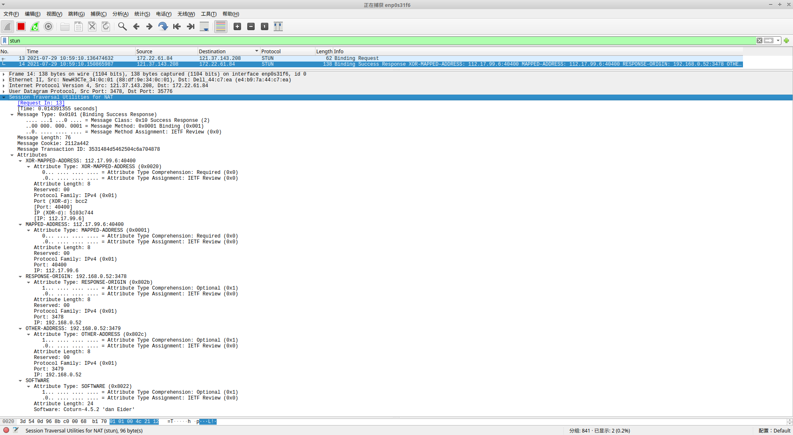

# 有关WebRTC

## 一. WebRTC原理及标准

## 二. Scheme方案

### 2.1 Stun/Turn服务器 - coturn

#### ☞ 协议解读



#### ☞ 源码分析

```c

```

#### ☞ stun/turn服务器工具  - turnserver启动及trickle-ice页面测试

- 命令行方式

  - turnserver -n -o -u **user:userpassword** -a -r **121.37.143.208:3478** #-n 不使用配置文件；-o 后台运行；-u 用户名:密码; -a 长期验证;  -r 公网IP:协议端口

    ```shell
    #打开浏览器
    chromium-browser --no-sandbox https://yejinlei.gitee.io/webrtc-samples/src/content/peerconnection/trickle-ice/
    
    #人工输入
    STUN or TURN URI: turn:121.37.143.208:3478    #这里使用turn:xxx.xxx.xxx.xxx & IceTransports value: 选择all, 会同时测试stun和turn协议, 如果使用stun, 只测试stun 
    TURN username:user
    TURN password:userpassword
    
    #返回信息
    Time	Component	Type	Foundation	Protocol Address	  Port	Priority
    0.007	rtp	host	1517209936	udp	172.22.61.84	52834	126 | 32542 | 255
    0.026	rtp	srflx	2893983876	udp	112.17.99.6	    51413	100 | 32542 | 255
    0.094	rtp	relay	659902998	udp	192.168.0.52	49338	2 | 32542 | 255
    0.107	rtp	host	351090080	tcp	172.22.61.84	    9	90 | 32542 | 255
    0.108	                                                                 Done
    ```
    *备注说明 :*

    - host, 浏览器所在本机IP
    - srflx, 浏览器所在外网IP
    - relay, turn服务器所在内网IP
    - udp/tcp,  stun协议同时支持udp和tcp, 上述结果表明tcp协议只获取host IP, udp可以获取所有IP

  - turnserver -n -o -u user:userpassword -a -r 121.37.143.208:3478 **--stun-only**    #只开启stun

  - turnserver -n -o -u user:userpassword -a -r 121.37.143.208:3478 **--no-stun**        #只开启turn

- 使用turnserver.conf配置文件方式

```shell
#网络接口设备
relay-device=eth0
#网络接口IP
listening-ip=192.168.0.52
#stun/turn监听端口
listening-port=3478
tls-listening-port=5349
relay-ip=192.168.0.52
#公网IP/内网IP
external-ip=121.37.143.208/192.168.0.52
relay-threads=50
#fingerprint
lt-cred-mech
#openssl req -x509 -newkey rsa:2048 -keyout /etc/turn_server_pkey.pem -out /etc/turn_server_cert.pem -days 99999 -nodes
cert=/etc/turn_server_cert.pem
pkey=/etc/turn_server_pkey.pem
pidfile=”/var/run/turnserver.pid”
#mobility
#帐号/密码
user=username:userpassword
#任意
realm=hxdi
```

#### ☞ coturn其他工具

##### nat类型发现工具 - turnutils_natdiscovery

```sh
turnutils_natdiscovery -m -f 121.37.143.208 -L 172.22.61.84       

-= Mapping Behavior Discovery =-

========================================
RFC 5780 response 1
No ALG: Mapped == XOR-Mapped
0: IPv4. Response origin: : 192.168.0.52:3478
0: IPv4. Other addr: : 192.168.0.52:3479
0: IPv4. UDP reflexive addr: 112.17.99.6:7633
0: IPv4. Local addr: : 172.22.61.84:43650
STUN receive timeout..

========================================
NAT with Endpoint Independent Mapping!
========================================

-= Filtering Behavior Discovery =-

========================================
RFC 5780 response 2
No ALG: Mapped == XOR-Mapped
3: IPv4. Response origin: : 192.168.0.52:3478
3: IPv4. Other addr: : 192.168.0.52:3479
3: IPv4. UDP reflexive addr: 112.17.99.6:8234
3: IPv4. Local addr: : 172.22.61.84:55028
STUN receive timeout..
STUN receive timeout..

========================================
NAT with Address and Port Dependent Filtering!
========================================
```


##### stun客户端工具 - turnutils_stunclient

```sh
turnutils_stunclient 121.37.143.208 -L 172.22.61.84
========================================
RFC 5780 response 1
0: IPv4. Response origin: : 192.168.0.52:3478
0: IPv4. Other addr: : 192.168.0.52:3479
0: IPv4. UDP reflexive addr: 112.17.99.6:6547
```


##### turn客户端工具 - turnutils_uclient

```sh
turnutils_uclient -u user -w userpassword -L 172.22.61.84 -v 121.37.143.208
========================================
0: IPv4. Connected from: 172.22.61.84:45169
0: IPv4. Connected to: 121.37.143.208:3478
0: allocate sent
0: allocate response received: 
0: allocate sent
0: allocate response received: 
0: success
0: IPv4. Received relay addr: 192.168.0.52:49916
0: clnet_allocate: rtv=16712490065460457036
0: refresh sent
0: refresh response received: 
0: success
0: IPv4. Connected from: 172.22.61.84:43969
0: IPv4. Connected to: 121.37.143.208:3478
0: IPv4. Connected from: 172.22.61.84:44946
0: IPv4. Connected to: 121.37.143.208:3478
0: allocate sent
0: allocate response received: 
0: allocate sent
0: allocate response received: 
0: success
0: IPv4. Received relay addr: 192.168.0.52:49917
0: clnet_allocate: rtv=0
0: refresh sent
0: refresh response received: 
0: success
0: allocate sent
0: allocate response received: 
0: allocate sent
0: allocate response received: 
0: success
0: IPv4. Received relay addr: 192.168.0.52:61004
0: clnet_allocate: rtv=6257617103726301502
0: refresh sent
0: refresh response received: 
0: success
0: channel bind sent
0: cb response received: 
0: channel bind: error 403 (Forbidden IP)
```

##### turn回显工具 - turnutils_peer,  需要turnutils_uclient配合

```sh
#开启turn服务器, 参考turnserver, 地址121.37.143.208 

#在机器A上, 开启turnutils_peer, 地址10.13.4.102
./turnutils_peer -v 121.37.143.208

#在机器B上, 使用turnutils_uclient, 地址172.22.61.84, 与A建立连接后, 会收到A发送的消息
turnutils_uclient -u user -w  uerpassword -L 172.22.61.84 -v 121.37.143.208 -e 10.13.4.102  #-e 10.13.4.102, 此处为A内网IP
========================================
0: IPv4. Connected from: 172.22.61.84:50104                               
0: IPv4. Connected to: 121.37.143.208:3478                               
0: allocate sent                                                         
0: allocate response received:             
0: allocate sent                                                         
0: allocate response received:
0: success
0: IPv4. Connected from: 172.22.61.84:56766
0: IPv4. Connected to: 121.37.143.208:3478
0: IPv4. Connected from: 172.22.61.84:41803
0: IPv4. Connected to: 121.37.143.208:3478
0: allocate sent
0: allocate response received: 
0: allocate sent
0: allocate response received: 
0: success
0: IPv4. Received relay addr: 192.168.0.52:64033
0: clnet_allocate: rtv=0
0: refresh sent
0: refresh response received: 
0: success
0: allocate sent
0: allocate response received: 
0: allocate sent
0: allocate response received: 
0: success
0: IPv4. Received relay addr: 192.168.0.52:57208
0: clnet_allocate: rtv=12521194767362737480
0: refresh sent
0: refresh response received: 
0: success
0: channel bind sent
0: cb response received: 
0: success: 0x64d4
0: channel bind sent
0: cb response received: 
0: success: 0x64d4
0: channel bind sent
0: cb response received: 
0: success: 0x5d9f
0: channel bind sent
0: cb response received: 
0: success: 0x5d9f
0: channel bind sent
0: cb response received: 
0: success: 0x7761
1: Total connect time is 1
1: start_mclient: msz=2, tot_send_msgs=0, tot_recv_msgs=0, tot_send_bytes ~ 0, tot_recv_bytes ~ 0
2: start_mclient: msz=2, tot_send_msgs=0, tot_recv_msgs=0, tot_send_bytes ~ 0, tot_recv_bytes ~ 0
3: start_mclient: msz=2, tot_send_msgs=0, tot_recv_msgs=0, tot_send_bytes ~ 0, tot_recv_bytes ~ 0
4: start_mclient: msz=2, tot_send_msgs=0, tot_recv_msgs=0, tot_send_bytes ~ 0, tot_recv_bytes ~ 0
5: start_mclient: msz=2, tot_send_msgs=5, tot_recv_msgs=0, tot_send_bytes ~ 500, tot_recv_bytes ~ 0
6: start_mclient: msz=2, tot_send_msgs=10, tot_recv_msgs=0, tot_send_bytes ~ 1000, tot_recv_bytes ~ 0
7: start_mclient: msz=2, tot_send_msgs=10, tot_recv_msgs=0, tot_send_bytes ~ 1000, tot_recv_bytes ~ 0
8: start_mclient: msz=2, tot_send_msgs=10, tot_recv_msgs=0, tot_send_bytes ~ 1000, tot_recv_bytes ~ 0
9: start_mclient: msz=2, tot_send_msgs=10, tot_recv_msgs=0, tot_send_bytes ~ 1000, tot_recv_bytes ~ 0
10: start_mclient: msz=2, tot_send_msgs=10, tot_recv_msgs=0, tot_send_bytes ~ 1000, tot_recv_bytes ~ 0
11: start_mclient: msz=2, tot_send_msgs=10, tot_recv_msgs=0, tot_send_bytes ~ 1000, tot_recv_bytes ~ 0
12: start_mclient: msz=2, tot_send_msgs=10, tot_recv_msgs=0, tot_send_bytes ~ 1000, tot_recv_bytes ~ 0
13: start_mclient: msz=2, tot_send_msgs=10, tot_recv_msgs=0, tot_send_bytes ~ 1000, tot_recv_bytes ~ 0
14: start_mclient: msz=2, tot_send_msgs=10, tot_recv_msgs=0, tot_send_bytes ~ 1000, tot_recv_bytes ~ 0
14: done, connection 0x7fbd55223010 closed.
15: start_mclient: msz=1, tot_send_msgs=10, tot_recv_msgs=0, tot_send_bytes ~ 1000, tot_recv_bytes ~ 0
15: done, connection 0x7fbd558e3010 closed.
15: start_mclient: tot_send_msgs=10, tot_recv_msgs=0
15: start_mclient: tot_send_bytes ~ 1000, tot_recv_bytes ~ 0
15: Total transmit time is 14
15: Total lost packets 10 (100.000000%), total send dropped 0 (0.000000%)
15: Average round trip delay 0.000000 ms; min = 4294967295 ms, max = 0 ms
15: Average jitter -nan ms; min = 4294967295 ms, max = 0 ms
```


### 2.2 Kurent分析与实践 

### 2.3 Jitsi分析与实践

