# 有关WebRTC

## 一. WebRTC概述及索引

1. 信令部分
   1. WebSocket/SSE/XHR/Other
   2. 会话描述协议SDP
   3. XMPP/SIP
   4. HTTP
   
2. 通信部分
   1. ICE/STUN/TURN
   2. mDNS
   
3. 数据部分
   1. SRTP/SRTCP
   2. SCTP
   3. Codec
      1. 视频编解码
      2. 音频编解码
   
4. 安全部分
   
   1. TLS/DTLS
   
5. 浏览器侧(Pion Stack)
   
   1. Chromium实现
   
      1. Web API
         1. PeerConnection
         2. DataChannel
      2. Native C++ API
   2. Pion纯Go实现

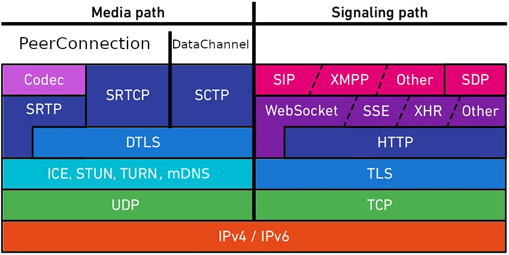

### 1 信令部分

#### 1.1 WebSocket/SSE/XHR/Other

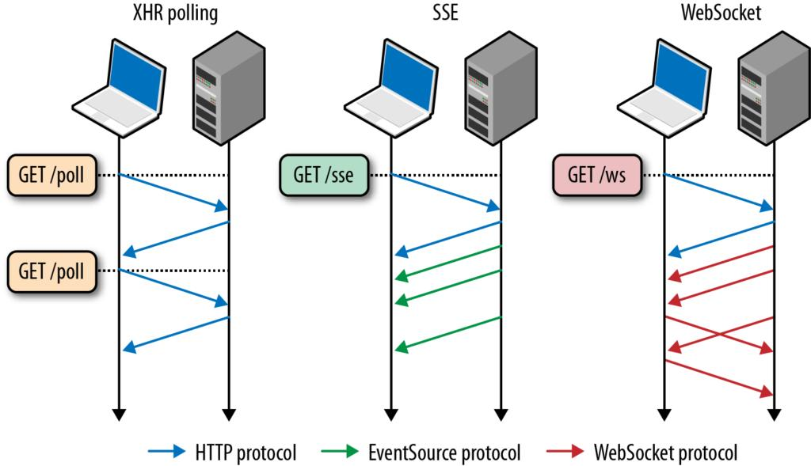

#### 1.1.1 WebSocket(Web套接口, 服务器“push”模式, 长连接)

​         **WebSockets** 是一种先进的技术。它可以在用户的浏览器和服务器之间打开交互式通信会话。使用此API，您可以向服务器发送消息并接收事件驱动的响应，而无需通过轮询服务器的方式以获得响应。

- 参考资料
  - [MDN WebSockets](https://developer.mozilla.org/zh-CN/docs/Web/API/WebSockets_API)
  - [RFC 6455 — The WebSocket Protocol](https://tools.ietf.org/html/rfc6455)
  - [WebSocket API Specification](https://www.w3.org/TR/websockets/)
  - [WebSockets - Send & Receive Messages](https://www.tutorialspoint.com/websockets/websockets_send_receive_messages.htm)
  - [Introducing WebSockets: Bringing Sockets to the Web](https://www.html5rocks.com/en/tutorials/websockets/basics/)
  - [WebSockets 简介：将套接字引入网络](https://www.html5rocks.com/zh/tutorials/websockets/basics/)
  - [WebSocket 教程](https://www.ruanyifeng.com/blog/2017/05/websocket.html)
  - [html5rocks tutorials]( http://www.html5rocks.com/en/tutorials/websockets/basics/)
  - <<HTML5 WebSocket权威指南>>

#### 1.1.2 SSE(服务器发送事件, 服务器“push”模式, 长连接)

- 参考资料
  - [MDN Server-sent events](https://developer.mozilla.org/zh-CN/docs/Web/API/Server-sent_events)
  - [MDN 使用服务器发送事件](https://developer.mozilla.org/zh-CN/docs/Web/API/Server-sent_events/Using_server-sent_events)
  - [html5rocks tutorials](http://www.html5rocks.com/en/tutorials/eventsource/basics/[)

#### 1.1.3 XHR(AJAX XMLHttpRequest, 客户端“pull”模式, polling)
​         **XMLHttpRequest**(XHR) 是一种创建 AJAX请求的JavaScript API。它的方法提供了在浏览器和服务器之间发送请求的能力。

- 参考资料
  - [MDN XMLHttpRequest](https://developer.mozilla.org/zh-CN/docs/Glossary/XHR_(XMLHttpRequest))

#### 1.1.5 Comet彗星技术(混合技术, 服务器“push”模式)

- 实现方式有两种:

  - 基于Ajax的long polling
  - 基于iframe及htmlfile的流（streaming）方式
- 参考资料
  - [Comet技术详解：基于HTTP长连接的Web端实时通信技术](http://www.52im.net/thread-334-1-1.html)
  - [开源Comet服务器iComet：支持百万并发的Web端即时通讯方案](http://www.52im.net/thread-330-1-1.html)

#### 1.1.6 BOSH(同步HTTP双向流, 本质上也是Comet)
​         **BOSH(Bidirectional-streams Over Synchronous HTTP)**是一种在客户端和服务器端之间通过HTTP的请求/响应进行客户端和服务器双向通信的技术，BOSH在XMPP系列规范中的XEP-0124中定义，应用场合为基于浏览器的客户端访问XMPP服务器。

#### 1.2 SDP会话描述协议

- 标准SDP/planB/unifiedPlan

- JESP State Machine

  ```shell
                      setRemote(OFFER)               setLocal(PRANSWER)
                          /-----\                               /-----\
                          |     |                               |     |
                          v     |                               v     |
           +---------------+    |                +---------------+    |
           |               |----/                |               |----/
           |  have-        | setLocal(PRANSWER)  | have-         |
           |  remote-offer |------------------- >| local-pranswer|
           |               |                     |               |
           |               |                     |               |
           +---------------+                     +---------------+
                ^   |                                   |
                |   | setLocal(ANSWER)                  |
  setRemote(OFFER)  |                                   |
                |   V                  setLocal(ANSWER) |
           +---------------+                            |
           |               |                            |
           |               |<---------------------------+
           |    stable     |
           |               |<---------------------------+
           |               |                            |
           +---------------+          setRemote(ANSWER) |
                ^   |                                   |
                |   | setLocal(OFFER)                   |
  setRemote(ANSWER) |                                   |
                |   V                                   |
           +---------------+                     +---------------+
           |               |                     |               |
           |  have-        | setRemote(PRANSWER) |have-          |
           |  local-offer  |------------------- >|remote-pranswer|
           |               |                     |               |
           |               |----\                |               |----\
           +---------------+    |                +---------------+    |
                          ^     |                               ^     |
                          |     |                               |     |
                          \-----/                               \-----/
                      setLocal(OFFER)               setRemote(PRANSWER)
  ```

- 参考资料
  
  - [RFC 8829 JavaScript Session Establishment Protocol (JSEP)](https://www.rfc-editor.org/rfc/rfc8829.html), JavaScript会话建立协议

#### 1.3 XMPP/SIP

##### 1.3.1 XMPP(可扩展消息处理和现场协议)
​         XMPP(Extensible Messaging and Presence Protocol,可扩展消息处理和现场协议) 是一种网络即时通讯协议或者说是开放消息协议，它基于XML，具有很强的扩展性，被广泛使用在即时通讯软件、网络游戏聊天、Web聊天及Web消息推送、联网的实时文档协作工具、移动设备的消息推送等场景。

- XMPP/WS(XMPP over WebSocket)

- XMPP over BOSH

- 参考资料
  - [xep-0340](https://xmpp.org/extensions/xep-0340.html)
  - [jitsi/strophejs](https://github.com/jitsi/strophejs), XMPP JS Client
  - [jitsi/Smack](https://github.com/jitsi/Smack),  XMPP Java Client
  - XMPP.js, XMPP JS Client
  - Prosody, XMPP Server Written in Lua
  - Openfire, XMPP Server Written in Java
  - Tigase, XMPP Server Written in Java
  - ejabberd, XMPP Server Written in Erlang

#### 1.4 HTTP

#### 1.4.1 HTTP

- HTTP/1.0 vs HTTP/1.1
  - 增加了 PUT、DELETE 等新的方法；
  - 增加了缓存管理和控制；
  - 明确了连接管理，允许长连接；
  - 允许响应数据分块（chunked），利于传输大文件；
  - 强制要求 Host 头，让互联网主机托管成为可能；
- 轮询(polling) vs 长轮询(long polling)
- 短连接 vs 长连接
- 跨域技术
- 参考资料
  - [WEB端即时通讯：HTTP长连接、长轮询（long polling）详解](http://www.52im.net/thread-224-1-1.html)
  - [WEB端即时通讯：不用WebSocket也一样能搞定消息的即时性](http://www.52im.net/thread-296-1-1.html)

#### 1.4.2 HTTPS
#### 1.4.3 HTTP2
#### 1.4.4 HTTP3

### 2 通信部分

#### 2.1 STUN/TURN/ICE

##### 2.1.1  STUN

​		这里介绍STUN两种用法: 1. 获取服务器反射地址srflx；  2. 借助STUN获取NAT类型以及不同NAT的穿透性；

###### 1) 获取srflx

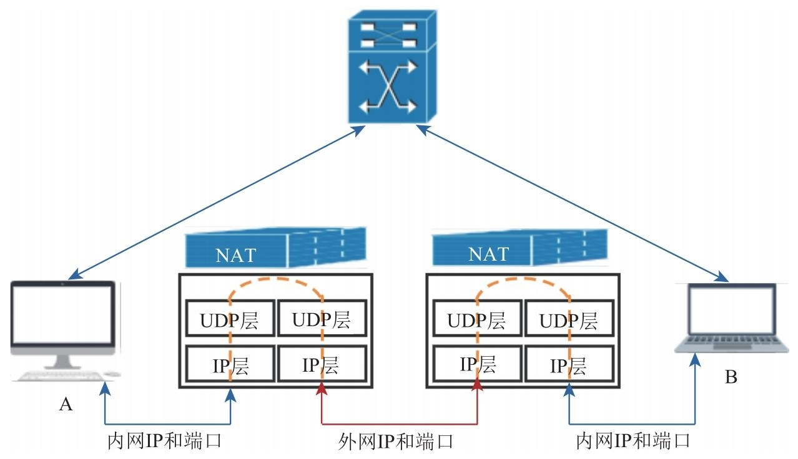

- 方法一

  ```sh
  curl -L ip.tool.lu                      
  当前IP: 112.17.99.6
  归属地: 中国 浙江省 杭州市
  ```

- 方法二

  ```sh
  turnutils_stunclient 123.60.88.103                   
  
  ========================================
  RFC 5780 response 1
  0: IPv4. Response origin: : 123.60.88.103:3478
  0: IPv4. Other addr: : 123.60.88.103:3479
  0: IPv4. UDP reflexive addr: 112.17.99.6:36874
  ```


###### 2) NAT类型及穿透性
- RFC3489中的NAT类型

| 图示                                               | 说明                                                         |
| -------------------------------------------------- | ------------------------------------------------------------ |
| 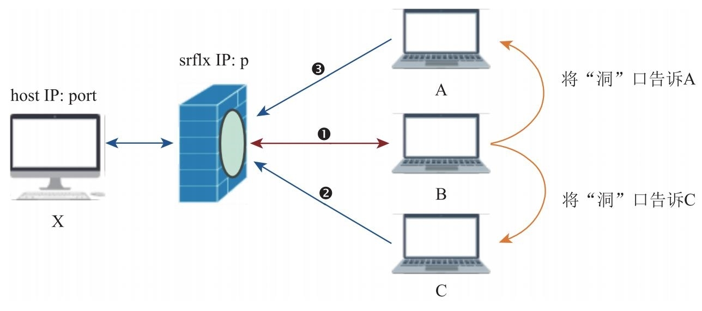 | **Full Cone NAT - 完全锥型NAT:**<br />所有从同一内网IP和端口号发送过来的请求都会被映射成同一个外网IP和端口号，并且任何一个外网主机都可以通过这个映射的外网IP和端口号向这台内网主机发送包。。由于对外部请求的来源无任何限制，因此这种方式虽然足够简单，但却不安全。<br />{<br/>     内网IP ， <br/>     内网端口， <br/>     映射的外网IP， <br/>     映射的外网端口<br />} |
| 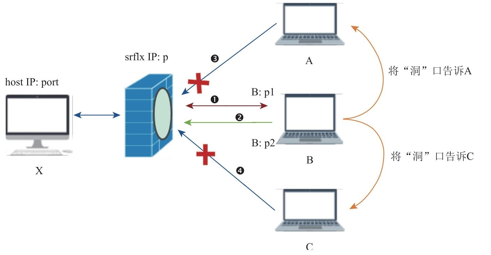              | **Restricted Cone NAT - IP限制锥型NAT:**<br />所有从同一个内网IP和端口号发送的过来的请求都会被映射成同一个外网IP和端口号。与完全锥型不同的是，外网主机只能够向先前已经向它发送过数据包的内网主机发送包。这意味着，NAT设备只向内转发那些来自于当前已知的外部主机的数据包，从而保障了外部请求来源的安全性。<br />{<br/>    内网IP ， <br/>    内网端口， <br/>    映射的外网IP， <br/>    映射的外网端口，<br/>   [ <br />       **被访问主机的IP ， … <br />**   ]<br />} |
| 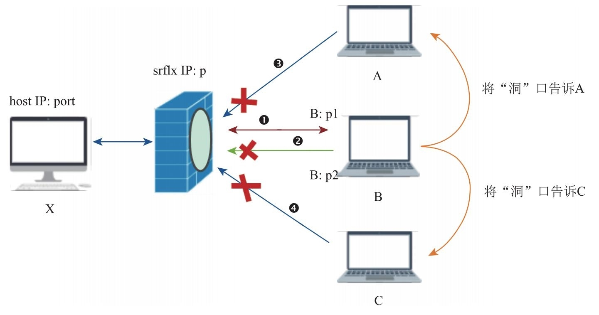                  | **Port Restricted Cone NAT - 端口限制锥型NAT:**<br />与限制锥型NAT很相似，只不过它包括端口号。也就是说，一台IP地址X和端口P的外网主机想给内网主机发送包，必须是这台内网主机先前已经给这个IP地址X和端口号P发送过数据包。端口号P这一要求进一步强化了对外部报文请求来源的限制，从而较Restrictd Cone更具安全性。<br />{<br/>     内网IP ， <br/>     内网端口， <br/>     映射的外网IP， <br/>     映射的外网端口，<br/>     [ <br/>         **{ 被访问主机的IP , 被访问主机的端口} ，  … <br/>**     ]<br />} |
| 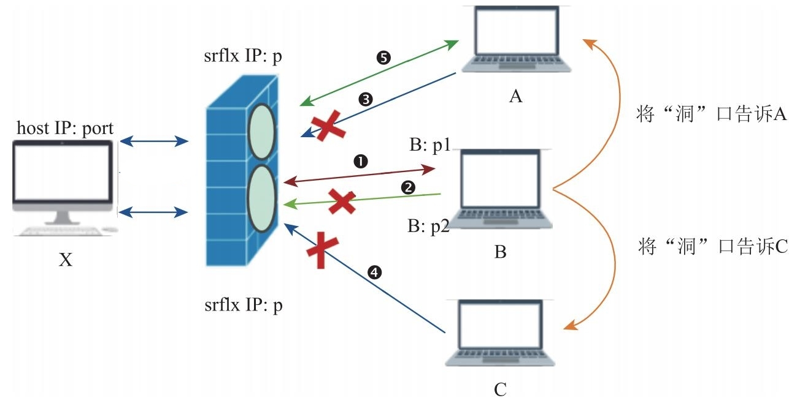 | **Symmetric NAT - 对称NAT:**<br />所有从同一个内网IP和端口号发送到一个特定目的IP和端口号的请求，都会被映射到同一个IP和端口号，如果同一台主机使用相同的源地址和端口号发送包，但是发往不同的目的地，NAT将会使用不同的映射。此外，只有收到的数据的外网主机才可以反过来向内网主机发送包。<br />{<br/>     内网IP ， <br/>     内网端口， <br/>     **//不仅访问地址变化了， 映射IP也要发生变化** <br/>     映射的外网IP ， <br/>     **// 不仅访问端口变化了， 映射端口也要发生变化** <br/>     映射的外网端口，<br/>     被访问主机的IP, <br/>     被访问主机的端口<br/>} |
|                                                    |                                                              |

- RFC5780中的NAT类型

  | Mapping | Filtering |
  | ---- | ---- |
  | 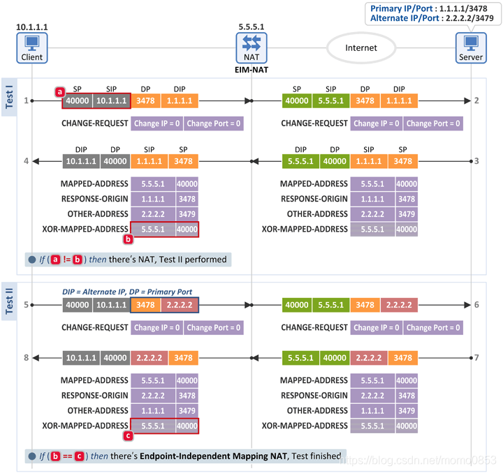     |  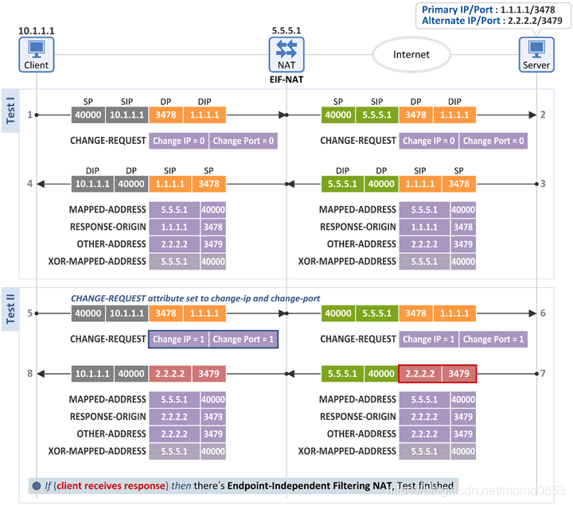    |
  | | |
  | 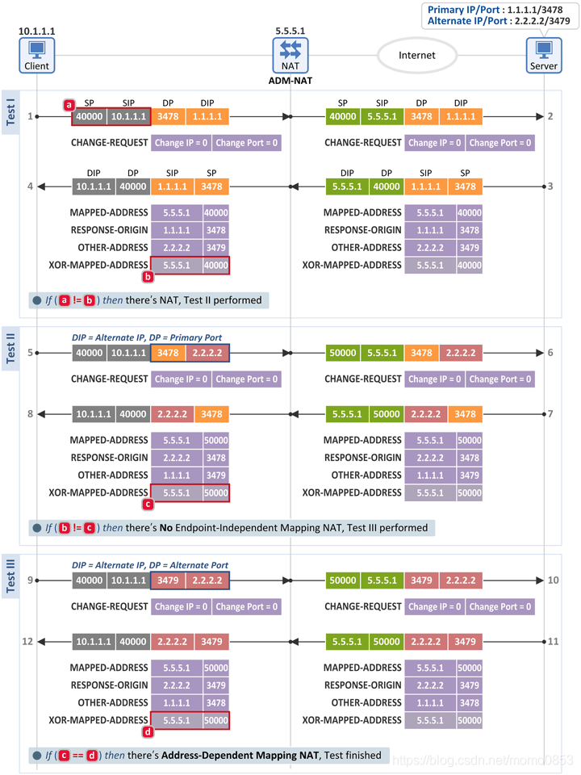     |  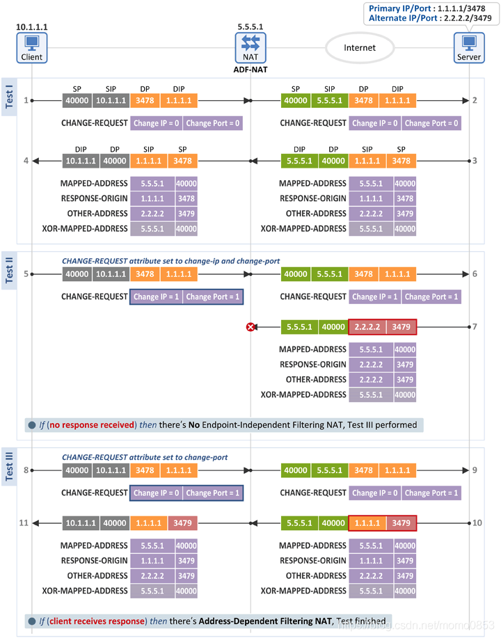    |
  | | |
  | 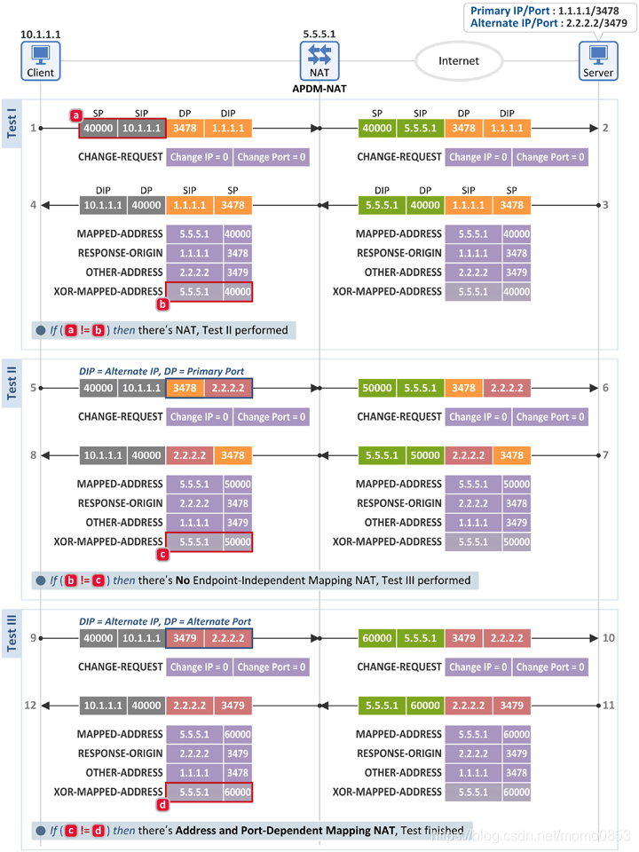     | 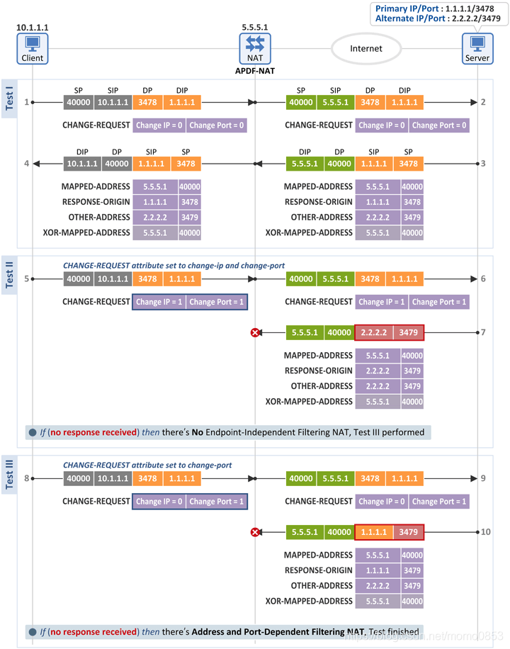     |
  
- RFC3489与RFC5780 NAT对应关系

  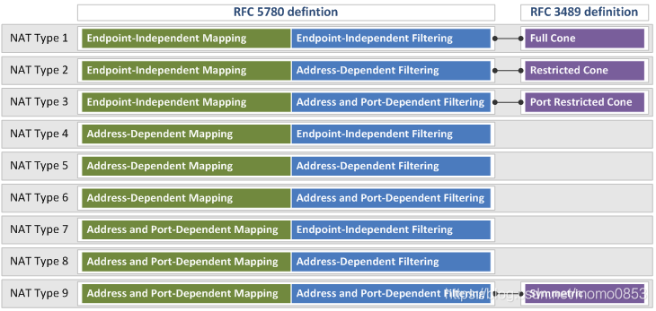

- 不同NAT组合的穿透性


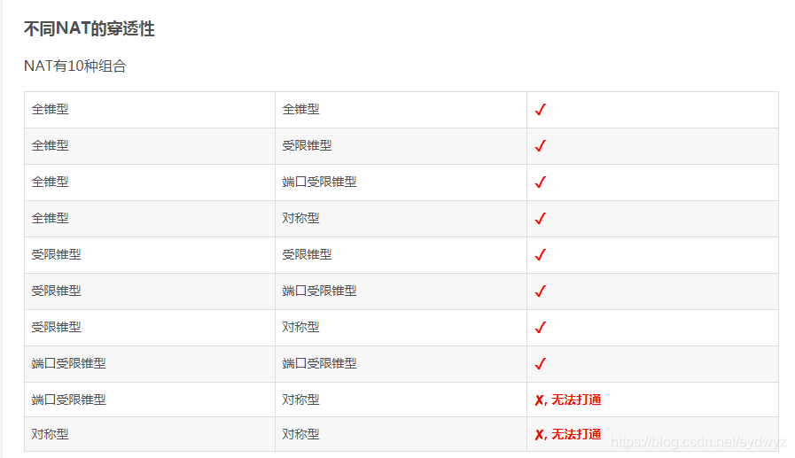

- 具体分析

  | 图示及说明                                                   |
  | ------------------------------------------------------------ |
  | 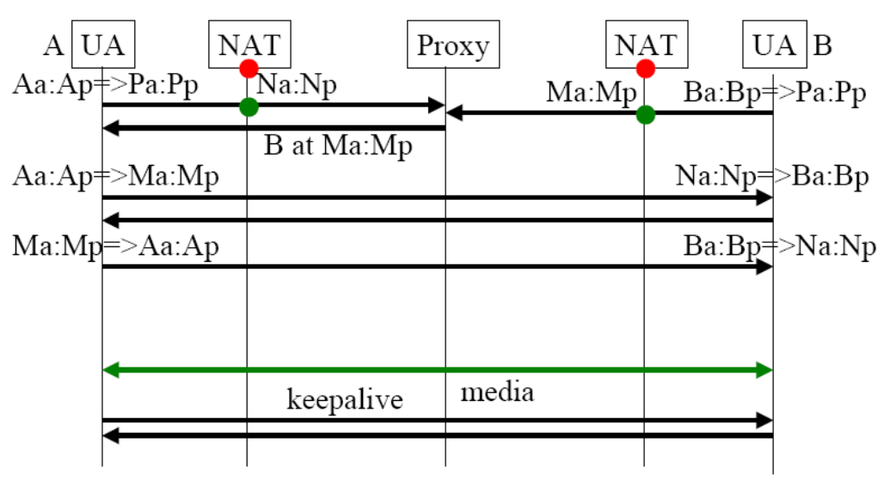<br />**在ICE/STUN协助下, 打过“洞”之后, 任意全锥型发起都可通信** |
  | 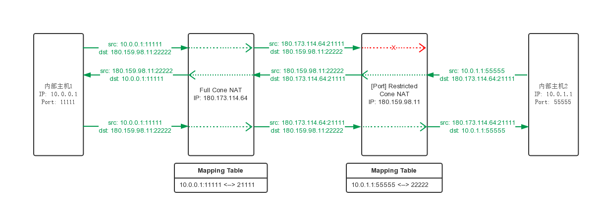<br />**在ICE/STUN协助下, 打过“洞”之后, 端口受限锥型发起可通信** |
  | 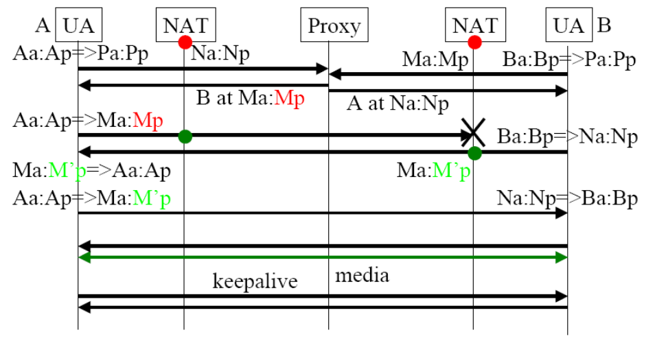<br />**在ICE/STUN协助下,  打过“洞”之后, 对称型发起可通信** |
  | 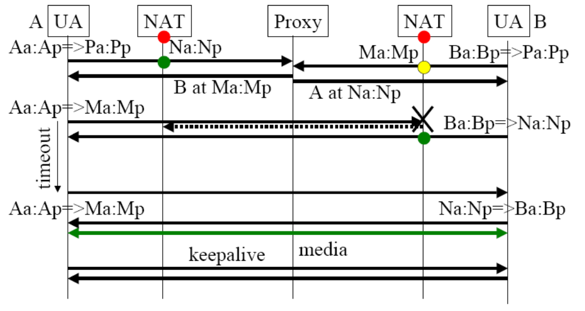<br />**在ICE/STUN协助下,  打过“洞”之后, 任意端口受限锥型发起可通信** |
  | 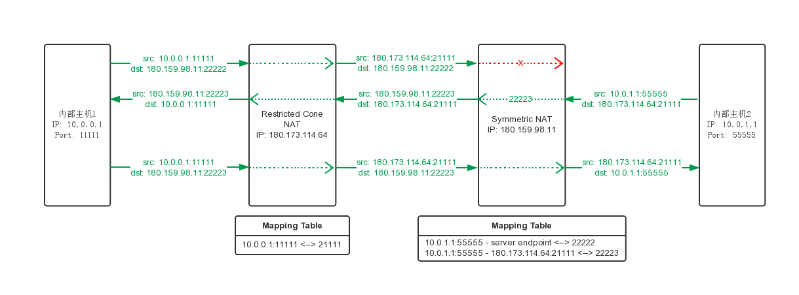<br />**在ICE/STUN协助下,  打过“洞”之后, 对称型发起可通信** |
  | 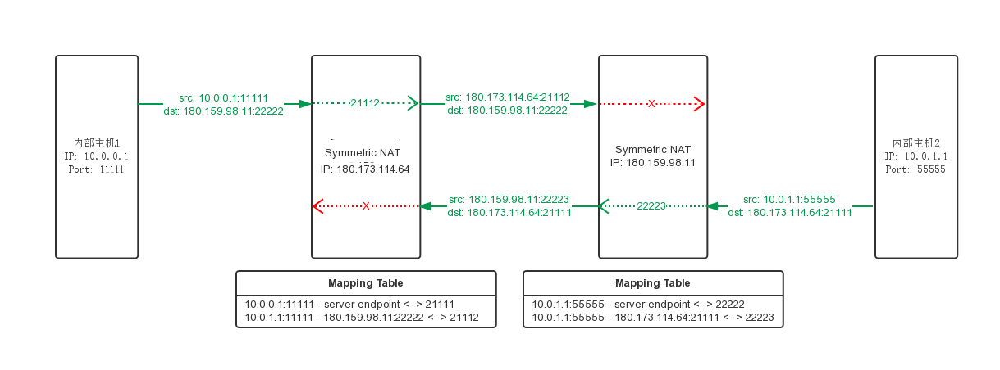<br />**即使打过“洞”, 任何发起都无法通信** |


- NAT类型检测

  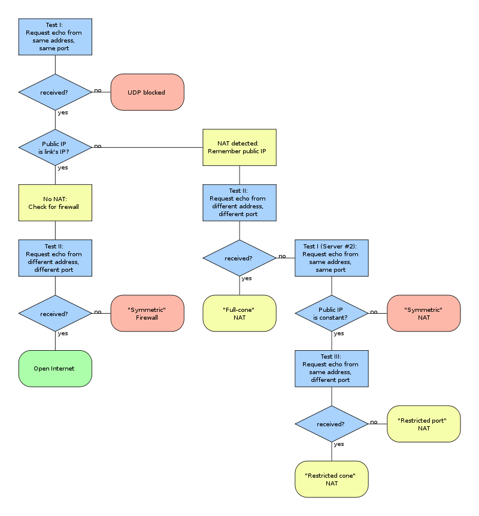

​															*NAT检测原理 摘自: https://datatracker.ietf.org/doc/html/rfc3489#page-22*

```sh
turnutils_natdiscovery -m -f -= Mapping Behavior Discovery =-

-= Mapping Behavior Discovery =-

========================================
RFC 5780 response 1
No ALG: Mapped == XOR-Mapped
0: IPv4. Response origin: : 123.60.88.103:3478
0: IPv4. Other addr: : 123.60.88.103:3479
0: IPv4. UDP reflexive addr: 112.17.99.6:4961
0: IPv4. Local addr: : 0.0.0.0:32872

========================================
RFC 5780 response 2
No ALG: Mapped == XOR-Mapped
0: IPv4. Response origin: : 123.60.88.103:3478
0: IPv4. Other addr: : 123.60.88.103:3479
0: IPv4. UDP reflexive addr: 112.17.99.6:4961
0: IPv4. Local addr: : 0.0.0.0:32872

========================================
NAT with Endpoint Independent Mapping!
========================================

-= Filtering Behavior Discovery =-

========================================
RFC 5780 response 3
No ALG: Mapped == XOR-Mapped
0: IPv4. Response origin: : 123.60.88.103:3478
0: IPv4. Other addr: : 123.60.88.103:3479
0: IPv4. UDP reflexive addr: 112.17.99.6:4962
0: IPv4. Local addr: : 0.0.0.0:32826
STUN receive timeout..
STUN receive timeout..

========================================
NAT with Address and Port Dependent Filtering!
========================================

```

```sh
➜  bin git:(master) ✗ sudo pystun -H stun.voipbuster.com -d
DEBUG:pystun:Do Test1
DEBUG:pystun:sendto: ('stun.voipbuster.com', 3478)
DEBUG:pystun:recvfrom: ('77.72.169.212', 3478)
DEBUG:pystun:Result: {'ExternalIP': '124.160.115.189', 'Resp': True, 'ExternalPort': 62357, 'ChangedPort': 3479, 'SourcePort': 3478, 'SourceIP': '77.72.169.212', 'ChangedIP': '77.72.169.213'}
DEBUG:pystun:Do Test2
DEBUG:pystun:sendto: ('stun.voipbuster.com', 3478)
DEBUG:pystun:sendto: ('stun.voipbuster.com', 3478)
DEBUG:pystun:sendto: ('stun.voipbuster.com', 3478)
DEBUG:pystun:sendto: ('stun.voipbuster.com', 3478)
DEBUG:pystun:Result: {'ExternalIP': None, 'Resp': False, 'ExternalPort': None, 'ChangedPort': None, 'SourcePort': None, 'SourceIP': None, 'ChangedIP': None}
DEBUG:pystun:Do Test1
DEBUG:pystun:sendto: ('77.72.169.213', 3479)
DEBUG:pystun:sendto: ('77.72.169.213', 3479)
DEBUG:pystun:recvfrom: ('77.72.169.213', 3479)
DEBUG:pystun:Result: {'ExternalIP': '23.90.145.69', 'Resp': True, 'ExternalPort': 2100, 'ChangedPort': 3478, 'SourcePort': 3479, 'SourceIP': '77.72.169.213', 'ChangedIP': '77.72.169.212'}
NAT Type: Symmetric NAT
External IP: 23.90.145.69
External Port: 2100

➜  bin git:(master) ✗ sudo pystun -H stun.voipbuster.com -d
DEBUG:pystun:Do Test1
DEBUG:pystun:sendto: ('stun.voipbuster.com', 3478)
DEBUG:pystun:recvfrom: ('77.72.169.211', 3478)
DEBUG:pystun:Result: {'ExternalIP': '23.90.145.69', 'Resp': True, 'ExternalPort': 9395, 'ChangedPort': 3479, 'SourcePort': 3478, 'SourceIP': '77.72.169.211', 'ChangedIP': '77.72.169.210'}
DEBUG:pystun:Do Test2
DEBUG:pystun:sendto: ('stun.voipbuster.com', 3478)
DEBUG:pystun:sendto: ('stun.voipbuster.com', 3478)
DEBUG:pystun:sendto: ('stun.voipbuster.com', 3478)
DEBUG:pystun:sendto: ('stun.voipbuster.com', 3478)
DEBUG:pystun:Result: {'ExternalIP': None, 'Resp': False, 'ExternalPort': None, 'ChangedPort': None, 'SourcePort': None, 'SourceIP': None, 'ChangedIP': None}
DEBUG:pystun:Do Test1
DEBUG:pystun:sendto: ('77.72.169.210', 3479)
DEBUG:pystun:recvfrom: ('77.72.169.210', 3479)
DEBUG:pystun:Result: {'ExternalIP': '23.90.145.69', 'Resp': True, 'ExternalPort': 10238, 'ChangedPort': 3478, 'SourcePort': 3479, 'SourceIP': '77.72.169.210', 'ChangedIP': '77.72.169.211'}
NAT Type: Symmetric NAT
External IP: 23.90.145.69
External Port: 10238                                                                                                                                                  
pystun -H stun.voipbuster.com -d
DEBUG:pystun:Do Test1
DEBUG:pystun:sendto: ('stun.voipbuster.com', 3478)
DEBUG:pystun:recvfrom: ('77.72.169.211', 3478)
DEBUG:pystun:Result: {'ExternalIP': '23.90.145.69', 'Resp': True, 'ExternalPort': 9395, 'ChangedPort': 3479, 'SourcePort': 3478, 'SourceIP': '77.72.169.211', 'ChangedIP': '77.72.169.210'}
DEBUG:pystun:Do Test2
DEBUG:pystun:sendto: ('stun.voipbuster.com', 3478)
DEBUG:pystun:sendto: ('stun.voipbuster.com', 3478)
DEBUG:pystun:sendto: ('stun.voipbuster.com', 3478)
DEBUG:pystun:sendto: ('stun.voipbuster.com', 3478)
DEBUG:pystun:Result: {'ExternalIP': None, 'Resp': False, 'ExternalPort': None, 'ChangedPort': None, 'SourcePort': None, 'SourceIP': None, 'ChangedIP': None}
DEBUG:pystun:Do Test1
DEBUG:pystun:sendto: ('77.72.169.210', 3479)
DEBUG:pystun:recvfrom: ('77.72.169.210', 3479)
DEBUG:pystun:Result: {'ExternalIP': '23.90.145.69', 'Resp': True, 'ExternalPort': 10238, 'ChangedPort': 3478, 'SourcePort': 3479, 'SourceIP': '77.72.169.210', 'ChangedIP': '77.72.169.211'}
NAT Type: Symmetric NAT
External IP: 23.90.145.69
External Port: 10238

➜  bin git:(master) ✗ sudo pystun -H 123.60.88.103 -d      
DEBUG:pystun:Do Test1
DEBUG:pystun:sendto: ('123.60.88.103', 3478)
DEBUG:pystun:recvfrom: ('123.60.88.103', 3478)
DEBUG:pystun:Result: {'ExternalIP': '112.17.99.6', 'Resp': True, 'ExternalPort': 26881, 'ChangedPort': 3479, 'SourcePort': 3478, 'SourceIP': '123.60.88.103', 'ChangedIP': '123.60.88.103'}
DEBUG:pystun:Do Test2
DEBUG:pystun:sendto: ('123.60.88.103', 3478)
DEBUG:pystun:sendto: ('123.60.88.103', 3478)
DEBUG:pystun:sendto: ('123.60.88.103', 3478)
DEBUG:pystun:sendto: ('123.60.88.103', 3478)
DEBUG:pystun:Result: {'ExternalIP': None, 'Resp': False, 'ExternalPort': None, 'ChangedPort': None, 'SourcePort': None, 'SourceIP': None, 'ChangedIP': None}
DEBUG:pystun:Do Test1
DEBUG:pystun:sendto: ('123.60.88.103', 3479)
DEBUG:pystun:sendto: ('123.60.88.103', 3479)
DEBUG:pystun:sendto: ('123.60.88.103', 3479)
DEBUG:pystun:sendto: ('123.60.88.103', 3479)
DEBUG:pystun:Result: {'ExternalIP': None, 'Resp': False, 'ExternalPort': None, 'ChangedPort': None, 'SourcePort': None, 'SourceIP': None, 'ChangedIP': None}
NAT Type: Meet an error, when do Test1 on Changed IP and Port
External IP: None
External Port: None


#pystun检测代码, https://github1s.com/jtriley/pystun/blob/HEAD/stun/__init__.py#L105-L182
```

###### 3) stund


##### 2.1.2  TURN

1. 参考资料
   - [jitsi/turnserver](https://github.com/jitsi/turnserver)
   - [TURN REST Server API](https://www.ietf.org/proceedings/87/slides/slides-87-behave-10.pdf)

##### 2.1.3  ICE

​         交互式连通性建立（Interactive Connectivity Establishment - ICE）是一个允许实时对等端发现对方并且彼此连接的**框架**。ICE可以找到媒体传输的最短路径, 同时允许我们穿过防火墙和NAT进行工作.

1. ICE 代理向操作系统查询本地 IP 地址；
2. 如果有配置,ICE 代理会查询外部 STUN 服务器,以取得本地端的公共 IP 和端口号；
3. 如果有配置,ICE 代理会将 TURN 服务器追加为最后一个候选项；假如端到端的连接失败,数据将通过指定的中间设备转发。

###### 1) ICE流程

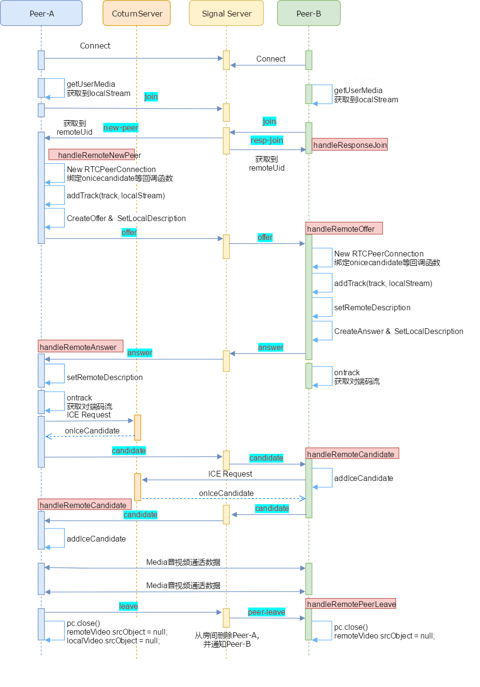

###### 2) ICE candidate类型

| 类型             | 别名  | 如何传给对端     | 用法                                                         |
| ---------------- | ----- | ---------------- | ------------------------------------------------------------ |
| 主机候选项       | host  | 信令服务器       | 从网卡中获取的本地传输地址，如果此地址位于NAT之后，则为内网地址 |
| 服务器反射候选项 | srflx | 信令服务器       | 从发送给Stun服务器的Binding检查中获取的传输地址。如果此地址位于NAT之后，则为最外层NAT的公网地址 |
| 对端反射候选项   | prflx | Stun Binding请求 | 从对端发送的Stun Binding请求获取的传输地址。这是一种在连接检查期间新发生的候选项 |
| 中继候选项       | relay | 信令服务器       | 媒体中继服务器的传输地址。通过使用TURN Allocate请求获取      |

###### 3) 参考资料
- [jitsi/ice4j](https://github.com/jitsi/ice4j)

##### 2.1.4  coturn搭建及测试

- turnserver配置
- 测试, 使用check
- 测试NAT, 使用nat
- 测试stun, 使用stunclient
- 测试turn, 使用uclient和peer
  - PEER: peer -v
  - PEER: tcpdump -n ip host 192.168.0.230 or 192.168.0.188 and udp -XX
  - UCLIENT: turnutils_uclient -v TURNSERVER_IP -u USERNAME -w PASS  -e PEER_IP

##### 2.1.5  参考资料

- [RFC 3489: STUN - Simple Traversal of User Datagram Protocol (UDP) Through Network Address Translators (NATs)](https://datatracker.ietf.org/doc/html/rfc3489)
- [RFC 4787: Network Address Translation (NAT) Behavioral Requirements for Unicast UDP](https://datatracker.ietf.org/doc/html/rfc4787)
- [RFC 5389: Session Traversal Utilities for NAT (STUN)](https://tools.ietf.org/html/rfc5389)
- [RFC 5769: Test Vectors for Session Traversal Utilities for NAT (STUN)](https://datatracker.ietf.org/doc/html/rfc5769)
- [RFC 5780: NAT Behavior Discovery Using STUN](https://tools.ietf.org/html/rfc5780)
- [RFC 7064: URI Scheme for STUN](https://tools.ietf.org/html/rfc7064)
- [RFC 5766: TURN: Relay Extensions to STUN](https://tools.ietf.org/html/rfc5766)
- [RFC 5245: ICE: A Protocol for NAT for Offer/Answer Protocols](https://tools.ietf.org/html/rfc5245)
- [RFC 6062: TURN Extensions for TCP Allocations](https://tools.ietf.org/html/rfc6062)
- [RFC 7065: TURN URI](https://tools.ietf.org/html/rfc7065)
- [RFC 6544: TCP Candidates with ICE](https://tools.ietf.org/html/rfc6544)


#### 2.2 mDNS
### 3 数据部分

#### 3.1 SRTP/SRTCP
#### 3.2 SCTP
#### 3.3 Codec
#### 3.4 参考资料
- [jitsi/jitsi-rtp](https://github.com/jitsi/jitsi-rtp)
- [jitsi/jitsi-srtp](https://github.com/jitsi/jitsi-srtp)
- [jitsi/jitsi-sctp](https://github.com/jitsi/jitsi-sctp)

### 4 安全部分
#### 4.1 TLS
#### 4.2 DTLS

### 5 浏览器侧API

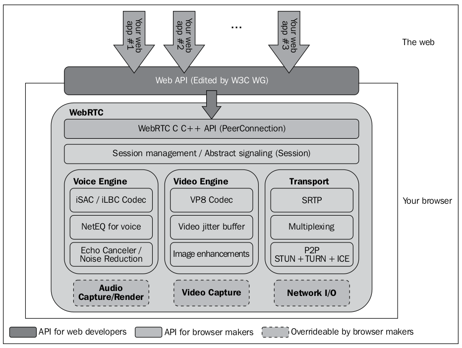

#### 5.1 Web API

#### 5.1.1  getUserMedia
#### 5.1.2  RTCPeerConnection
#### 5.1.3  RTCDataChannel

### 5.2 Native API
#### 5.2.1 Native API之Chromium实现
#### 5.2.2 Native API之Pion纯Go实现

### 5.3 参考资料

- [MDN WebRTC API](https://developer.mozilla.org/zh-CN/docs/Web/API/WebRTC_API)
- [webrtc samples](https://yejinlei.gitee.io/webrtc-samples/)


---


## 二. 各种解决方案

### 1 Stun/Turn服务器 - coturn(TODO)

4. 参考资料

- [快速理解P2P技术中的NAT穿透原理](http://www.52im.net/thread-1055-1-1.html)
- [Netmanias 对于 RFC 3489 与 STUN (RFC 5389/5780) 的对比解读](https://netmanias.com/en/post/techdocs/6065/nat-network-protocol/stun-rfc-3489-vs-stun-rfc-5389-5780)
- [http://www.ctiforum.com/news/guonei/524504.html](http://www.ctiforum.com/news/guonei/524504.html)
- [WebRTC TURN协议初识及turnserver实践](https://zhuanlan.zhihu.com/p/71025431)
- [WebRTC音视频传输基础：NAT穿透](https://blog.jianchihu.net/webrtc-av-transport-basis-nat-traversal.html)
- [RFC3489 STUN之客户端所处环境探测流程与部分属性含义说明](https://www.cnblogs.com/oldmanlv/p/5643060.html)
- [[NAPT(以此类型讨论)](https://www.cnblogs.com/freezlz/p/5483231.html)](https://www.cnblogs.com/freezlz/p/5483231.html)
- [STUN (RFC 3489) vs. STUN (RFC 5389/5780)](https://www.netmanias.com/en/?m=view&id=techdocs&tag=248&no)
- [NAT Behavior Discovery Using Classic STUN (RFC 3489)](https://www.netmanias.com/en/post/techdocs/6066/nat-network-protocol/nat-behavior-discovery-using-classic-stun-rfc-3489)
- [NAT Behavioral Requirements, as Defined by the IETF (RFC 4787) - Part 1. Mapping Behavior](https://www.netmanias.com/en/?m=view&id=techdocs&no=6058&tag=248)
- [NAT Behavioral Requirements, as Defined by the IETF (RFC 4787) - Part 2. Filtering Behavior](https://www.netmanias.com/en/?m=view&id=techdocs&tag=248&no=6062)

​		*开源项目*
- [pion/turn](https://github.com/pion/turn)

- [wolfcs/stund](https://gitee.com/wolfcs/stund)


#### ☞ stun/turn服务器工具  - turnserver启动及trickle-ice页面测试

- 命令行方式

  - turnserver -n -o -u **user:userpassword** -a -r **121.37.143.208:3478** #-n 不使用配置文件；-o 后台运行；-u 用户名:密码； -a 长期验证；  -r 公网IP:协议端口

    ```shell
    #打开浏览器
    chromium-browser --no-sandbox https://yejinlei.gitee.io/webrtc-samples/src/content/peerconnection/trickle-ice/
    
    #人工输入
    STUN or TURN URI: turn:121.37.143.208:3478    #这里使用turn:xxx.xxx.xxx.xxx & IceTransports value: 选择all, 会同时测试stun和turn协议, 如果使用stun, 只测试stun 
    TURN username:user
    TURN password:userpassword
    
    #返回信息
    Time	Component	Type	Foundation	Protocol Address	  Port	Priority
    0.007	rtp	host	1517209936	udp	172.22.61.84	52834	126 | 32542 | 255
    0.026	rtp	srflx	2893983876	udp	112.17.99.6	    51413	100 | 32542 | 255
    0.094	rtp	relay	659902998	udp	192.168.0.52	49338	2 | 32542 | 255
    0.107	rtp	host	351090080	tcp	172.22.61.84	    9	90 | 32542 | 255
    0.108	                                                                 Done
    ```
    *备注说明 :*

    - host, 浏览器所在本机IP
    - srflx, 浏览器所在外网IP, reflexive
    - relay, turn服务器所在内网IP
    - udp/tcp,  stun协议同时支持udp和tcp, 上述结果表明tcp协议只获取host IP, udp可以获取所有IP

  - turnserver -n -o -u user:userpassword -a -r 121.37.143.208:3478 **--stun-only**    #只开启stun

  - turnserver -n -o -u user:userpassword -a -r 121.37.143.208:3478 **--no-stun**        #只开启turn

- 使用turnserver.conf配置文件方式

```shell
#网络接口设备
relay-device=eth0
#stun/turn监听端口
listening-port=3478
tls-listening-port=5349
relay-ip=192.168.0.52
#公网IP/内网IP
external-ip=121.37.143.208/192.168.0.52
#relay-threads=1
#fingerprint
lt-cred-mech
#openssl req -x509 -newkey rsa:2048 -keyout /etc/turn_server_pkey.pem -out /etc/turn_server_cert.pem -days 99999 -nodes
cert=/etc/turn_server_cert.pem
pkey=/etc/turn_server_pkey.pem
pidfile=”/var/run/turnserver.pid”
mobility
#帐号/密码
user=username:userpassword
realm=hxdi
```

#### ☞ coturn其他工具

##### nat类型发现工具 - turnutils_natdiscovery

```sh
turnutils_natdiscovery -m -f stun.stunprotocol.org     #18.191.223.12是stun.stunprotocol.org真实IP              

-= Mapping Behavior Discovery =-

========================================
RFC 5780 response 1
No ALG: Mapped == XOR-Mapped
0: IPv4. Response origin: : 18.191.223.12:3478
0: IPv4. Other addr: : 18.219.110.18:3479
0: IPv4. UDP reflexive addr: 202.101.191.36:10006
0: IPv4. Local addr: : 0.0.0.0:47291

========================================
RFC 5780 response 2
No ALG: Mapped == XOR-Mapped
0: IPv4. Response origin: : 18.219.110.18:3478
0: IPv4. Other addr: : 18.191.223.12:3479
0: IPv4. UDP reflexive addr: 202.101.191.36:10007
0: IPv4. Local addr: : 0.0.0.0:47291

========================================
RFC 5780 response 3
No ALG: Mapped == XOR-Mapped
1: IPv4. Response origin: : 18.191.223.12:3479
1: IPv4. Other addr: : 18.219.110.18:3478
1: IPv4. UDP reflexive addr: 202.101.191.36:10008
1: IPv4. Local addr: : 0.0.0.0:47291

========================================
NAT with Address and Port Dependent Mapping!       #
========================================

-= Filtering Behavior Discovery =-

========================================
RFC 5780 response 4
No ALG: Mapped == XOR-Mapped
1: IPv4. Response origin: : 18.191.223.12:3478
1: IPv4. Other addr: : 18.219.110.18:3479
1: IPv4. UDP reflexive addr: 202.101.191.36:10012
1: IPv4. Local addr: : 0.0.0.0:48128
STUN receive timeout..
STUN receive timeout..

========================================
NAT with Address and Port Dependent Filtering!
========================================

#@@@@@@@@@@@@@@@@@@@@@@@@@@@@@@@@@@@@@@@@@@@@@@@@@@@@@@@@@@@@@@@@@@@@@@@@@@@

turnutils_natdiscovery -m -f 121.37.143.208 -L 172.22.61.84       

-= Mapping Behavior Discovery =-

========================================
RFC 5780 response 1
No ALG: Mapped == XOR-Mapped
0: IPv4. Response origin: : 192.168.0.52:3478
0: IPv4. Other addr: : 192.168.0.52:3479
0: IPv4. UDP reflexive addr: 202.101.191.36:9452
0: IPv4. Local addr: : 0.0.0.0:55249
STUN receive timeout..

========================================
NAT with Endpoint Independent Mapping!
========================================

-= Filtering Behavior Discovery =-

========================================
RFC 5780 response 2
No ALG: Mapped == XOR-Mapped
3: IPv4. Response origin: : 192.168.0.52:3478
3: IPv4. Other addr: : 192.168.0.52:3479
3: IPv4. UDP reflexive addr: 202.101.191.36:9471
3: IPv4. Local addr: : 0.0.0.0:46084
STUN receive timeout..
STUN receive timeout..

========================================
NAT with Address and Port Dependent Filtering!
========================================
```


##### stun客户端工具 - turnutils_stunclient

```sh
turnutils_stunclient stun.stunprotocol.org
========================================
RFC 5780 response 1
0: IPv4. Response origin: : 18.191.223.12:3478        #18.191.223.12是stun.stunprotocol.org真实IP
0: IPv4. Other addr: : 18.219.110.18:3479
0: IPv4. UDP reflexive addr: 202.101.191.36:4758

nslookup stun.stunprotocol.org
Server:         8.8.8.8
Address:        8.8.8.8#53

Non-authoritative answer:
Name:   stun.stunprotocol.org
Address: 18.191.223.12
Name:   stun.stunprotocol.org
Address: 2600:1f16:8c5:101::108

#@@@@@@@@@@@@@@@@@@@@@@@@@@@@@@@@@@@@@@@@@@@@@@@@@@@@@@@@@@@@@@@@@@@@@@@@@@@

turnutils_stunclient 121.37.143.208        
========================================
RFC 5780 response 1
0: IPv4. Response origin: : 192.168.0.52:3478       #192.168.0.52是内网IP, 121.37.143.208是映射地址
0: IPv4. Other addr: : 192.168.0.52:3479
0: IPv4. UDP reflexive addr: 202.101.191.36:5028
```


##### turn客户端工具 - turnutils_uclient

```sh
turnutils_uclient -u user -w userpassword -L 172.22.61.84 -v 121.37.143.208
========================================
0: IPv4. Connected from: 172.22.61.84:45169
0: IPv4. Connected to: 121.37.143.208:3478
0: allocate sent
0: allocate response received: 
0: allocate sent
0: allocate response received: 
0: success
0: IPv4. Received relay addr: 192.168.0.52:49916
0: clnet_allocate: rtv=16712490065460457036
0: refresh sent
0: refresh response received: 
0: success
0: IPv4. Connected from: 172.22.61.84:43969
0: IPv4. Connected to: 121.37.143.208:3478
0: IPv4. Connected from: 172.22.61.84:44946
0: IPv4. Connected to: 121.37.143.208:3478
0: allocate sent
0: allocate response received: 
0: allocate sent
0: allocate response received: 
0: success
0: IPv4. Received relay addr: 192.168.0.52:49917
0: clnet_allocate: rtv=0
0: refresh sent
0: refresh response received: 
0: success
0: allocate sent
0: allocate response received: 
0: allocate sent
0: allocate response received: 
0: success
0: IPv4. Received relay addr: 192.168.0.52:61004
0: clnet_allocate: rtv=6257617103726301502
0: refresh sent
0: refresh response received: 
0: success
0: channel bind sent
0: cb response received: 
0: channel bind: error 403 (Forbidden IP)
```

##### turn回显工具 - turnutils_peer,  需要turnutils_uclient配合

```sh
#开启turn服务器, 参考turnserver, 地址121.37.143.208 

#在机器A上, 开启turnutils_peer, 地址10.13.4.102
./turnutils_peer -v 121.37.143.208

#在机器B上, 使用turnutils_uclient, 地址172.22.61.84, 与A建立连接后, 会收到A发送的消息
turnutils_uclient -u user -w  uerpassword -L 172.22.61.84 -v 121.37.143.208 -e 10.13.4.102  #-e 10.13.4.102, 此处为A内网IP
========================================
0: IPv4. Connected from: 172.22.61.84:50104                               
0: IPv4. Connected to: 121.37.143.208:3478                               
0: allocate sent                                                         
0: allocate response received:             
0: allocate sent                                                         
0: allocate response received:
0: success
0: IPv4. Connected from: 172.22.61.84:56766
0: IPv4. Connected to: 121.37.143.208:3478
0: IPv4. Connected from: 172.22.61.84:41803
0: IPv4. Connected to: 121.37.143.208:3478
0: allocate sent
0: allocate response received: 
0: allocate sent
0: allocate response received: 
0: success
0: IPv4. Received relay addr: 192.168.0.52:64033
0: clnet_allocate: rtv=0
0: refresh sent
0: refresh response received: 
0: success
0: allocate sent
0: allocate response received: 
0: allocate sent
0: allocate response received: 
0: success
0: IPv4. Received relay addr: 192.168.0.52:57208
0: clnet_allocate: rtv=12521194767362737480
0: refresh sent
0: refresh response received: 
0: success
0: channel bind sent
0: cb response received: 
0: success: 0x64d4
0: channel bind sent
0: cb response received: 
0: success: 0x64d4
0: channel bind sent
0: cb response received: 
0: success: 0x5d9f
0: channel bind sent
0: cb response received: 
0: success: 0x5d9f
0: channel bind sent
0: cb response received: 
0: success: 0x7761
1: Total connect time is 1
1: start_mclient: msz=2, tot_send_msgs=0, tot_recv_msgs=0, tot_send_bytes ~ 0, tot_recv_bytes ~ 0
2: start_mclient: msz=2, tot_send_msgs=0, tot_recv_msgs=0, tot_send_bytes ~ 0, tot_recv_bytes ~ 0
3: start_mclient: msz=2, tot_send_msgs=0, tot_recv_msgs=0, tot_send_bytes ~ 0, tot_recv_bytes ~ 0
4: start_mclient: msz=2, tot_send_msgs=0, tot_recv_msgs=0, tot_send_bytes ~ 0, tot_recv_bytes ~ 0
5: start_mclient: msz=2, tot_send_msgs=5, tot_recv_msgs=0, tot_send_bytes ~ 500, tot_recv_bytes ~ 0
6: start_mclient: msz=2, tot_send_msgs=10, tot_recv_msgs=0, tot_send_bytes ~ 1000, tot_recv_bytes ~ 0
7: start_mclient: msz=2, tot_send_msgs=10, tot_recv_msgs=0, tot_send_bytes ~ 1000, tot_recv_bytes ~ 0
8: start_mclient: msz=2, tot_send_msgs=10, tot_recv_msgs=0, tot_send_bytes ~ 1000, tot_recv_bytes ~ 0
9: start_mclient: msz=2, tot_send_msgs=10, tot_recv_msgs=0, tot_send_bytes ~ 1000, tot_recv_bytes ~ 0
10: start_mclient: msz=2, tot_send_msgs=10, tot_recv_msgs=0, tot_send_bytes ~ 1000, tot_recv_bytes ~ 0
11: start_mclient: msz=2, tot_send_msgs=10, tot_recv_msgs=0, tot_send_bytes ~ 1000, tot_recv_bytes ~ 0
12: start_mclient: msz=2, tot_send_msgs=10, tot_recv_msgs=0, tot_send_bytes ~ 1000, tot_recv_bytes ~ 0
13: start_mclient: msz=2, tot_send_msgs=10, tot_recv_msgs=0, tot_send_bytes ~ 1000, tot_recv_bytes ~ 0
14: start_mclient: msz=2, tot_send_msgs=10, tot_recv_msgs=0, tot_send_bytes ~ 1000, tot_recv_bytes ~ 0
14: done, connection 0x7fbd55223010 closed.
15: start_mclient: msz=1, tot_send_msgs=10, tot_recv_msgs=0, tot_send_bytes ~ 1000, tot_recv_bytes ~ 0
15: done, connection 0x7fbd558e3010 closed.
15: start_mclient: tot_send_msgs=10, tot_recv_msgs=0
15: start_mclient: tot_send_bytes ~ 1000, tot_recv_bytes ~ 0
15: Total transmit time is 14
15: Total lost packets 10 (100.000000%), total send dropped 0 (0.000000%)
15: Average round trip delay 0.000000 ms； min = 4294967295 ms, max = 0 ms
15: Average jitter -nan ms； min = 4294967295 ms, max = 0 ms
```

### 2 Kurent分析与实践(已部署成功, 文档待补充)

### 3 Jitsi分析与实践
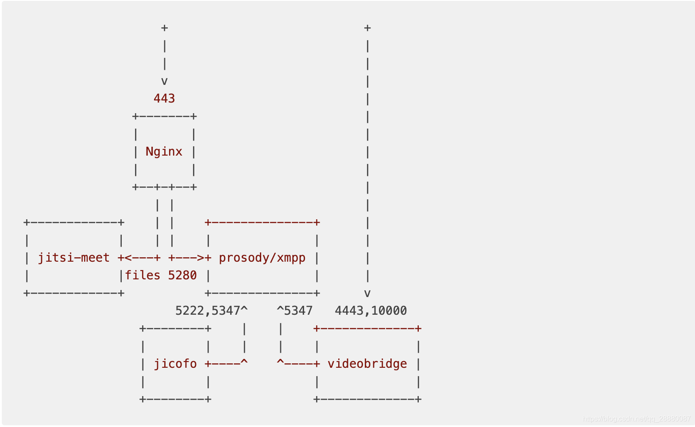
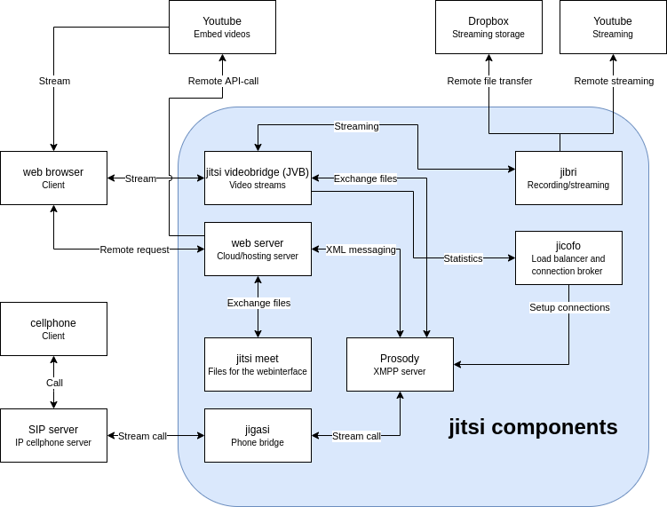


#### 2.3.1 分析与定制

> 总入口: https://gitee.com/yejinlei/jitsi-meet-all,  下载所有子项目 git clone --recurse-submodules https://gitee.com/yejinlei/jitsi-meet-all 
>
> ​	| 目录docker-jitsi-meet:   https://gitee.com/yejinlei/docker-jitsi-meet.git   #容器工程
>
> ​    |目录jitsi-meet: https://gitee.com/yejinlei/docker-jitsi-meet.git                     #对应Web服务
>
> ​    |目录jitsi-videobridge: https://gitee.com/yejinlei/jitsi-videobridge.git          #Video  SFU服务
>
> ​    |目录jicofo: https://gitee.com/yejinlei/jicofo.git                                                      #会议服务

##### 2.3.1.1 Web, 内置web服务器及Web网页含WebRTC Client服务
###### 1) web服务器
###### 2) Web业务

###### 3) 工程化

- 源码构建, 最终生成jitsi-meet-web.deb包, 替换官方deb包
  - 使用Webpack打包web工程
  - 构建软件包
- 容器制作, 参考Dockerfiler
  - 安装cron, nginx-extras
  - 安装官方jitsi-meet-web, jitsi-meet-web-config #web业务及nginx配置
    - jitsi-meet-web包主要文件
      - index.html
      - interface_config.js
      - pwa-worker.js
      - manifest.json
      - connection_optimization
        - do_external_connect.js
      - libs/*.js *.wasm
      - scripts/*.sh
      - static
        - close.js
        - close3.js
    - jitsi-meet-web-config包主要文件
  - 安装socat  #acme.sh脚本中会用到, acme.sh用于申请免费ssl证书-let's encrypt
  - 
- 容器运行
  - 容器中的PID1程序, s6
    - rootfs/etc/**cont-init.d**/10-config     #初始化阶段
      - tpl /defaults/nginx.conf > /config/nginx/nginx.conf
      - tpl /defaults/meet.conf > /config/nginx/meet.conf
      - tpl /defaults/ssl.conf > /config/nginx/ssl.conf
      - tpl /defaults/default > /config/nginx/site-confs/default
      - tpl /defaults/system-config.js >> /config/config.js
      - tpl /defaults/settings-config.js >> /config/config.js
    - rootfs/etc/**services.d**/cron                  #运行阶段
    - rootfs/etc/**services.d**/nginx                #运行阶段
  - 环境变量(通过命令查找: grep -nr '.Env'), 很多功能开关通过环境变量动态设置
    - **nginx.conf**, nginx全局配置文件
      - NGINX_WORKER_PROCESSES, 默认: 4
      - NGINX_WORKER_CONNECTIONS, 默认: 768
      - NGINX_RESOLVER, 默认:127.0.0.11
    - **default**, 所有站点默认配置
      - DISABLE_HTTPS
      - ENABLE_HTTP_REDIRECT
      - ENABLE_IPV6
    - **meet.conf**, 站点配置文件
      - ENABLE_COLIBRI_WEBSOCKET, 默认: 1
      - ENABLE_XMPP_WEBSOCKET, 默认: 1
      - DEPLOYMENTINFO_SHARD, 默认: 1
      - ENABLE_FLOC, 默认: 0
      - XMPP_BOSH_URL_BASE
      - XMPP_DOMAIN 
      - ETHERPAD_URL_BASE
    - **ssl.conf**, nginx支持https配置文件
      - ENABLE_LETSENCRYPT, 默认: 0
      - LETSENCRYPT_DOMAIN
      - ENABLE_HSTS, 默认: 1

###### 4) 参考资料

- [npm中文文档](https://www.npmjs.cn/)
- [Webpack](https://webpack.js.org/) 及 [中文文档](https://webpack.docschina.org/)
- [Nginx WebSocket proxying](http://nginx.org/en/docs/http/websocket.html)
- [Developer Guide (Web)](https://jitsi.github.io/handbook/docs/dev-guide/dev-guide-web)
- [构建软件包](https://www.debian.org/doc/manuals/maint-guide/build.zh-cn.html)
- [Debian 新维护者手册](https://www.debian.org/doc/manuals/maint-guide/index.zh-cn.html)

##### 2.3.1.2 Prosody, 提供XMPP信令交换服务
###### 1) Prosody, XMPP服务器

###### 2) 工程化

- 容器制作, 参考Dockerfile
  - 安装lua5.2及lua相关库
  - 安装jitsi-meet-prosody*.deb
- 容器运行
  - 容器中的PID1程序, s6
    - rootfs/etc/**cont-init.d**/10-config     #初始化阶段
      - tpl /defaults/saslauthd.conf > /etc/saslauthd.conf
      - tpl /defaults/prosody.cfg.lua > /config/prosody.cfg.lua
      - tpl /defaults/conf.d/jitsi-meet.cfg.lua > /config/conf.d/jitsi-meet.cfg.lua
  - 环境变量
    - **prosody.cfg.lua**
      - LOG_LEVEL
      - GLOBAL_MODULES
      - GLOBAL_CONFIG
    - **saslauthd.conf**
      - AUTH_TYPE, 默认: internal
      - LDAP_URL
      - LDAP_BASE
      - LDAP_BINDDN
      - LDAP_BINDPW
      - LDAP_FILTER
      - LDAP_VERSION, 默认: 3
      - LDAP_AUTH_METHOD, 默认: bind
      - LDAP_USE_TLS, 默认: 0
      - XMPP_DOMAIN, 共用
      - LDAP_TLS_CHECK_PEER, 默认: 0
      - LDAP_TLS_CACERT_FILE, 默认: /etc/ssl/certs/ca-certificates.crt
      - LDAP_TLS_CACERT_DIR, 默认: /etc/ssl/certs
      - LDAP_TLS_CIPHERS
      - LDAP_START_TLS, 默认: 0
    - **jitsi-meet.cfg.lua**
      - ENABLE_AUTH, 默认: 0
      - ENABLE_GUESTS. 默认: 0
      - AUTH_TYPE, 默认: internal, 共用
      - JWT_ASAP_KEYSERVER, 默认:
      - JWT_ALLOW_EMPTY, 默认: 0
      - JWT_AUTH_TYPE, 默认: token
      - 

###### 3) 参考资料

- [prosody webSockets](https://prosody.im/doc/websocket)
- [prosody  bosh](https://prosody.im/doc/setting_up_bosh)

##### 2.3.1.3 jicofo, 提供会议管理服务

###### 1) 工程化
###### 2) 参考资料

##### 2.3.1.4 JVB, 提供SFU服务

###### 1) 工程化
###### 2) 参考资料

## 三. RFC汇总及参考资料

1. [RFC2119] Bradner, S., "Key words for use in RFCs to Indicate Requirement Levels", BCP 14, RFC 2119, DOI 10.17487/RFC2119, March 1997, <https://www.rfc-editor.org/info/rfc2119>.
2. [RFC3261] Rosenberg, J., Schulzrinne, H., Camarillo, G., Johnston, A., Peterson, J., Sparks, R., Handley, M., and E. Schooler, "SIP: Session Initiation Protocol", RFC 3261, DOI 10.17487/RFC3261, June 2002, <https://www.rfc-editor.org/info/rfc3261>.
3. [RFC3264] Rosenberg, J. and H. Schulzrinne, "An Offer/Answer Model with Session Description Protocol (SDP)", RFC 3264, DOI 10.17487/RFC3264, June 2002, <https://www.rfc-editor.org/info/rfc3264>.
4. [RFC3552] Rescorla, E. and B. Korver, "Guidelines for Writing RFC Text on Security Considerations", BCP 72, RFC 3552, DOI 10.17487/RFC3552, July 2003, <https://www.rfc-editor.org/info/rfc3552>.
5. [RFC3605] Huitema, C., "Real Time Control Protocol (RTCP) attribute in Session Description Protocol (SDP)", RFC 3605, DOI 10.17487/RFC3605, October 2003, <https://www.rfc-editor.org/info/rfc3605>.
6. [RFC3711] Baugher, M., McGrew, D., Naslund, M., Carrara, E., and K. Norrman, "The Secure Real-time Transport Protocol (SRTP)", RFC 3711, DOI 10.17487/RFC3711, March 2004, <https://www.rfc-editor.org/info/rfc3711>.
7. [RFC3890] Westerlund, M., "A Transport Independent Bandwidth Modifier for the Session Description Protocol (SDP)", RFC 3890, DOI 10.17487/RFC3890, September 2004, <https://www.rfc-editor.org/info/rfc3890>.
8. [RFC4145] Yon, D. and G. Camarillo, "TCP-Based Media Transport in the Session Description Protocol (SDP)", RFC 4145, DOI 10.17487/RFC4145, September 2005, <https://www.rfc-editor.org/info/rfc4145>. 
9. [RFC4566] Handley, M., Jacobson, V., and C. Perkins, "SDP: Session Description Protocol", RFC 4566, DOI 10.17487/RFC4566, July 2006, <https://www.rfc-editor.org/info/rfc4566>.
10. [RFC4585] Ott, J., Wenger, S., Sato, N., Burmeister, C., and J. Rey, "Extended RTP Profile for Real-time Transport Control Protocol (RTCP)-Based Feedback (RTP/AVPF)", RFC 4585, DOI 10.17487/RFC4585, July 2006, <https://www.rfc-editor.org/info/rfc4585>.
11. [RFC5124] Ott, J. and E. Carrara, "Extended Secure RTP Profile for Real-time Transport Control Protocol (RTCP)-Based Feedback (RTP/SAVPF)", RFC 5124, DOI 10.17487/RFC5124, February 2008, <https://www.rfc-editor.org/info/rfc5124>.
12. [RFC5285] Singer, D. and H. Desineni, "A General Mechanism for RTP Header Extensions", RFC 5285, DOI 10.17487/RFC5285, July 2008, <https://www.rfc-editor.org/info/rfc5285>.
13. [RFC5761] Perkins, C. and M. Westerlund, "Multiplexing RTP Data and Control Packets on a Single Port", RFC 5761, DOI 10.17487/RFC5761, April 2010, <https://www.rfc-editor.org/info/rfc5761>.
14. [RFC5888] Camarillo, G. and H. Schulzrinne, "The Session Description Protocol (SDP) Grouping Framework", RFC 5888, DOI 10.17487/RFC5888, June 2010, <https://www.rfc-editor.org/info/rfc5888>.
15. [RFC6236] Johansson, I. and K. Jung, "Negotiation of Generic Image Attributes in the Session Description Protocol (SDP)", RFC 6236, DOI 10.17487/RFC6236, May 2011, <https://www.rfc-editor.org/info/rfc6236>.
16. [RFC6347] Rescorla, E. and N. Modadugu, "Datagram Transport Layer Security Version 1.2", RFC 6347, DOI 10.17487/RFC6347, January 2012, <https://www.rfc-editor.org/info/rfc6347>.
17. [RFC6716] Valin, JM., Vos, K., and T. Terriberry, "Definition of the Opus Audio Codec", RFC 6716, DOI 10.17487/RFC6716, September 2012, <https://www.rfc-editor.org/info/rfc6716>.
18. [RFC6904] Lennox, J., "Encryption of Header Extensions in the Secure Real-time Transport Protocol (SRTP)", RFC 6904, DOI 10.17487/RFC6904, April 2013, <https://www.rfc-editor.org/info/rfc6904>.
19. [RFC7160] Petit-Huguenin, M. and G. Zorn, Ed., "Support for Multiple Clock Rates in an RTP Session", RFC 7160, DOI 10.17487/RFC7160, April 2014, <https://www.rfc-editor.org/info/rfc7160>.
20. [RFC7587] Spittka, J., Vos, K., and JM. Valin, "RTP Payload Format for the Opus Speech and Audio Codec", RFC 7587, DOI 10.17487/RFC7587, June 2015, <https://www.rfc-editor.org/info/rfc7587>.
21. [RFC7742] Roach, A.B., "WebRTC Video Processing and Codec Requirements", RFC 7742, DOI 10.17487/RFC7742, March 2016, <https://www.rfc-editor.org/info/rfc7742>.
22. [RFC7850] Nandakumar, S., "Registering Values of the SDP 'proto' Field for Transporting RTP Media over TCP under Various RTP Profiles", RFC 7850, DOI 10.17487/RFC7850, April 2016, <https://www.rfc-editor.org/info/rfc7850>.
23. [RFC7874] Valin, JM. and C. Bran, "WebRTC Audio Codec and Processing Requirements", RFC 7874, DOI 10.17487/RFC7874, May 2016, <https://www.rfc-editor.org/info/rfc7874>.
24. [RFC8108] Lennox, J., Westerlund, M., Wu, Q., and C. Perkins, "Sending Multiple RTP Streams in a Single RTP Session", RFC 8108, DOI 10.17487/RFC8108, March 2017, <https://www.rfc-editor.org/info/rfc8108>.
25. [RFC8122] Lennox, J. and C. Holmberg, "Connection-Oriented Media Transport over the Transport Layer Security (TLS) Protocol in the Session Description Protocol (SDP)", RFC 8122, DOI 10.17487/RFC8122, March 2017, <https://www.rfc-editor.org/info/rfc8122>.
26. [RFC8174] Leiba, B., "Ambiguity of Uppercase vs Lowercase in RFC 2119 Key Words", BCP 14, RFC 8174, DOI 10.17487/RFC8174, May 2017, <https://www.rfc-editor.org/info/rfc8174>.
27. [RFC8445] Keranen, A., Holmberg, C., and J. Rosenberg, "Interactive Connectivity Establishment (ICE): A Protocol for Network Address Translator (NAT) Traversal", RFC 8445, DOI 10.17487/RFC8445, July 2018, <https://www.rfc-editor.org/info/rfc8445>.
28. [RFC8826] Rescorla, E., "Security Considerations for WebRTC", RFC 8826, DOI 10.17487/RFC8826, January 2021, <https://www.rfc-editor.org/info/rfc8826>.
29. [RFC8827] Rescorla, E., "WebRTC Security Architecture", RFC 8827, DOI 10.17487/RFC8827, January 2021, <https://www.rfc-editor.org/info/rfc8827>.
30. [RFC8830] Alvestrand, H., "WebRTC MediaStream Identification in the Session Description Protocol", RFC 8830, DOI 10.17487/RFC8830, January 2021, <https://www.rfc-editor.org/info/rfc8830>.
31. [RFC8834] Perkins, C., Westerlund, M., and J. Ott, "Media Transport and Use of RTP in WebRTC", RFC 8834, DOI 10.17487/RFC8834, January 2021, <https://www.rfc-editor.org/info/rfc8834>.
32. [RFC8838] Ivov, E., Uberti, J., and P. Saint-Andre, "Trickle ICE: Incremental Provisioning of Candidates for the Interactive Connectivity Establishment (ICE) Protocol", RFC 8838, DOI 10.17487/RFC8838, January 2021, <https://www.rfc-editor.org/info/rfc8838>.
33. [RFC8839] Petit-Huguenin, M., Nandakumar, S., Holmberg, C., Keränen, A., and R. Shpount, "Session Description Protocol (SDP) Offer/Answer Procedures for Interactive Connectivity Establishment (ICE)", RFC 8839, DOI 10.17487/RFC8839, January 2021, <https://www.rfc-editor.org/info/rfc8839>.
34. [RFC8840] Ivov, E., Stach, T., Marocco, E., and C. Holmberg, "A Session Initiation Protocol (SIP) Usage for Incremental Provisioning of Candidates for the Interactive Connectivity Establishment (Trickle ICE)", RFC 8840, DOI 10.17487/RFC8840, January 2021, <https://www.rfc-editor.org/info/rfc8840>.
35. [RFC8841] Holmberg, C., Shpount, R., Loreto, S., and G. Camarillo, "Session Description Protocol (SDP) Offer/Answer Procedures for Stream Control Transmission Protocol (SCTP) over Datagram Transport Layer Security (DTLS) Transport", RFC 8841, DOI 10.17487/RFC8841, January 2021, <https://www.rfc-editor.org/info/rfc8841>.
36. [RFC8842] Holmberg, C. and R. Shpount, "Session Description Protocol (SDP) Offer/Answer Considerations for Datagram Transport Layer Security (DTLS) and Transport Layer Security (TLS)", RFC 8842, DOI 10.17487/RFC8842, January 2021, <https://www.rfc-editor.org/info/rfc8842>.
37. [RFC8843] Holmberg, C., Alvestrand, H., and C. Jennings, "Negotiating Media Multiplexing Using the Session Description Protocol (SDP)", RFC 8843, DOI 10.17487/RFC8843, January 2021, <https://www.rfc-editor.org/info/rfc8843>.
38. [RFC8851] Roach, A.B., Ed., "RTP Payload Format Restrictions", RFC 8851, DOI 10.17487/RFC8851, January 2021, <https://www.rfc-editor.org/info/rfc8851>.
39. [RFC8852] Roach, A.B., Nandakumar, S., and P. Thatcher, "RTP Stream Identifier Source Description (SDES)", RFC 8852, DOI 10.17487/RFC8852, January 2021, <https://www.rfc-editor.org/info/rfc8852>.
40. [RFC8853] Burman, B., Westerlund, M., Nandakumar, S., and M. Zanaty, "Using Simulcast in Session Description Protocol (SDP) and RTP Sessions", RFC 8853, DOI 10.17487/RFC8853, January 2021, <https://www.rfc-editor.org/info/rfc8853>.
41. [RFC8854] Uberti, J., "WebRTC Forward Error Correction Requirements", RFC 8854, DOI 10.17487/RFC8854, January 2021, <https://www.rfc-editor.org/info/rfc8854>.
42. [RFC8858] Holmberg, C., "Indicating Exclusive Support of RTP and RTP Control Protocol (RTCP) Multiplexing Using the Session Description Protocol (SDP)", RFC 8858, DOI 10.17487/RFC8858, January 2021, <https://www.rfc-editor.org/info/rfc8858>
43. [RFC8859] Nandakumar, S., "A Framework for Session Description Protocol (SDP) Attributes When Multiplexing", RFC 8859, DOI 10.17487/RFC8859, January 2021, <https://www.rfc-editor.org/info/rfc8859>.
44. [RFC3389] Zopf, R., "Real-time Transport Protocol (RTP) Payload for Comfort Noise (CN)", RFC 3389, DOI 10.17487/RFC3389, September 2002, <https://www.rfc-editor.org/info/rfc3389>.
45. [RFC3556] Casner, S., "Session Description Protocol (SDP) Bandwidth Modifiers for RTP Control Protocol (RTCP) Bandwidth", RFC 3556, DOI 10.17487/RFC3556, July 2003, <https://www.rfc-editor.org/info/rfc3556>.
46. [RFC3960] Camarillo, G. and H. Schulzrinne, "Early Media and Ringing Tone Generation in the Session Initiation Protocol (SIP)", RFC 3960, DOI 10.17487/RFC3960, December 2004, <https://www.rfc-editor.org/info/rfc3960>.
47. [RFC4568] Andreasen, F., Baugher, M., and D. Wing, "Session Description Protocol (SDP) Security Descriptions for Media Streams", RFC 4568, DOI 10.17487/RFC4568, July 2006, <https://www.rfc-editor.org/info/rfc4568>.
48. [RFC4588] Rey, J., Leon, D., Miyazaki, A., Varsa, V., and R. Hakenberg, "RTP Retransmission Payload Format", RFC 4588, DOI 10.17487/RFC4588, July 2006, <https://www.rfc-editor.org/info/rfc4588>.
49. [RFC4733] Schulzrinne, H. and T. Taylor, "RTP Payload for DTMF Digits, Telephony Tones, and Telephony Signals", RFC 4733, DOI 10.17487/RFC4733, December 2006, <https://www.rfc-editor.org/info/rfc4733>.
50. [RFC5245] Rosenberg, J., "Interactive Connectivity Establishment (ICE): A Protocol for Network Address Translator (NAT) Traversal for Offer/Answer Protocols", RFC 5245, DOI 10.17487/RFC5245, April 2010, <https://www.rfc-editor.org/info/rfc5245>.
51. [RFC5506] Johansson, I. and M. Westerlund, "Support for Reduced-Size Real-Time Transport Control Protocol (RTCP): Opportunities and Consequences", RFC 5506, DOI 10.17487/RFC5506, April 2009, <https://www.rfc-editor.org/info/rfc5506>.
52. [RFC5576] Lennox, J., Ott, J., and T. Schierl, "Source-Specific Media Attributes in the Session Description Protocol (SDP)", RFC 5576, DOI 10.17487/RFC5576, June 2009, <https://www.rfc-editor.org/info/rfc5576>.
53. [RFC5763] Fischl, J., Tschofenig, H., and E. Rescorla, "Framework for Establishing a Secure Real-time Transport Protocol (SRTP) Security Context Using Datagram Transport Layer Security (DTLS)", RFC 5763, DOI 10.17487/RFC5763, May 2010, <https://www.rfc-editor.org/info/rfc5763>.
54. [RFC5764] McGrew, D. and E. Rescorla, "Datagram Transport Layer Security (DTLS) Extension to Establish Keys for the Secure Real-time Transport Protocol (SRTP)", RFC 5764, DOI 10.17487/RFC5764, May 2010, <https://www.rfc-editor.org/info/rfc5764>.
55. [RFC6120] Saint-Andre, P., "Extensible Messaging and Presence Protocol (XMPP): Core", RFC 6120, DOI 10.17487/RFC6120, March 2011, <https://www.rfc-editor.org/info/rfc6120>.
56. [RFC6464] Lennox, J., Ed., Ivov, E., and E. Marocco, "A Real-time Transport Protocol (RTP) Header Extension for Client-to-Mixer Audio Level Indication", RFC 6464, DOI 10.17487/RFC6464, December 2011, <https://www.rfc-editor.org/info/rfc6464>.
57. [RFC8828] Uberti, J. and G. Shieh, "WebRTC IP Address Handling Requirements", RFC 8828, DOI 10.17487/RFC8828, January 2021, <https://www.rfc-editor.org/info/rfc8828>.
58. [SDP4WebRTC] Nandakumar, S. and C. Jennings, "Annotated Example SDP for WebRTC", Work in Progress, Internet-Draft, draft-ietf-rtcweb-sdp-14, 17 December 2020, <https://tools.ietf.org/html/draft-ietf-rtcweb-sdp-14>.
59. [TS26.114] 3GPP, "3rd Generation Partnership Project; Technical Specification Group Services and System Aspects; IP Multimedia Subsystem (IMS); Multimedia Telephony; Media handling and interaction (Release 16)", 3GPP TS 26.114 V16.3.0, September 2019, <https://www.3gpp.org/DynaReport/26114.htm>.
60. [W3C.webrtc] Jennings, C., Ed., Boström, H., Ed., and J. Bruaroey, Ed., "WebRTC 1.0: Real-time Communication Between Browsers", World Wide Web Consortium PR PR-webrtc-20201215, December 2020, <https://www.w3.org/TR/2020/PR-webrtc-20201215/>.


1. [Real-time Communication Between Browsers 1.0](https://w3c.github.io/webrtc-pc/), 中文 <<WebRTC 1.0浏览器间实时通讯>>
2. [Get Started with WebRTC](https://www.html5rocks.com/en/tutorials/webrtc/basics/)

